# Capítulo IV: Product Design

## 4.1. Style Guidelines

### 4.1.1. General Style Guidelines
El diseño visual de la plataforma **SumaqAgro** se inclina hacia una estética moderna, limpia e intuitiva, en línea con nuestro compromiso de ofrecer soluciones agrotecnológicas que transmitan innovación, sostenibilidad, confianza y cercanía. Nuestro objetivo es crear una experiencia digital que sea tanto eficiente como cercana y profesional para los agricultores, cooperativas e ingenieros agrónomos.

En esta sección, detallaremos cada uno de los elementos visuales y de estilo que guían el desarrollo de la aplicación SumaqAgro, siempre siguiendo los principios de Diseño de Experiencia de Usuario (UX) e Interfaz de Usuario (UI) para garantizar la máxima usabilidad, legibilidad y accesibilidad (a11y).

**Branding**

El logo principal de **SumaqAgro**, un nombre que evoca la unión entre la naturaleza y la tecnología aplicada al sector agrícola. Nuestro propósito es ser un puente tecnológico para el campo, ofreciendo una solución integral de monitoreo satelital de precisión para agricultores, cooperativas e ingenieros agrónomos. El branding se enfoca en transmitir innovación, sostenibilidad, confianza y cercanía, valores esenciales para quienes buscan integrar la tecnología en el desarrollo del sector agrotecnológico.

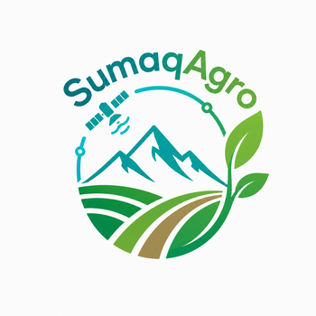

**Imagotipo Horizontal (Versión Web / Sidebar):** Diseñado específicamente para integrarse en la barra lateral (*sidebar*) e interfaz principal de la plataforma web, esta versión organiza de manera lineal el isotipo de la marca, el tipograma **SumaqAgro** y el eslogan *"Cultivando un mejor mañana"*, optimizando el espacio horizontal para garantizar máxima legibilidad, elegancia y un reconocimiento de marca inmediato en pantallas de alta resolución.
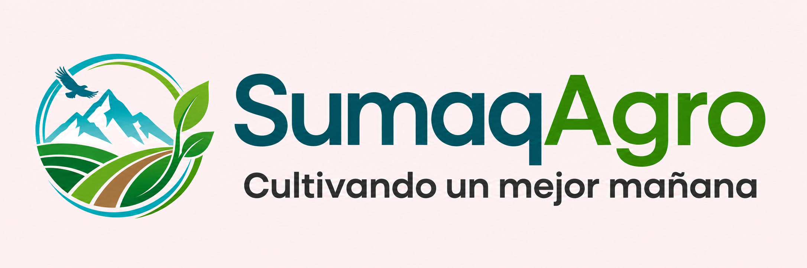

**Typography**

La identidad tipográfica de SumaqAgro utiliza fuentes sans-serif seleccionadas de Google Fonts, elegidas por su alta legibilidad, apariencia moderna y óptima compatibilidad con entornos digitales navegables. La combinación de **Poppins** como tipografía principal e **Inter** como tipografía secundaria permite establecer una jerarquía visual clara e intuitiva entre títulos, contenidos informativos y elementos de interfaz, garantizando el cumplimiento de los estándares de accesibilidad web (a11y).

**Fuente principal: Poppins**

Se utiliza principalmente en encabezados y títulos, aportando un estilo geométrico y contemporáneo que refuerza la identidad visual de SumaqAgro:
- **Títulos principales (H1 / Sección heading):** Poppins Bold, 40 px en versión de escritorio / 28 px en móvil (Ejemplo: “Cultiva con Información”).
- **Títulos de secciones (H2 / Sub-headings):** Poppins SemiBold, 32 px en escritorio / 24 px en móvil (Ejemplo: “Nuestro Impacto en el Campo”).
- **Títulos de tarjetas o bloques (H3):** Poppins Medium, 20 px.
- **Subtítulos internos (H4):** Poppins Medium o SemiBold, entre 18 px y 20 px según el contexto.

**Fuente secundaria: Inter**

Se utiliza en bloques de lectura, etiquetas, botones, formularios y componentes de la interfaz gráfica debido a su extraordinaria claridad y rendimiento de lectura en pantallas de diversas resoluciones:
- **Párrafos principales (Body 1):** Inter Regular, 16 px.
- **Textos secundarios, subtítulos y Footer (Body 2):** Inter Regular, 14 px.
- **Botones y llamadas a la acción (Button Text / CTA):** Inter SemiBold, 16 px.
- **Etiquetas de formularios o elementos de interfaz (Labels):** Inter Medium, 14 px.

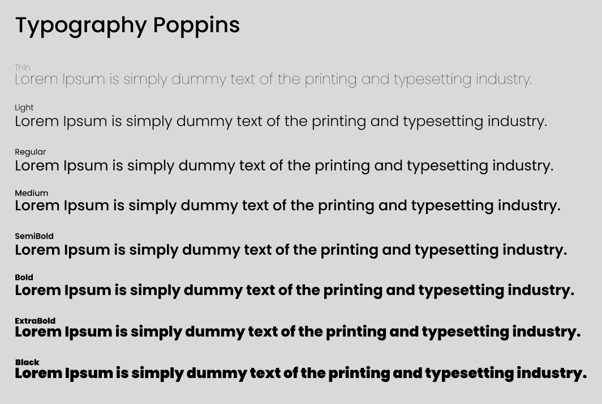
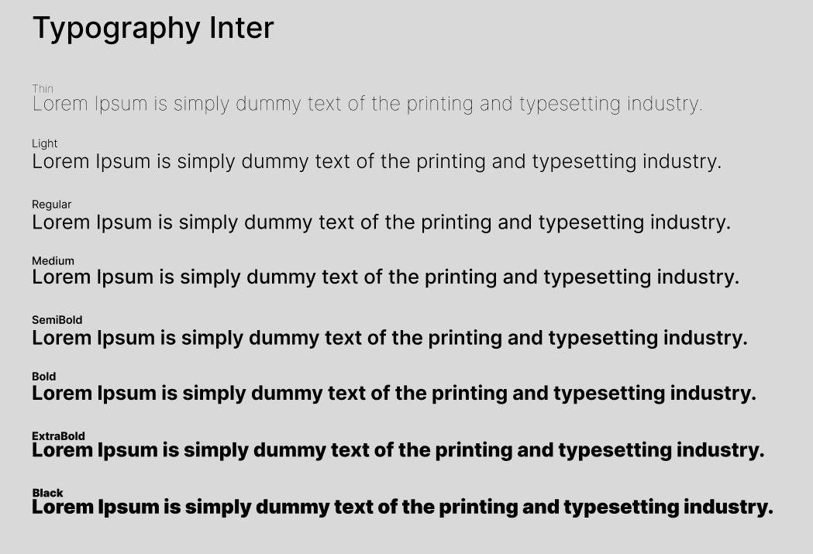

Esta combinación y jerarquía tipográfica permite mantener una experiencia de usuario consistente, altamente accesible, clara y profesional a través de los distintos dispositivos y secciones de la plataforma.

**Colors**

La interfaz web utilizará una paleta de colores basada principalmente en tonos **teal, verdes y neutros**, complementados con colores de estado para comunicar acciones, advertencias y errores.

- **Color primario:** se utilizarán tonos teal como color principal de identidad visual. Estos colores estarán presentes en elementos destacados de la interfaz, estados activos, componentes principales y elementos interactivos.

- **Color secundario:** los tonos verdes se emplearán como complemento del color principal, especialmente en botones, indicadores positivos, elementos relacionados con el estado de los cultivos y acciones secundarias.

- **Colores neutros:** se utilizarán tonos grises y blancos para mantener una interfaz limpia y facilitar la lectura del contenido. El fondo general de las vistas empleará tonos claros, mientras que componentes como el **sidebar utilizarán un fondo blanco** para diferenciar claramente la navegación del área principal de trabajo.

- **Superficies y tarjetas:** las tarjetas y contenedores de información utilizarán principalmente fondos blancos o tonos neutros claros. Algunos componentes importantes podrán utilizar fondos oscuros pertenecientes a la paleta principal para generar mayor jerarquía visual.

- **Navegación:** el menú lateral mantendrá una apariencia clara, utilizando fondo blanco y colores verdes o teal para identificar opciones seleccionadas, iconos y elementos interactivos.

- **Estados del sistema:** se utilizarán colores específicos para comunicar información importante:
  - **Rojo:** errores, acciones incorrectas o situaciones que requieren atención inmediata.
  - **Amarillo:** advertencias o situaciones que necesitan precaución.
  - **Verde:** estados correctos, disponibles, saludables o confirmaciones exitosas.

- **Contraste y legibilidad:** los colores oscuros serán utilizados principalmente para textos y elementos destacados, mientras que los tonos claros servirán como fondos y superficies, buscando mantener un contraste adecuado y una lectura sencilla en toda la aplicación.

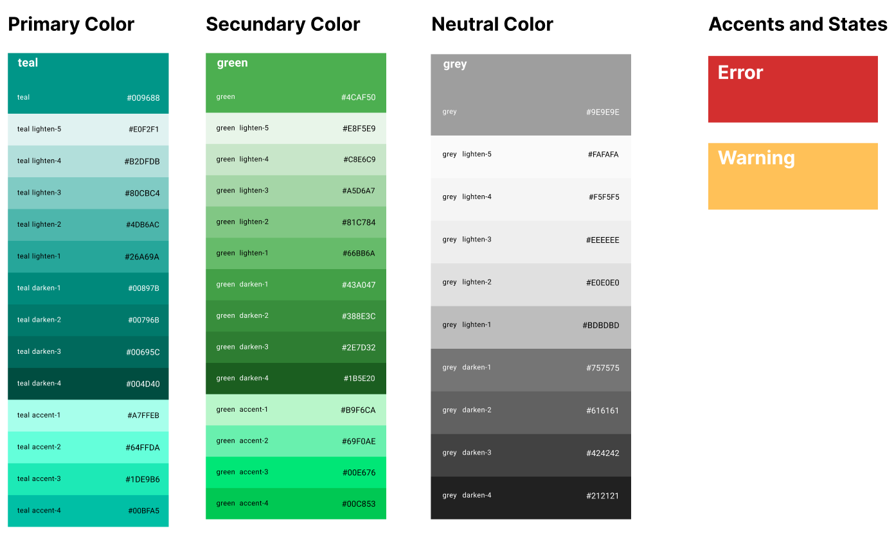

**Spacing**

SumaqAgro utiliza un sistema de espaciado basado en múltiplos de 8 px, permitiendo mantener una interfaz ordenada, consistente y fácil de adaptar a diferentes tamaños de pantalla. Este sistema se aplica en márgenes, paddings, separación entre componentes y distribución de contenido.

*   **4 px – Extra Small (XS):** Separaciones mínimas entre elementos relacionados, como iconos y texto.
*   **8 px – Small (S):** Espaciado interno pequeño, utilizado en botones, etiquetas y elementos compactos.
*   **16 px – Medium (M):** Espaciado estándar entre textos, campos de formulario y elementos dentro de una tarjeta.
*   **24 px – Large (L):** Separación entre grupos de contenido, tarjetas o bloques relacionados.
*   **32 px – Extra Large (XL):** Espaciado entre secciones internas o componentes principales.
*   **48 px – 2XL:** Utilizado para separar bloques importantes dentro de una misma sección.
*   **64 px – 3XL:** Recomendado para la separación vertical entre secciones principales de la página.
*   **80 px – 4XL:** Puede utilizarse en secciones amplias como Hero, Features o Call to Action en versión Desktop.

**Tono de Comunicación**

La voz y el tono de SumaqAgro están diseñados para ser tan claros, cercanos y confiables como nuestra plataforma. Nuestro objetivo es conectar con agricultores, cooperativas y profesionales del sector agrícola de manera empática, accesible y profesional.

* **Tono: Empático y cercano.** Buscamos reconocer y comprender las principales dificultades del trabajo agrícola, como heladas, sequías, plagas, estrés hídrico o la toma de decisiones basada en información limitada, transmitiendo comprensión y apoyo frente a estos desafíos.

* **Actitud: Profesional y confiable.** Explicamos conceptos técnicos —como el índice NDVI, monitoreo satelital o análisis de cultivos— de manera sencilla pero precisa, relacionándolos con beneficios concretos como la reducción de pérdidas, la optimización de recursos y la mejora de la productividad.

* **Lenguaje: Claro y directo.** Evitamos términos innecesariamente complejos y empleamos mensajes breves orientados a la acción. Las llamadas a la acción (CTAs) indican claramente lo que el usuario puede realizar mediante frases como “Registrar mi parcela”, “Ver estado del cultivo” o “Consultar alertas”.

* **Voz: Experta y facilitadora.** Posicionamos a SumaqAgro como una herramienta moderna para la transformación agrícola, manteniendo siempre una comunicación accesible que prioriza los beneficios prácticos que la plataforma ofrece en el día a día.

**Dimensiones del tono de voz**

Siguiendo las cuatro dimensiones del tono de voz, SumaqAgro se ubica de la siguiente manera:

* **Divertido / Serio → Serio.** Las decisiones del productor afectan su cosecha y sus ingresos, por lo que se evitan los chistes y el lenguaje informal en alertas, costos y recomendaciones.
* **Formal / Casual → Casual.** Se usa un trato cercano y en segunda persona (“Tu cultivo tiene buen vigor”, “¡Buen día, Guillermo!”), con frases cortas y sin tecnicismos innecesarios.
* **Respetuoso / Irreverente → Respetuoso.** Se reconoce el conocimiento y la experiencia del agricultor, y los mensajes de error explican cómo corregir el problema sin culpar al usuario.
* **Entusiasta / Sereno → Sereno.** Las alertas de helada o plaga se comunican con calma y con pasos claros a seguir; el entusiasmo se reserva para confirmar logros, como un registro exitoso o un cultivo en estado “Óptimo”.

Este enfoque comunicacional busca generar confianza y lealtad, asegurando a los productores y organizaciones agrícolas que cuentan con un aliado tecnológico claro y efectivo para optimizar la gestión de sus cultivos.

### 4.1.2. Web Style Guidelines

Esta sección define las pautas visuales, de maquetación y de componentes de interfaz para el desarrollo del sitio web estático (**Landing Page en HTML5/CSS3/JS**) y la aplicación web orientada a la gestión agrícola en **Vue**, utilizando **Vue** como biblioteca principal de componentes de UI.

El enfoque está centrado en garantizar una experiencia visual y de interacción consistente, accesible (**a11y**) y adaptable a cualquier dispositivo utilizado en campo u oficina.

#### Responsive Design

La interfaz de **SumaqAgro** se adapta de forma fluida a las pantallas de teléfonos móviles, tabletas y computadoras de escritorio mediante un sistema de cuadrícula (*Grid System*) y puntos de interrupción (*breakpoints*) estandarizados:

- **Extra Small (xs ≤ 576px):** Smartphones en orientación vertical utilizados por agricultores en campo.

- **Small (sm 577px – 768px):** Tabletas y dispositivos móviles en orientación horizontal.

- **Medium (md 769px – 1024px):** Laptops y pantallas compactas de oficina cooperativa.

- **Large (lg > 1024px):** Monitores de escritorio para análisis detallado de mapas satelitales y reportes.

Para el **Landing Page**, la adaptabilidad se logra mediante *CSS Flexbox*, *CSS Grid* y *Media Queries* nativas.

Para la **Web Application en Vue**, la maquetación se gestiona mediante directivas de diseño responsivo y bibliotecas de componentes adaptables.

#### Componentes y patrones compatibles

- **Navegación (*Navbar / Menu*):** En la aplicación web se utiliza `<mat-toolbar>` en combinación con `<mat-menu>` o `<mat-sidenav>` para la barra lateral responsiva, integrada con el módulo de enrutamiento mediante `routerLink`. En el Landing Page se emplea una barra superior fija (*sticky*) construida con elementos semánticos `<header>` y `<nav>`.

- **Tarjetas (*Cards*):** Implementación de `<mat-card>` para estructurar contenedores de información clave como el resumen de lotes, mapas de vigor foliar (*NDVI*), estados de alertas fitosanitarias y balances financieros de campaña.

- **Botones de acción:** Uso de variantes de Vue según la jerarquía del elemento:
  - `<button mat-raised-button>` para llamadas a la acción principales, como **“Registrar Parcela”** y **“Consultar al Asesor”**.
  - `<button mat-button>` para acciones secundarias.
  - `<button mat-icon-button>` para controles en visores de mapas satelitales.

- **Diálogos y Notificaciones:** Uso de `MatSnackBar` para la confirmación de registros de gastos o avisos preventivos, y `MatDialog` para el despliegue contextual de fichas técnicas de lotes, recetas fitosanitarias o vista previa de certificados de cosecha en PDF.

#### Accesibilidad (a11y)

Con el fin de asegurar que la plataforma sea inclusiva para todos los perfiles de usuario, incluyendo agricultores, dirigentes de cooperativas y agrónomos, se consideran las siguientes pautas:

- **Soporte ARIA:** Integración explícita de atributos `aria-label`, `aria-expanded` y `aria-live` en componentes interactivos y dinámicos.

- **Navegación por teclado:** Compatibilidad completa de foco e interacción mediante secuencias de teclado estándar como `Tab`, `Enter`, `Space` y `Escape`.

- **Contraste y escalabilidad:** Cumplimiento de los niveles de contraste de color según la norma **WCAG 2.1 AA**, con un ratio mínimo de **4.5:1** para texto normal, y uso de unidades relativas como `rem` y `em` para garantizar el escalado de tipografías sin distorsión de la interfaz.

### 4.1.3. Mobile Style Guidelines

Esta sección define las pautas de la aplicación móvil de **SumaqAgro**, diseñada en Figma para Android (frame de 360 × 800 px) y pensada para el uso en campo con una sola mano. Hereda la identidad visual de las secciones anteriores. [Ver diseño en Figma](https://www.figma.com/design/ISAgMtqNOAucizqd3eXYzR/UI-DESIGN?node-id=898-10332).

**a) Patrones de navegación:** Se emplea una *Bottom Navigation Bar* fija con cinco destinos (Inicio, Monitoreo, Finanzas, Alertas y Perfil), con íconos y etiquetas visibles, complementada con un botón de acción flotante (*FAB*) para la acción principal de Finanzas (“Anotar gasto”). Las vistas de detalle y los formularios usan una flecha de retroceso en la barra superior.

**b) Componentes nativos:**
- Botones primarios rellenos en teal (`#00796B`) con texto blanco y ancho completo en formularios; botones secundarios con borde teal.
- Tarjetas (*cards*) de 16 px de radio para los indicadores clave, con la tarjeta de *Salud Foliar* en teal oscuro (`#004D40`) para dar jerarquía.
- *Bottom sheets* para selectores (*Cambiar Parcela*, *Enviar foto de plaga*) y modales o diálogos para confirmaciones (guardar gasto, finalizar plan, cerrar sesión).
- Chips de selección (*Insumos y Abono*, *Mano de Obra / Jornal*, *Flete*) y banners ámbar para avisos de sincronización pendiente.

**c) Tipografía:** Poppins para títulos y cifras clave (Display 32 px, H1 28 px, H2 24 px, H3 20 px) e Inter para texto e interfaz (cuerpo 16 px, texto secundario 14 px, etiquetas y *captions* 12 px).

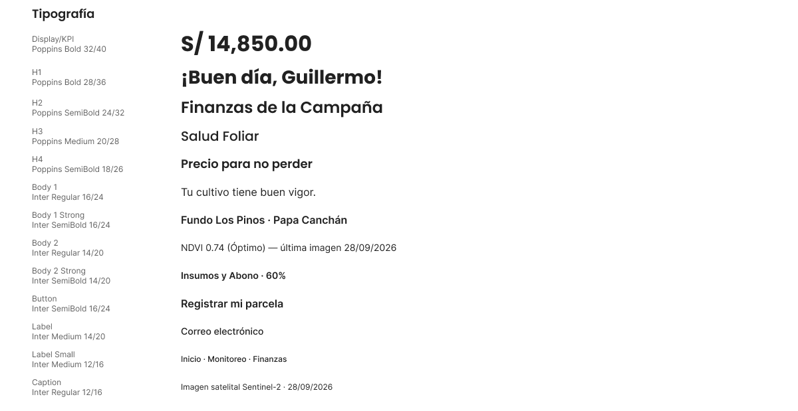

**d) Colores:** Escala Material en teal (primario), verde (confirmaciones y estado “Óptimo”) y grises (fondos y bordes); rojo `#D32F2F` para errores y alertas críticas y ámbar `#FFC107` para avisos. El texto blanco solo se usa sobre teal `#00796B` o más oscuro (contraste AA ≥ 4.5:1).

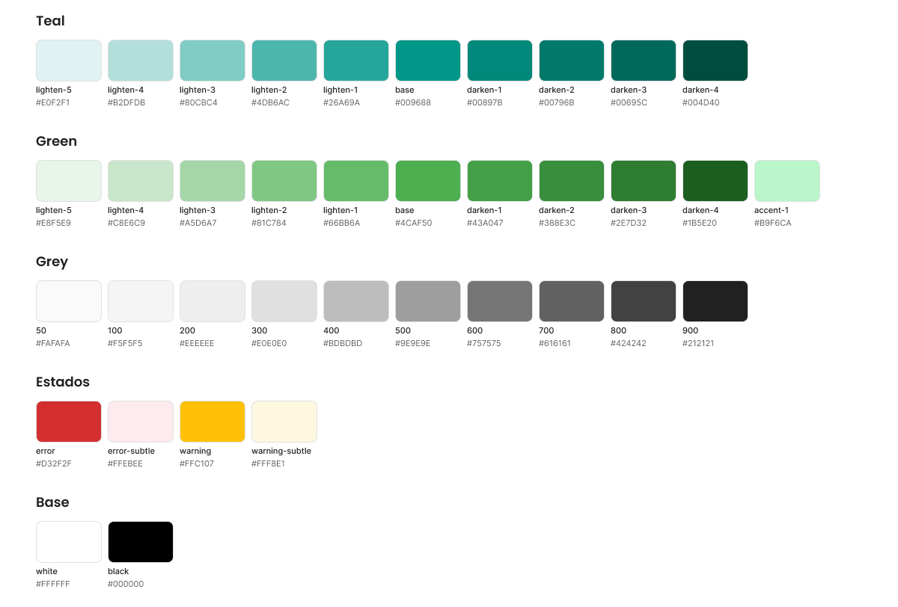

**e) Espaciado:** Base de 8 px (4, 8, 16, 24, 32 y 48 px), con márgenes laterales de 16 px y radios de 8, 12, 16 y 24 px.

**f) Gestos y accesibilidad:** Solo se usan toques simples (*tap*), sin gestos complejos. Las áreas táctiles son de al menos 48 × 48 px, y los estados se comunican con ícono y texto, no solo con color.

**g) Iconografía:** Se utilizan íconos *Material Symbols Rounded* de 24 × 24 px, siempre acompañados de una etiqueta.

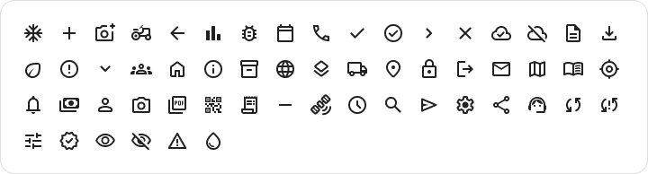

## 4.2. Information Architecture

### 4.2.1. Organization Systems

La organización jerárquica del Landing Page de "SumaqAgro" ha sido diseñada con el propósito de guiar al usuario de manera lógica y efectiva desde su primer contacto con la solución hasta su conversión en cliente. Esta estructura responde a principios de arquitectura de la información que priorizan la claridad, la relevancia y la progresión natural del contenido, permitiendo que los usuarios comprendan de inmediato el valor del producto, cómo funciona, sus beneficios, y los pasos para adquirirlo.

**Inicio**

- **Propósito**: Captar la atención del visitante con un mensaje claro y directo orientado al sector agrícola.

- **Contenido**: Propuesta de valor en el banner principal y llamadas a la acción directas.

**Información explicativa**

- **Nosotros:** Presentación del propósito de la plataforma y el equipo detrás de la solución.

- **¿A quién ayudamos?:** Segmentación explícita del valor para los tres públicos objetivo (agricultores independientes, líderes de cooperativas y asesores técnicos/agrónomos).

- **Soluciones y Características:** Detalle de las capacidades tecnológicas clave como monitoreo satelital (NDVI), contabilidad de costos, certificación digital y prescripciones con alertas.

- **Demo del Producto:** Video demostrativo sobre el funcionamiento en campo de la plataforma.

**Conversión y Validación**

- **Planes:** Detalle de las opciones de suscripción diseñadas para cada perfil (Plan Semilla, Cooperativa Pro y Plan Asesor Técnico).

- **Impacto y Testimonios:** Presentación de métricas de alcance y testimonios reales de clientes que validan la experiencia.

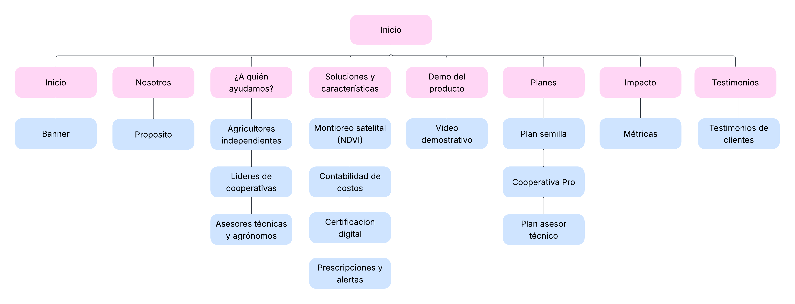

> Organización en el landing page

Además, la arquitectura jerárquica en la interfaz de la aplicación web de "SumaqAgro" ha sido diseñada para facilitar el acceso y gestión eficiente de las múltiples funcionalidades del sistema. Esta estructura permite una distribución lógica del contenido, reduciendo la carga cognitiva del usuario en campo y mejorando su capacidad para encontrar rápidamente las herramientas que necesita.

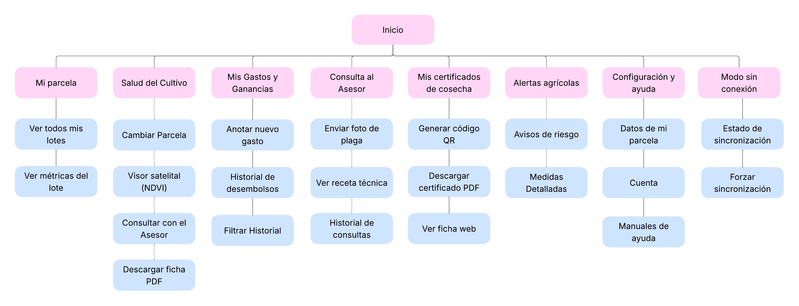

> Organización en la aplicación

**Pantalla de inicio (Mi Parcela)**

Una vista general tipo dashboard que presenta:

- Tarjetas resumen de vigor vegetal (NDVI), costos acumulados de la campaña y punto de equilibrio financiero.

- Avisos destacados de alertas fitosanitarias activas o riesgos climáticos.

- Accesos rápidos para explorar lotes y consultar datos clave de la parcela.

**Navegación principal**

Sistema jerárquico accesible desde un menú lateral con iconografía clara. Incluye las siguientes pestañas:

- Mi Parcela

- Salud del Cultivo

- Mis Gastos y Ganancias

- Consulta al Asesor

- Mis Certificados de Cosecha

- Alertas Agrícolas

- Configuración y Ayuda

- Modo Sin Conexión

**Filtrado y organización avanzada**

**a. Para Agricultores Independientes**

- **Filtros por:** Parcelas, lotes y capas satelitales (Vigor del Follaje / Humedad).

- **Funcionalidades destacadas:** Visor satelital (NDVI), registro de gastos y solicitudes de asistencia al asesor.

**b. Para Líderes de Cooperativas**

- **Filtros por:** Lotes comunitarios, categorías de gastos acumulados e historial de cosechas.

- **Funcionalidades destacadas:** Emisión de certificados de calidad con código QR, fichas PDF exportables y métricas de rendimiento por lote.

**c. Para Asesores Técnicos y Agrónomos**

- **Filtros por:** Parcelas asignadas, estado de consultas fitosanitarias y nivel de riesgo/alerta.

- **Funcionalidades destacadas:** Revisión de fotografías de plagas enviadas por agricultores, emisión de recetas técnicas y seguimiento de avisos de riesgo.

**Organización visual del contenido**

- **Jerárquica (*visual hierarchy*):** Se aplica en el Landing Page (de la propuesta de valor a los planes) y en los dashboards, donde el indicador más importante, como la salud foliar, se destaca sobre los demás y los detalles quedan en niveles inferiores.
- **Secuencial (*step-by-step*):** Se aplica en las tareas que se completan en pasos ordenados: el registro de cuenta, la recuperación de contraseña con código OTP, el registro de una parcela (mapa, datos del cultivo y confirmación) y el plan de acción de una alerta.
- **Matricial:** Se aplica en cuadrículas de tarjetas, como las parcelas registradas con sus cupos disponibles, los indicadores clave del dashboard y la comparación de planes de suscripción en el Landing Page.

**Esquemas de categorización del contenido**

- **Por tópicos:** Los módulos de la aplicación se agrupan por tema (Principal, Operación agrícola y Sistema), al igual que los gastos (Insumos y Abono, Mano de Obra y Flete) y las alertas (clima y fitosanitarias).
- **Cronológico:** El historial de gastos, las alertas, las consultas al asesor y los certificados se ordenan del más reciente al más antiguo.
- **Alfabético:** Se aplica en las listas de selección, como parcelas y cultivos, para encontrar un elemento sin esfuerzo.
- **Según audiencia:** Se desarrolla a continuación en *Segmentación por audiencia*.

**Segmentación por audiencia**

**a. Agricultores independientes**

- Enfoque en el control visual de la salud de sus cultivos, manejo contable sencillo de la campaña y prevención ante contingencias climáticas.

- Visualización rápida de métricas clave y acceso directo a canales de ayuda y soporte en campo.

**b. Líderes de cooperativas**

- Enfoque en la estandarización de la producción, respaldo técnico comercial de la cosecha colectiva y la gestión eficiente de costos.

- Herramientas para la generación de documentos oficiales con código QR que facilitan la venta transparente a acopiadores y compradores.

**c. Asesores técnicos y agrónomos**

- Enfoque en la asistencia técnica distribuida, optimización de visitas a terreno e intervención precisa ante plagas o heladas.

- Canal de comunicación directo para dictar diagnósticos, recomendar dosificación de insumos y mantener un historial clínico por cada parcela.

### 4.2.2. Labeling Systems

El sistema de etiquetado de **SumaqAgro** ha sido diseñado para ser claro, directo y fácil de entender por agricultores, cooperativas y agrónomos, usando palabras clave con un número mínimo de términos sin perder precisión. Las etiquetas evitan tecnicismos innecesarios y buscan reducir la carga cognitiva del usuario en el campo.

#### Principios

- **Consistencia:** Se usan las mismas etiquetas en botones, menús y mensajes relacionados. Por ejemplo: **“Ver todos mis lotes”**, **“Consultar con el Asesor”** y **“Descargar Ficha PDF”**.

- **Simplicidad:** Se evita el uso de jergas técnicas complejas, empleando términos agrícolas cotidianos. Ejemplos: **“Vigor del Follaje (NDVI)”**, **“Déficit de Humedad”** y **“Precio para no perder”**.

#### Etiquetado en el Landing Page

- **Inicio:** Es la primera sección que el usuario ve al entrar. Presenta la propuesta de valor **“Cultiva con Información. Decide con Precisión”** y botones directos.

- **Nosotros:** Muestra el propósito de **SumaqAgro** y la presentación del equipo detrás de la plataforma.

- **¿A quién ayudamos?:** Segmenta la información para **“Agricultores independientes”**, **“Líderes de cooperativas”** y **“Asesores técnicos y agrónomos”**.

- **Soluciones y Características:** Presenta los módulos de **“Monitoreo satelital (NDVI)”**, **“Contabilidad de costos”**, **“Certificación digital”** y **“Prescripciones y alertas”**.

- **Demo del Producto:** Incluye la sección de **“Video demostrativo”** para conocer la plataforma en acción.

- **Planes:** Presenta las opciones de suscripción: **“Plan Semilla”**, **“Cooperativa Pro”** y **“Plan Asesor Técnico”**.

- **Impacto:** Muestra **“Métricas”** y datos estadísticos de alcance en hectáreas monitoreadas y rendimiento de cultivos.

- **Testimonios:** Muestra **“Testimonios de Clientes”** y opiniones de productores que validan el uso de la solución.

- **Footer:** Contiene el logotipo de **SumaqAgro**, enlaces de navegación, redes sociales y accesos a información de soporte y aspectos legales.
#### Etiquetado en la Aplicación Web

- **Mi Parcela:** Vista principal del dashboard con métricas clave como **“Salud Foliar”**, **“Gasto Total”**, **“Precio para no perder”** y accesos a **“Ver todos mis lotes”**.

- **Salud del Cultivo:** Visor con mapas de **“Vigor del Follaje (NDVI)”**, **“Humedad del Suelo”** y opciones como **“Cambiar Parcela”**, **“Consultar con el Asesor”** y **“Descargar Ficha PDF”**.

- **Mis Gastos y Ganancias:** Sección financiera que etiqueta **“Finanzas de la Campaña”**, **“Anotar nuevo gasto”**, **“Historial de desembolsos”** y **“Filtrar Historial”**.

- **Consulta al Asesor:** Canal fitosanitario con etiquetas como **“Asistencia Fitosanitaria y Recetas”**, **“Enviar foto de plaga”**, **“Ver receta técnica”** e **“Historial de consultas”**.

- **Mis Certificados de Cosecha:** Módulo oficial con botones e indicadores como **“Generar código QR”**, **“Descargar certificado PDF”** y **“Ver ficha web”**.

- **Alertas Agrícolas:** Panel de notificaciones etiquetado con **“Avisos de riesgo”**, **“Boletín Fitosanitario”** y acciones como **“Medidas Detalladas”**.

- **Configuración y Ayuda:** Sección para gestionar **“Datos de mi parcela”**, **“Cuenta”**, **“Manuales de ayuda”** y el botón directo **“Llamar a Soporte SumaqAgro”**.

#### Etiquetado en la Aplicación Móvil

La aplicación móvil mantiene las mismas etiquetas del Lenguaje Ubicuo, con textos más cortos para pantallas de 360 px:

- **Barra de navegación inferior:** **Inicio** (*Home*), **Monitoreo** (*Monitoring*), **Finanzas** (*Finances*), **Alertas** (*Alerts*) y **Perfil** (*Profile*).
- **Tarjetas del Inicio:** **Salud Foliar** (*Leaf Health*), **Gasto Total** (*Total Spend*) y **Precio para no perder** (*Break-even Price*).
- **Acciones principales:** **Anotar gasto** (*Log expense*), **Enviar foto de plaga** (*Send pest photo*) y **Registrar parcela** (*Register new plot*).
- **Estados:** **Conectado** (*Connected*), **Óptimo** (*Optimal*) y **pendientes** (*pending*) para los datos por sincronizar.

### 4.2.3. SEO Tags and Meta Tags

Con el objetivo de mejorar la visibilidad de "SumaqAgro" en los motores de búsqueda y facilitar su descubrimiento tanto por agricultores independientes, líderes de cooperativas y asesores técnicos agrónomos interesados en optimizar el rendimiento y la gestión de sus cultivos, se ha establecido una estrategia SEO que incluye el uso adecuado de etiquetas HTML para los principales elementos informativos del sitio web estático (Landing Page) y la aplicación web.

**Landing Page**

- **Title:**  
  `<title>SumaqAgro – Satellite Monitoring and Precision Agriculture Management</title>`

Una frase concisa que refleja la propuesta de valor de la plataforma e integra palabras clave estratégicas como "monitoreo satelital", "gestión agrícola" y "precisión", términos frecuentemente utilizados por productores y profesionales del sector agrotecnológico al buscar soluciones digitales.

- **Meta Description:**  
  `<meta name="description" content="Agrotechnology platform for Peruvian agriculture. Optimize crop performance with NDVI maps, plot cost management, QR traceability, and phytosanitary risk alerts.">`

Esta descripción sintetiza el propósito de la herramienta destacando sus beneficios diferenciadores (salud foliar NDVI, control financiero y certificación digital), incorporando términos de búsqueda de alta relevancia como “agrotecnología”, “alertas fitosanitarias” y “código QR”.

- **Meta Keywords:**  
  `<meta name="keywords" content="SumaqAgro, agricultural satellite monitoring, NDVI index, precision agriculture Peru, agricultural cooperative management, agricultural cost control, QR harvest certification, phytosanitary alerts">`

Un conjunto seleccionado de palabras clave que abarca los perfiles de usuario objetivo (agricultores, cooperativas, agrónomos) y las funcionalidades centrales de la solución (NDVI, control de gastos, trazabilidad y alertas de riesgo).

- **Meta Author:**  
  `<meta name="author" content="Dymbia Team - Aplicacion Web">`

Identifica al equipo responsable del diseño, desarrollo y arquitectura de información del sitio web, reforzando la transparencia y la atribución del proyecto.

**Web Application – Dashboard Principal**

- **Title:**  
  `<title>My Plot – SumaqAgro | Crop Monitoring and Management Dashboard</title>`

Este título complementa la identidad de la plataforma con una llamada a la acción orientada a la gestión operativa, enfocándose en la centralización y monitoreo de predios agrícolas desde la vista principal de la aplicación.

- **Meta Description:**  
  `<meta name="description" content="Access your main SumaqAgro dashboard. View NDVI crop health maps for your plots, record campaign expenses, check the break-even price, and manage phytosanitary requests with your technical advisor.">`

Redactado con un enfoque funcional y operativo que detalla las acciones inmediatas que el usuario puede realizar en la interfaz, destacando la interacción entre agricultor, agrónomo y datos geoespaciales.

- **Meta Keywords:**  
  `<meta name="keywords" content="agricultural dashboard, my plot, NDVI maps, crop health, agricultural cost control, technical prescriptions, risk alerts, SumaqAgro platform">`

Palabras clave orientadas a la experiencia interna de la aplicación, utilizando términos específicos de uso continuo en la plataforma (ej. “agricultural dashboard”, “NDVI maps”, “technical prescriptions”).

- **Meta Author:**  
  `<meta name="author" content="Dymbia Team - Aplicacion Web">`

Especifica el equipo de desarrollo web responsable del proyecto para asegurar la vigencia y atribución tecnológica de la aplicación.

### 4.2.4. Searching Systems

Dentro de la sección **Mi Parcela** de la aplicación web, el sistema de búsqueda está integrado de forma simple pero efectiva para que el usuario pueda localizar lotes, registros o métricas rápidamente. Se utiliza un campo de búsqueda principal centrado en la parte superior del encabezado del dashboard, acompañado de indicadores de estado de conexión y notificaciones.

Este campo permite buscar por nombre de parcela, tipo de cultivo o sector. Por ejemplo: **“Papa Canchán”** o **“Lote 2”**.

#### Búsqueda en la parcela

El sistema de búsqueda permite al usuario localizar información específica relacionada con sus parcelas de forma rápida. La búsqueda puede realizarse utilizando términos asociados al nombre del lote, cultivo, variedad o sector registrado dentro de la plataforma.

#### Filtros de Búsqueda

Al realizar una búsqueda, los usuarios pueden refinar los resultados mediante diferentes criterios que permiten adaptar la información mostrada según sus necesidades.

- **Categoría o Cultivo:** Permite filtrar la información según el tipo de producto agrícola, como papa, café, entre otros.

- **Salud Fitosanitaria / Vigor (NDVI):** Permite identificar lotes según su condición actual, diferenciando entre estado óptimo, alerta moderada o riesgo severo.

#### Resultados de Búsqueda

Los resultados se presentan mediante una estructura visual basada en tarjetas y mapas de calor, permitiendo al usuario identificar rápidamente la información más relevante de cada parcela.

Cada resultado puede incluir:

- **Nombre del lote o parcela.**
- **Tipo de cultivo y variedad.**
- **Índice NDVI de salud foliar.**
- **Costo acumulado de la campaña.**
- **Estado de alerta activa.**

Para facilitar la interpretación de la información, se utiliza una codificación visual mediante colores:

- **Verde:** Representa un estado saludable del cultivo y un nivel adecuado de vigor foliar.

- **Amarillo:** Representa una condición de alerta moderada que requiere seguimiento.

- **Rojo:** Representa una situación de riesgo alto o una posible alerta fitosanitaria.

#### Búsqueda Avanzada por Segmento

**SumaqAgro** adapta sus funciones de búsqueda y filtrado según las necesidades de los diferentes perfiles de usuario de la plataforma.

##### Agricultores Independientes

Los agricultores pueden realizar búsquedas rápidas de sus lotes individuales, consultar información asociada a cada parcela y filtrar sus registros de campaña.

Entre las principales opciones se encuentran:

- Búsqueda de lotes o parcelas.
- Filtrado de gastos por categoría.
- Consulta de mano de obra, fertilizantes e insumos.
- Consulta del historial de precios de equilibrio de los cultivos.

##### Líderes de Cooperativas

Los líderes de cooperativas disponen de herramientas de búsqueda orientadas a la gestión consolidada de socios y producción agrícola.

Entre las principales opciones se encuentran:

- Búsqueda y filtrado de socios de la cooperativa.
- Consulta de volúmenes de acopio por sector.
- Seguimiento de certificados de cosecha.
- Búsqueda mediante código QR o número de ficha.

##### Asesores Técnicos Agrónomos

Los asesores técnicos cuentan con funciones de búsqueda enfocadas en el seguimiento y supervisión de las parcelas asignadas.

Entre las principales opciones se encuentran:

- Filtrado de parcelas según nivel de urgencia.
- Filtrado según severidad del riesgo.
- Consulta del historial de diagnósticos.
- Consulta de recetas fitosanitarias emitidas por predio.

#### Búsqueda en la Aplicación Móvil

En la aplicación móvil la búsqueda se simplifica para el uso con una sola mano:

- **Barra de búsqueda** en la parte superior de las pantallas de Inicio y Finanzas (por ejemplo, "Buscar en mi parcela").
- **Chips de filtro** bajo la barra, como **Todos**, **Insumos**, **Mano de obra** y **Flete** en el historial de gastos.
- **Resultados en tarjetas** de una sola columna, con el estado indicado por color, ícono y texto.

### 4.2.5. Navigation Systems

La navegación en **SumaqAgro** está diseñada para facilitar el recorrido del usuario de manera clara y rápida. En la Landing Page se implementa una barra de navegación fija (header) en la parte superior que contiene el isotipo de la marca, enlaces directos a las secciones principales, botones de acción y selector de idioma. Estas secciones son:

- **Home:** Retorno a la sección principal de bienvenida.
- **About Us:** Información sobre la propuesta de valor y el equipo.
- **Solutions:** Explicación técnica del monitoreo satelital y gestión agrícola.
- **Plans:** Detalle de las suscripciones disponibles para el campo.
- **Impact:** Resultados y testimonios de uso en los cultivos.
- **Sign In / Register:** Botones de acceso y registro a la plataforma.
- **Selector de Idioma (EN):** Opción para cambiar la localización del sitio.

> Navegación del sitio web (Landing Page)

Además, en la aplicación web se implementa un menú lateral fijo (sidenav) organizado por categorías principales, el cual permite el acceso directo a las funcionalidades de gestión y monitoreo del sistema:

- **Principal:**
  - **Mi Parcela:** Vista del panel general del predio.
- **Operación agrícola:**
  - **Salud del Cultivo:** Visor con mapas de vigor foliar y métricas del predio.
  - **Mis Gastos y Ganancias:** Gestión contable e historial financiero de campaña.
  - **Consulta al Asesor:** Canal directo de atención fitosanitaria y recetas técnicas.
  - **Mis Certificados de Cosecha:** Emisión y consulta de certificados trazables con QR.
- **Sistema:**
  - **Alertas Agrícolas:** Centro de avisos de riesgo y boletín fitosanitario.
  - **Configuración y Ayuda:** Ajustes de la cuenta, datos de parcelas y soporte.
  - **Modo Sin Conexión:** Estado operativo para sincronización de datos en campo.
  - **Cerrar Sesión:** Salida segura de la plataforma.

Cada sección está representada con un ícono claro y una etiqueta visible, asegurando una navegación fluida e intuitiva dentro de la consola de trabajo.

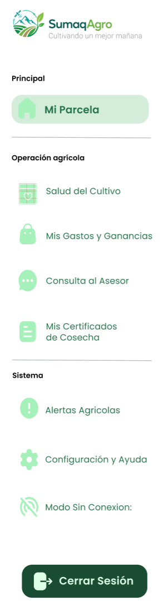

> Navegación de la aplicación web (Sidenav)

En la **aplicación móvil** el menú lateral se sustituye por una barra de navegación inferior (*Bottom Navigation Bar*) con cinco destinos fijos, ubicada en la zona del pulgar:

- **Inicio:** Panel de Mi Parcela con salud foliar, gasto total y precio para no perder.
- **Monitoreo:** Visor satelital con las capas de vigor foliar (NDVI) y humedad (NDWI).
- **Finanzas:** Gastos y ganancias de la campaña, con acceso al registro de un nuevo gasto.
- **Alertas:** Avisos de riesgo y plan de acción.
- **Perfil:** Configuración, ayuda, modo sin conexión y cierre de sesión.

Las vistas de detalle y los formularios se recorren con una flecha de retroceso en la barra superior, y las acciones frecuentes aparecen como accesos rápidos en el Inicio (*Consultar con el Asesor*, *Mis Certificados* y *Enviar foto de plaga*).

## 4.3. Landing Page UI Design
El landing page representa el primer punto de contacto entre los usuarios y la plataforma, por lo que su diseño debe comunicar de manera clara el propósito y los principales beneficios del servicio. En esta sección se presenta el diseño de la interfaz del landing page, considerando una organización visual atractiva, una navegación sencilla y elementos que faciliten la comprensión de la información y orienten al usuario hacia las acciones principales.

### 4.3.1. Landing Page Wireframe
#### Desktop Web Browser
El wireframe del landing page de **SumaqAgro** muestra la estructura inicial de la página y la forma en que se organizan sus principales elementos antes de aplicar el diseño visual definitivo. Su propósito es definir una distribución ordenada y funcional que sirva como base para el desarrollo posterior de la interfaz.

**Nav y Hero**

La sección Hero de la Landing Page presenta en su cabecera superior (Navbar) el isotipo y nombre de marca a la izquierda, los enlaces de anclaje (*Inicio*, *Nosotros*, *Soluciones*, *Planes*, *Impacto*), los botones de acceso (*Iniciar sesión* y *Registrarse*) y el selector de internacionalización (*ES*); seguidamente, el área principal de impacto despliega el subtítulo en mayúsculas *«AGRICULTURA INTELIGENTE PARA UN MEJOR MAÑANA»*, el encabezado principal (H1) *«Cultiva con Información. Decide con Precisión»*, un párrafo descriptivo que sintetiza la transformación de datos satelitales para el monitoreo de cultivos, costos y valor de la producción, y dos llamados a la acción primarios representados por los botones *Explorar* y *Cómo funciona* sobre un fondo fotográfico agrícola de campo.

**About**

La sección **Nosotros** (*About Us*) presenta una distribución asimétrica compuesta por un bloque textual a la izquierda y un recurso gráfico a la derecha; el área informativa incluye el kicker superior en mayúsculas *«SOBRE SUMAQAGRO»*, el encabezado de sección (H2) *«Nosotros»*, el subtítulo destacado (H3) *«Democratizamos la agricultura de precisión en el Perú»* y un párrafo institucional que detalla la misión de reducir la brecha de tecnificación en las cuencas de papa y café mediante datos satelitales abiertos y herramientas accesibles de monitoreo, costeo y certificación; mientras que a la derecha se exhibe una composición fotográfica con esquinas redondeadas que muestra una parcela de cultivo tecnificado junto a una mano sosteniendo un smartphone con la interfaz móvil del sistema desplegada.

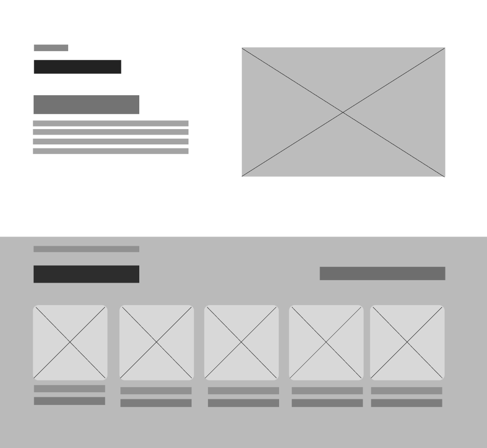

**Solutions**

La sección **¿A quién ayudamos?** organiza la propuesta de valor mediante tres tarjetas (*cards*) de autoselección por perfil orientadas a *Agricultores independientes*, *Líderes de cooperativas* y *Asesores técnicos y agrónomos*, detallando en cada una su enfoque productivo, una fotografía representativa de campo y un botón de llamado a la acción específico (*Registrar mi parcela*, *Gestionar cooperativa* y *Unirme como asesor*); inmediatamente después, la sección **Soluciones y Características** expone las cuatro capacidades tecnológicas clave del sistema mediante una grilla de tarjetas que describen el monitoreo satelital de vigor y humedad (*Satellite Monitoring of Vigor and Moisture*), la contabilidad de costos por lote (*Batch Cost Accounting*), la certificación digital de cosecha (*Digital Certification of Harvest Quality*) y el sistema de prescripciones agronómicas (*Agronomic Prescriptions and Alerts*), complementando cada bloque funcional con un indicador del impacto operativo directo que genera en campo.

**Video and Plans**

La sección **Conoce SumaqAgro en acción** presenta un contenedor central con fondo verde oscuro que alberga el reproductor del video demostrativo (*About-the-Product*) para evidenciar el funcionamiento en campo; inmediatamente después, la sección **Planes** (*Pricing*) introduce un conmutador de facturación mensual y anual (*«Ahorra 2 meses con el plan anual»*) junto a una grilla de tres tarjetas de suscripción que estructuran el modelo SaaS freemium y B2B: el **Plan Semilla** (S/ 0 para 1 parcela con NDVI básico y botón *«Empezar gratis»*), el **Plan Cooperativa Pro** (destacado con la etiqueta *«Más popular»* a S/ 189/mes para 50 productores con certificación de calidad y botón *«Suscribir cooperativa»*), y el **Plan Asesor Técnico** (S/ 89/mes para supervisar 20 fundos con recetas técnicas y botón *«Prueba de 14 días»*).

**Testimonials , Impact and Footer**

La sección **Impacto** y el cierre del Landing Page se estructuran en tres bloques consecutivos orientados a la credibilidad y la conversión: en primer lugar, el área de métricas cuantitativas presenta tres tarjetas superiores con indicadores clave de respaldo agrario (*333k+ Has. de papa*, *223k+ Familias cafeteras* y *>40% Sin cobertura técnica*), acompañadas en la parte inferior por el bloque testimonial *«Lo que dicen nuestros usuarios»* con tarjetas que incluyen avatar, calificación por estrellas y citas de validación de Juan Huamán (productor de papa) y Elena Vargas (cooperativa cafetalera); a continuación, se ubica el banner final de conversión (*Bottom CTA*) en verde oscuro con el titular *«Empieza a decidir con precisión hoy»*, un texto de apoyo y el botón principal de acción *Registrarse gratis*; finalmente, el pie de página (*Footer*) organiza sobre fondo oscuro el isotipo horizontal de SumaqAgro con su propuesta de valor a la izquierda, junto a una distribución de navegación en tres columnas de enlaces (*Products*, *Quick Links* y *Support*) para centralizar recursos, documentación y canales de soporte de la plataforma.

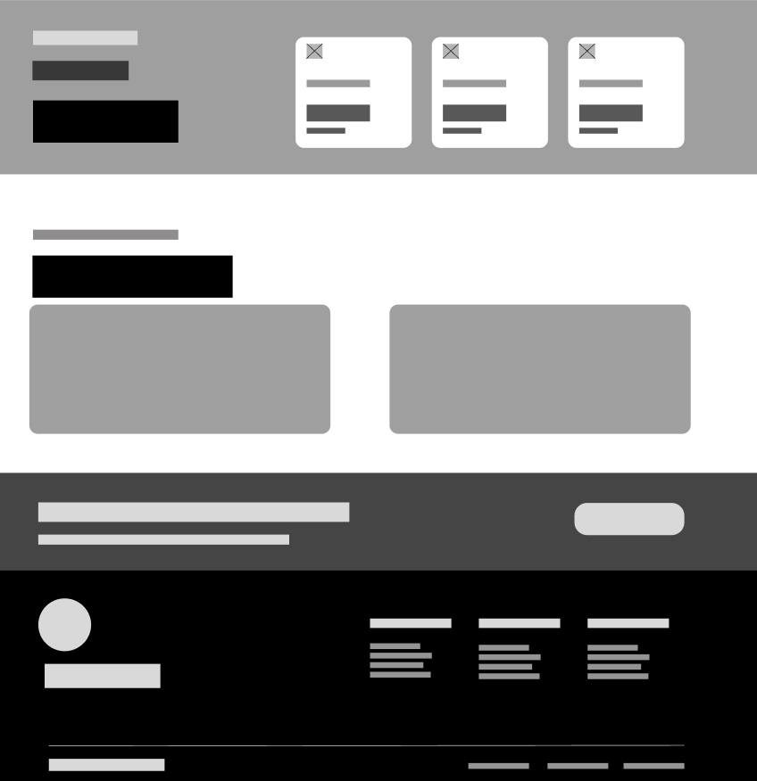

#### Mobile Web Browser
Para garantizar una experiencia de usuario inclusiva y accesible, el diseño responsivo de la Landing Page de SumaqAgro se fundamenta en un sistema de rejilla fluido adaptado a dispositivos móviles (*Mobile Web Browser*), utilizando una retícula de 4 columnas y una escala de espaciado basada en múltiplos de 8 px.

En esta vista, los componentes de escritorio se reorganizan de manera progresiva en una sola columna (*single-column layout*), condensando la barra de navegación superior en un menú colapsable tipo hamburguesa (*nav-toggle*) y apilando los bloques informativos, tarjetas de segmentos, matrices de soluciones y llamados a la acción (CTAs) de forma lineal para facilitar el desplazamiento continuo (*scrolling*) y la interacción con una sola mano sin pérdida de contexto ni funcionalidad.

**Hero**

En la vista móvil, la cabecera superior compacta el menú de navegación horizontal bajo un botón tipo hamburguesa (`nav-toggle`) ubicado en el extremo superior derecho, manteniendo a la izquierda el isotipo circular y el nombre de marca SumaqAgro; inmediatamente abajo, el área principal apila el contenido verticalmente en una sola columna centrada de cuatro retículas, encabezada por el *kicker* introductorio en mayúsculas, el titular principal (H1) distribuido en dos líneas de alto impacto y un bloque de tres líneas de texto descriptivo con la propuesta de valor satelital; finalmente, la zona inferior de interacción organiza dos botones de llamado a la acción (CTAs) de ancho adaptativo dispuestos lado a lado en posición horizontal para facilitar el acceso táctil inmediato con una sola mano.

**About**

En la vista móvil (**Mobile Web Browser**) de las secciones institucionales, el contenido se reorganiza en una columna lineal: el bloque superior **Nosotros** (*About Us*) apila verticalmente el kicker, el encabezado principal, el subtítulo y el texto de la propuesta de valor junto al contenedor de la imagen representativa del cultivo tecnificado; inmediatamente abajo, la sección **Nuestro equipo** sitúa el titular y su párrafo descriptivo para dar paso a una disposición adaptada en dos columnas que agrupa las cinco tarjetas (*cards*) con fotografía, nombre de cada integrante y un icono de acción rápida en la esquina superior derecha, rematando con el último perfil centrado al pie para optimizar el espacio vertical en pantallas compactas.

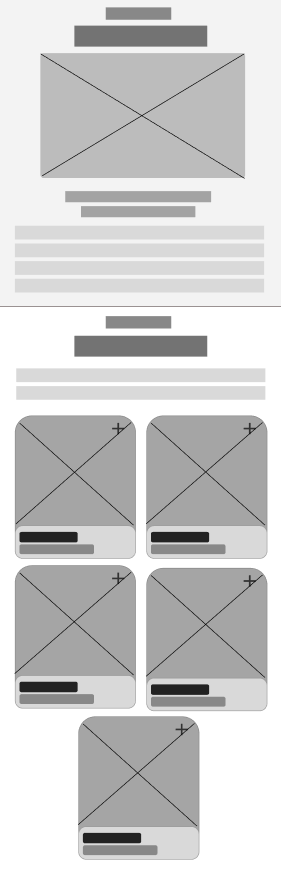

**Solutions**

En la vista móvil (**Mobile Web Browser**) de las secciones comerciales y funcionales, el contenido se adapta a una columna única vertical: en la parte superior, la sección **¿A quién ayudamos?** apila secuencialmente las tres tarjetas de autoselección por rol (*Agricultores independientes*, *Líderes de cooperativas* y *Asesores técnicos*), situando en cada una su icono, titular, descripción de enfoque, vista previa gráfica y el botón de acción (*CTA*) con ancho completo al pie para facilitar el toque con una sola mano; a continuación, la sección **Soluciones y Características** transforma la grilla de escritorio en un apilamiento lineal de cuatro tarjetas de funcionalidades (monitoreo satelital NDVI, costos por lote, certificación de calidad y prescripciones agronómicas), cada una con su barra decorativa superior, icono de módulo, título, párrafo descriptivo y una tarjeta inferior de impacto cuantificable orientada al valor en campo.

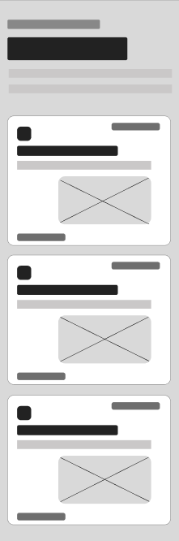
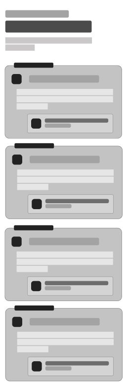

**Video and Plans**

En la vista móvil (**Mobile Web Browser**) de los bloques de demostración y monetización, la interfaz se compacta en una sola columna vertical: en la parte superior, la sección **Conoce SumaqAgro en acción** (*About-the-Product*) enmarca el contenedor del reproductor de video demostrativo centrado sobre un bloque de fondo verde oscuro (#233413) que incluye el botón de reproducción (*Play*) para evidenciar el funcionamiento en campo; inmediatamente después, la sección **Planes** (*Pricing*) sitúa el encabezado de sección, el texto descriptivo y un conmutador de facturación mensual/anual (*switch toggle*), dando paso al apilamiento secuencial de las tres tarjetas de suscripción (*Plan Semilla*, *Plan Cooperativa Pro* y *Plan Asesor Técnico*), donde cada una presenta su nombre de plan, tarifa destacada en Soles, resumen de características y su botón de llamado a la acción (*CTA*) en ancho completo al pie para una pulsación táctil accesible con una sola mano.

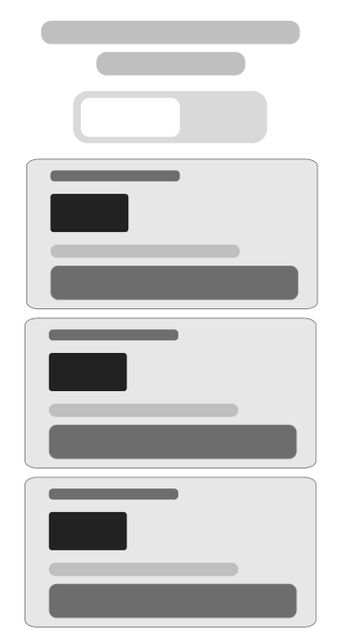

**Impact, Testimonials and Footer**

En la vista móvil (**Mobile Web Browser**) del cierre de la página, los componentes se reorganizan en una secuencia vertical de cuatro bloques lineales: en la parte superior, la sección **Impacto** apila las tres tarjetas de métricas agrarias (*333k+ Has. de papa*, *223k+ Familias cafeteras* y *>40% Sin cobertura técnica*); inmediatamente después, el bloque de testimonios (*«Lo que dicen nuestros usuarios»*) presenta de forma vertical las dos tarjetas de validación social con el avatar, nombre, rol y cita de cada usuario; a continuación, el banner final de conversión (*Bottom CTA*) condensa el titular, el texto de apoyo y el botón de acción *«Registrarse gratis»* adaptado a pantalla completa para facilitar la pulsación táctil con una sola mano; finalmente, el pie de página (*Footer*) sobre fondo oscuro (#031416) apila el isotipo de la marca, la descripción institucional y una botonera de enlaces sociales, rematando con tres columnas colapsadas verticalmente (*Products*, *Quick Links* y *Support*) que distribuyen el acceso a los recursos y enlaces ético-legales del sistema.

### 4.3.2. Landing Page Mock-up
El mock-up de la página de aterrizaje de Dymbia plasma la apariencia visual definitiva, integrando la paleta cromática, los estilos tipográficos, el material gráfico y la iconografía finales. De este modo, traslada de forma coherente la identidad visual de SumaqAgro a lo largo de cada uno de los bloques y componentes del sitio.

**Hero — SumaqAgro**

Presenta una barra de navegación con el logotipo de la marca, enlaces de sección y botones de acceso junto al selector de idioma. De fondo incorpora una fotografía panorámica de campos agrícolas en hileras bajo un cielo con degradado oscuro. El contenido central destaca el titular "Farm with Insight / Decide with Precision" en blanco y verde, un subtítulo sobre el monitoreo satelital de cultivos y costos, y dos botones de acción: el principal "Explore →" y el secundario "How it works?".

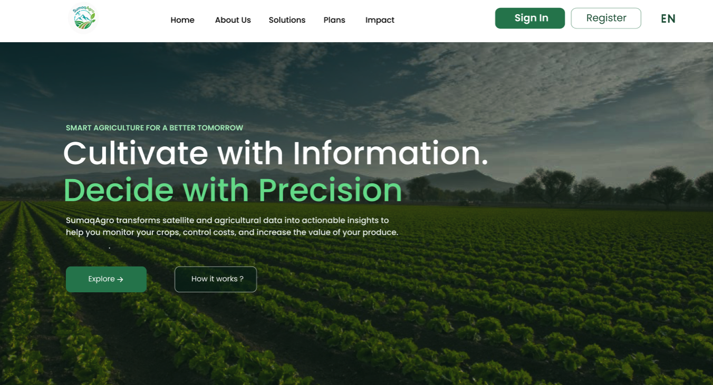

**About Us — SumaqAgro**

Presenta un diseño limpio sobre fondo blanco dividido en dos columnas. A la izquierda, incluye el antetítulo en verde "ABOUT SUMAQAGRO", el encabezado principal "About Us?" y el subtítulo "Democratizing precision agriculture in Peru", acompañados por un párrafo explicativo sobre el uso de imágenes satelitales libres para cerrar la brecha tecnológica en cultivos de papa y café sin sensores costosos. A la derecha, destaca una imagen de un campo con sistema de riego tecnificado y una mano sosteniendo un smartphone que visualiza las métricas y gráficos agronómicos de la plataforma.

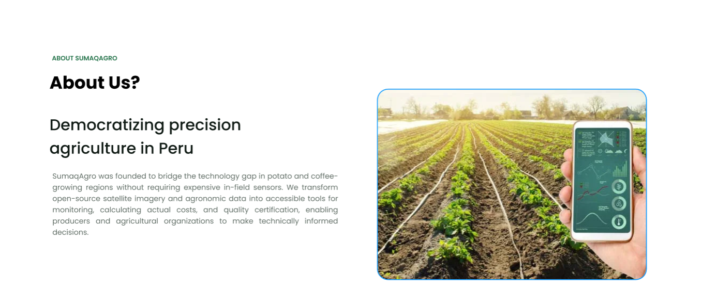

**Who do we help? — SumaqAgro**

Presenta el antetítulo en verde "OUR COMMUNITY", el encabezado principal "Who do we help?" y el mensaje de valor "We work with those who make the country's food security possible". En la zona inferior dispone tres tarjetas blancas con esquinas redondeadas orientadas a cada segmento clave: agricultores independientes, directivos de cooperativas y asesores técnicos. Cada tarjeta integra un ícono representativo, un resumen de enfoque, una fotografía de campo alusiva y el enlace de acción "Join as an advisor →".

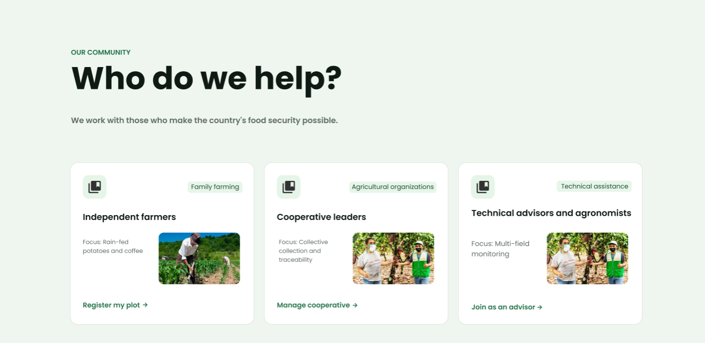

**Solutions and Features — SumaqAgro**

Presenta el encabezado "Solutions and Features" acompañado del lema de valor para la toma de decisiones en campo. En una cuadrícula de cuatro tarjetas blancas con acentos verdes, detalla sus módulos clave: monitoreo satelital de vigor y humedad, costeo por lote, certificación digital de cosecha y alertas agronómicas, destacando en cada una sus métricas de impacto operativo y económico.

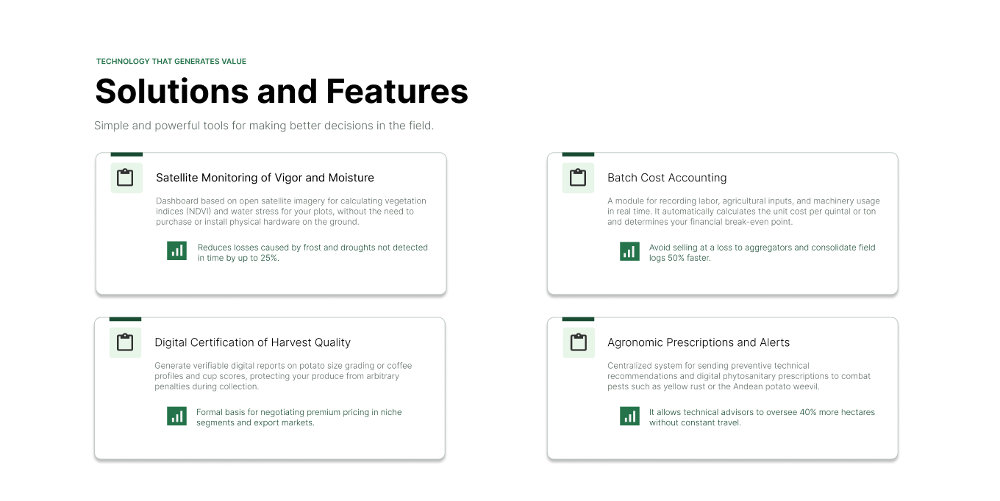

**Product Demo — SumaqAgro**

Presenta un fondo verde corporativo que enmarca el antetítulo "PRODUCT DEMO", el encabezado central "See SumaqAgro in action" y el subtítulo "Demo video". En la zona inferior destaca un reproductor de video de esquinas redondeadas sobre fondo gris claro con un botón central de reproducción (play) en verde brillante para visualizar la demostración interactiva de la plataforma.

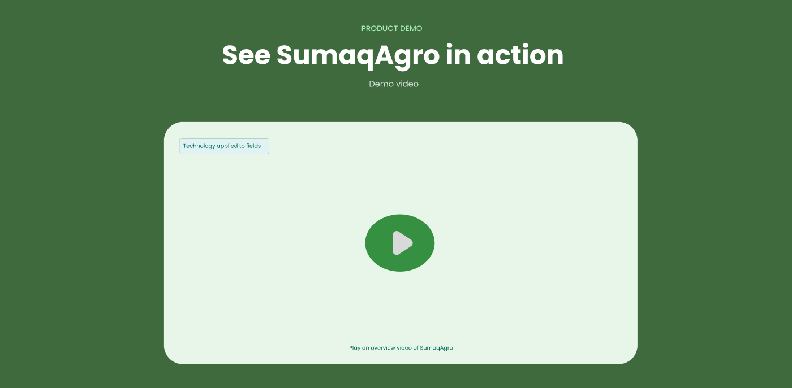

**Plans — SumaqAgro**

Presenta el titular "Choose the plan that fits your needs" sobre el antetítulo "PLANS" y un conmutador de facturación mensual o anual con descuento. En la zona inferior dispone tres tarjetas de suscripción adaptadas a cada perfil: Seed Plan (gratuito, para 1 parcela con NDVI básico y registro de labores), Pro Cooperative (S/189/mes, destacado como el más popular para 50 productores con certificación y exportación de reportes) y Technical Advisor Plan (S/89/mes, para 20 fincas supervisadas con NDVI avanzado y recomendaciones), cada una con su respectivo botón de acción directo.

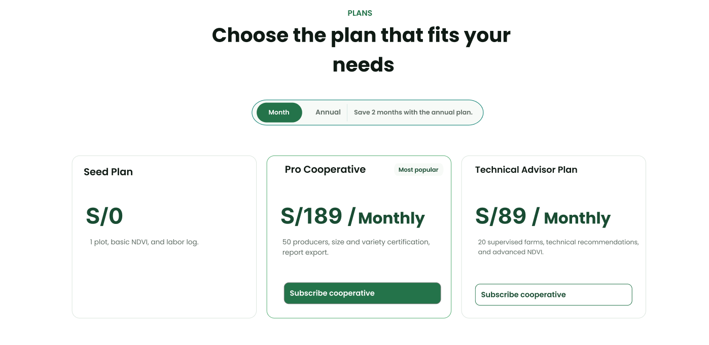

**Impact — SumaqAgro**

Presenta el antetítulo en verde "REAL RESULTS", el título principal "Impact" y una breve descripción sobre las métricas que respaldan el compromiso de la plataforma con la pequeña agricultura. A la derecha, distribuye tres tarjetas métricas blancas con íconos de usuario y barras de acento en verde: más de 333 mil hectáreas de papa, más de 223 mil familias cafetaleras y más del 40 % de reducción en la falta de cobertura técnica.

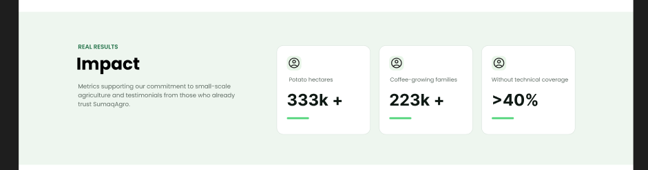

**Testimonials — SumaqAgro**

Presenta el bloque "What our users say?" con dos tarjetas de testimonios de cinco estrellas correspondientes a productores de papa y café. Cada testimonio incorpora la experiencia y valoración de los usuarios sobre el uso de SumaqAgro para mejorar la gestión y el monitoreo de sus cultivos.

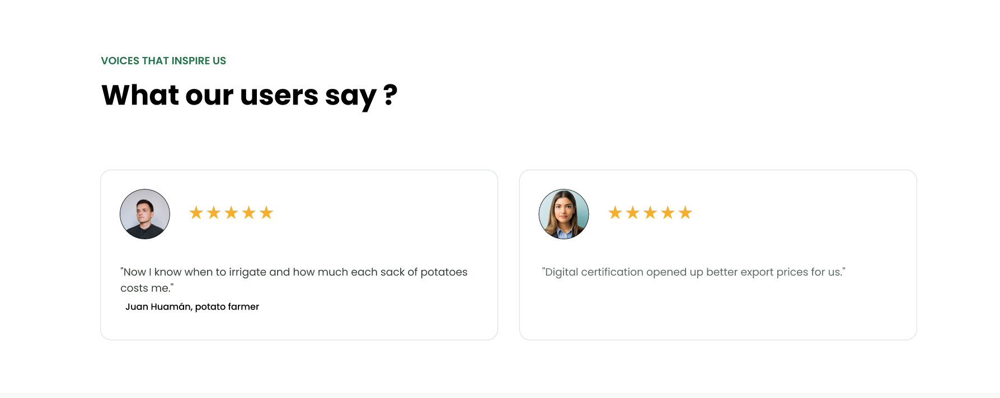

**Our Team — SumaqAgro**

Presenta un encabezado con el antetítulo en verde "THE PEOPLE BEHIND THE TECHNOLOGY", el título principal "Our Team" y una breve descripción sobre el compromiso de los integrantes con la agricultura de precisión en el Perú. En la parte inferior se organiza una cuadrícula horizontal de tarjetas con bordes redondeados sobre fondo blanco, mostrando las fotografías formales y los nombres completos de los cinco miembros del equipo de desarrollo: Benjamin Solorzano Sullca, Jose Carlos Vargas Enriquez, Drago Derick Duarte Ruffner, Yamil Jared Tejada Pumacayo y Miguel Sanca Condori.

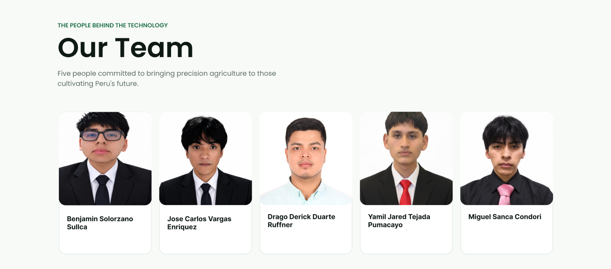

**Video About the Team — SumaqAgro**

Presenta un encabezado con el antetítulo en verde "Video About the Team", el título principal "Video About the Team" y una breve descripción sobre la presentación de los integrantes, sus roles y las responsabilidades asumidas durante el desarrollo de SumaqAgro. En la parte inferior se muestra un área de reproducción con bordes redondeados y un botón central para iniciar el video de presentación del equipo.

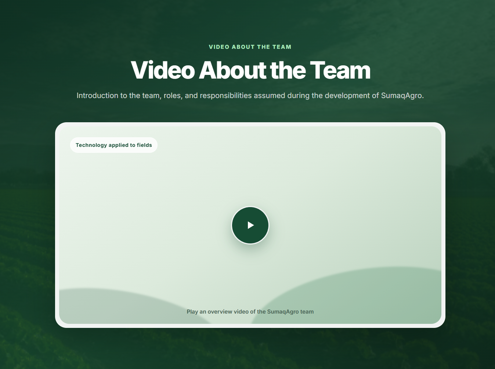

**Registration — SumaqAgro**

Presenta una franja de color verde corporativo orientada a incentivar el registro de nuevos usuarios. El bloque incorpora un mensaje de invitación y el botón principal "Sign up for free", facilitando el acceso directo a la plataforma desde la página de aterrizaje.

**Footer — SumaqAgro**

Presenta un pie de página sobre fondo oscuro que agrupa el logotipo de SumaqAgro, enlaces a redes sociales y diferentes columnas de navegación organizadas en las categorías "Products", "Quick Links" y "Support". Finalmente, incorpora los enlaces correspondientes a las políticas legales de privacidad y términos de servicio.

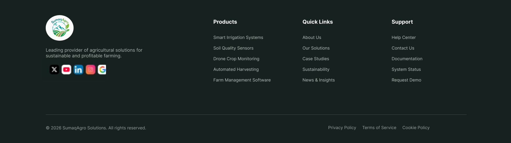

## 4.4. Web Applications UX/UI Design

Esta sección presenta y sustenta la arquitectura de interacción y el diseño visual de la plataforma SaaS de SumaqAgro, desarrollada por la startup Dymbia.
### 4.4.1. Web Applications Wireframes

#### Desktop Web Browser

**Aplicación de Principios de Diseño y Arquitectura de Información:** Para la conceptualización de este Wireframe (*Desktop Web Browser*), nos centramos en una Arquitectura de Información basada en el patrón de escaneo en "F" (*F-Pattern*), disponiendo la barra lateral (*Sidebar*) a la izquierda para organizar jerárquicamente los módulos de operación agrícola y configuración del sistema sin perder el contexto de navegación, mientras que la cabecera superior centraliza la búsqueda rápida y los indicadores de estado global (conectividad, notificaciones y perfil). Aplicamos el principio de Región Común y Proximidad de la Gestalt agrupando los datos clave en tres tarjetas de indicadores (*KPI Cards*) de alto nivel para supervisar la salud foliar, el gasto acumulado y el punto de equilibrio financiero, conectándolos directamente con las representaciones analíticas inferiores (gráfico de evolución vegetal NDVI y distribución circular de costos). A nivel de diseño inclusivo y accesibilidad (*a11y*), garantizamos áreas táctiles mínimas de 48 px en los botones de acción rápida (*View Satellite Map*, *View My Expenses* y el CTA primario *View All My Lots*), reforzando una jerarquía visual clara mediante contenedores bien delimitados y contraste tipográfico que agilizan la lectura y toma de decisiones del productor en campo.

A continuación, se presentan los wireframes principales de la aplicación web correspondientes:

**My Plot**: en la vista inicial (*Dashboard*), la interfaz organiza la supervisión del cultivo mediante una fila de tres tarjetas métricas (*KPI Cards*) de alto nivel que sintetizan la salud foliar (NDVI), la inversión acumulada y el punto de equilibrio financiero, complementadas en la sección inferior por un gráfico de barras para la evolución temporal del vigor vegetal y un gráfico circular (*Donut Chart*) para el desglose porcentual de costos operativos. Seguidamente, el flujo de interacción transiciona hacia la vista de gestión de parcelas al interactuar con el llamado a la acción superior, donde el usuario accede a una retícula de administración con los cupos disponibles de su plan, permitiéndole supervisar el estado de sus lotes activos o incorporar un nuevo predio agrícola mediante un formulario asistido de georreferenciación y delimitación cartográfica por coordenadas GPS.
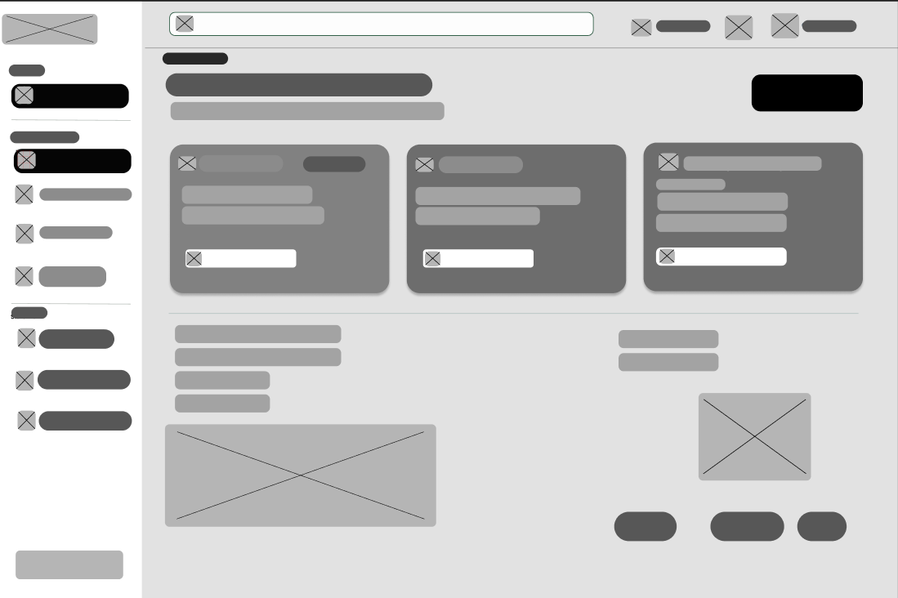
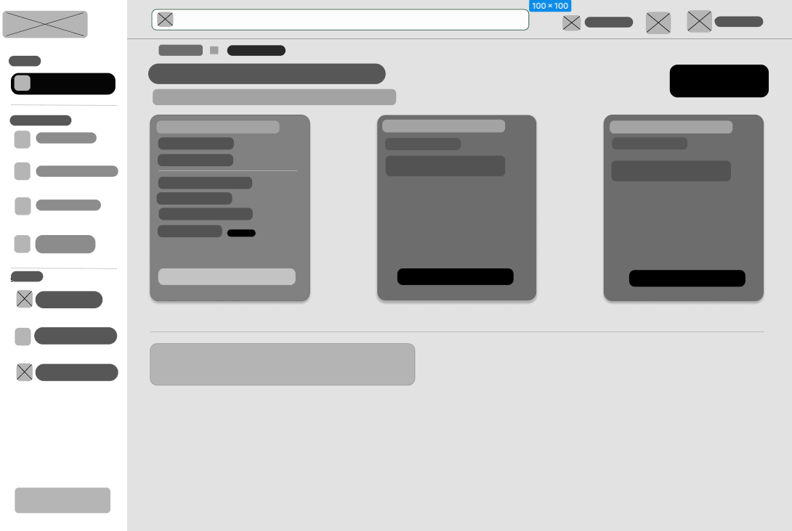
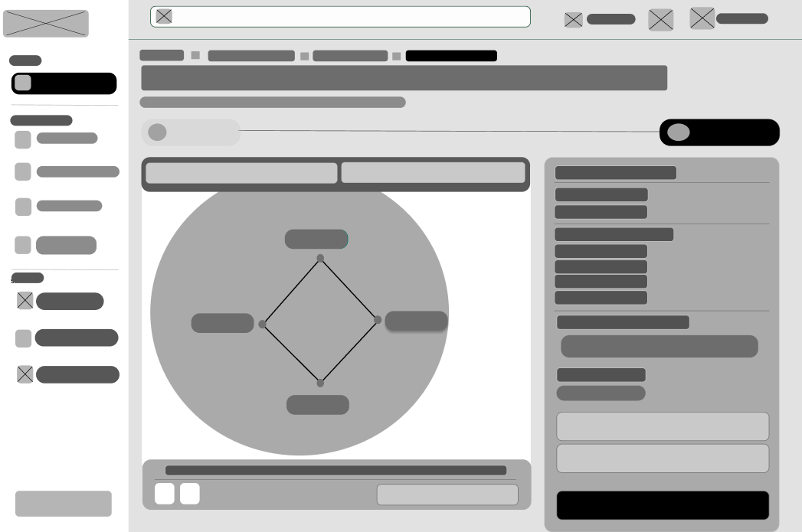
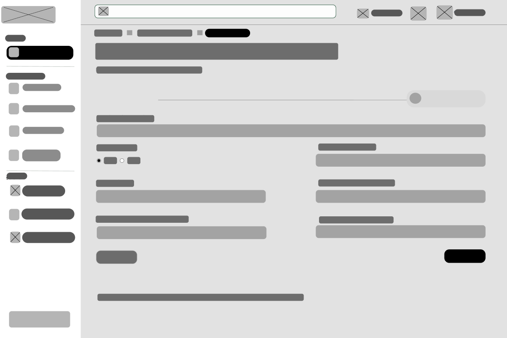

**Crop Health:** Esta vista centraliza la inspección agronómica y espacial del predio mediante un visor cartográfico interactivo que proyecta el polígono georreferenciado del lote junto con capas multiespectrales (NDVI para vigor vegetal y NDWI para humedad de suelo), complementado por un panel lateral de diagnóstico técnico preliminar y recomendaciones de manejo en campo; asimismo, la interfaz integra en su cabecera un selector conmutador de predios (*«Cambiar Parcela»*) que permite alternar fluidamente entre los diferentes terrenos registrados del productor sin perder el contexto operativo ni reiniciar los filtros de supervisión.

**My Expenses and Earnings:** Este módulo organiza la gestión financiera del predio mediante una fila superior de tres tarjetas métricas (*KPI Cards*) que sintetizan el gasto total acumulado, el volumen proyectado de cosecha y el precio de equilibrio calculado para evitar pérdidas comerciales, complementadas en la sección inferior por una tabla detallada de desembolsos con opciones de filtrado cronológico y por categoría (insumos, jornales y flete); asimismo, incorpora en su cabecera el botón de acción primario *«Anotar Nuevo Gasto»*, el cual despliega el formulario de registro ágil de costos diarios para asegurar que ningún egreso operativo quede fuera de la contabilidad de la campaña.
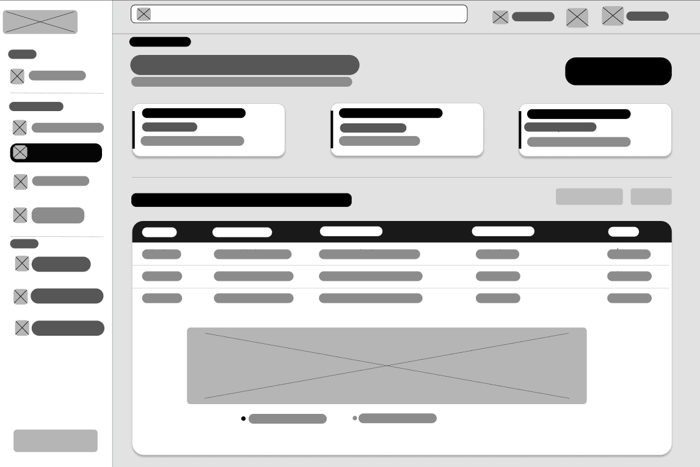

**Consult the Advisor:** La plataforma complementa la operación agrícola mediante la sección **Phytosanitary Assistance and Prescriptions**, la cual exhibe la prescripción técnica activa del agrónomo con su dosificación exacta y el historial cronológico de consultas, permitiendo reportar nuevas incidencias fitosanitarias mediante carga fotográfica; de manera complementaria, el módulo **My Harvest Certificates** organiza los expedientes de acreditación comercial del lote, reflejando el nombre del cultivo, el desglose de calibres de cosecha, el sello digital de respaldo cooperativo y el código QR de trazabilidad pública para respaldar el valor del producto ante intermediarios y compradores.
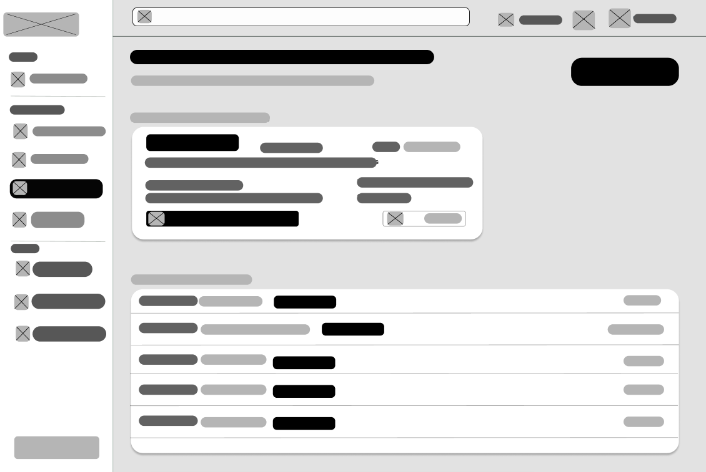
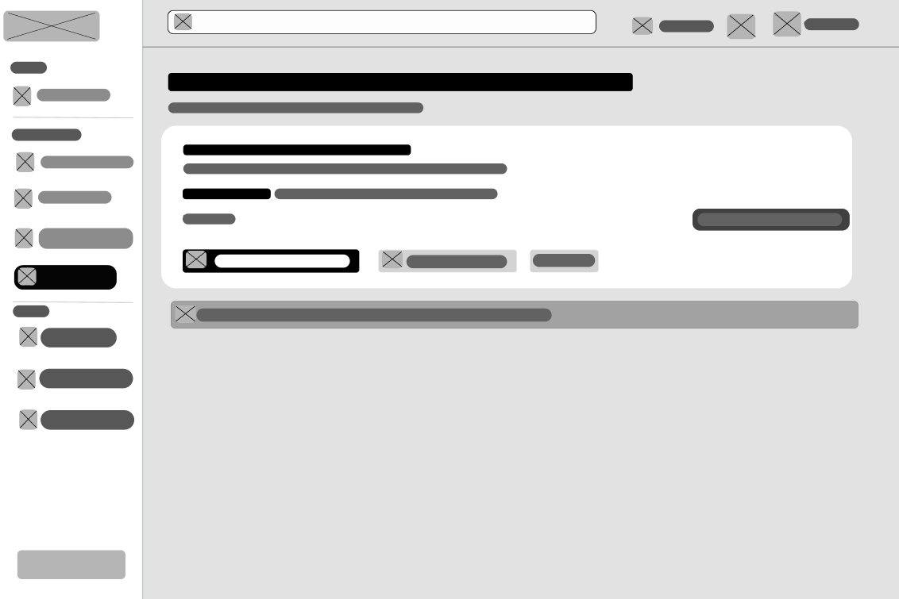

**Agricultural Alerts:** Este módulo centraliza la vigilancia agroclimática y sanitaria de las parcelas del productor (US-13, US-31), estructurándose a través de una secuencia de tarjetas informativas que detallan el incidente detectado (tales como caídas críticas de vigor foliar, estrés hídrico o riesgos de helada); cada reporte integra un panel de medidas técnicas detalladas, la cronología temporal de tareas requeridas para mitigar la anomalía y un indicador de plan de acción finalizado con confirmación de cumplimiento en campo, permitiendo auditar y cerrar el ciclo de contingencia del cultivo de manera ordenada y oportuna.
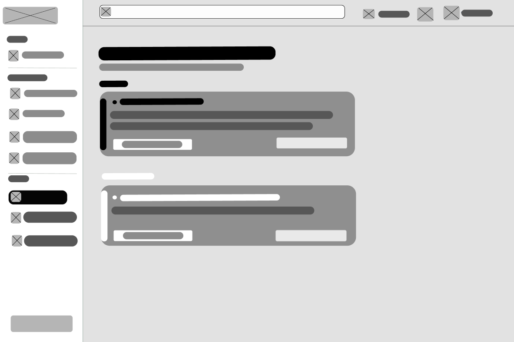
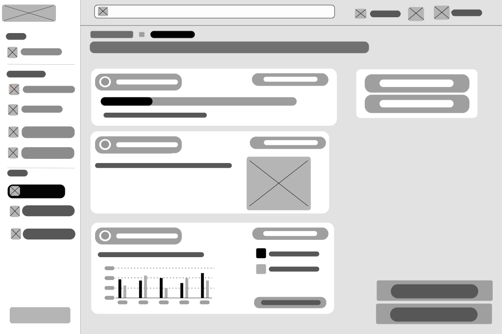
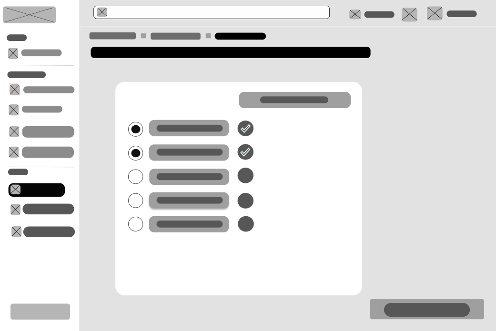
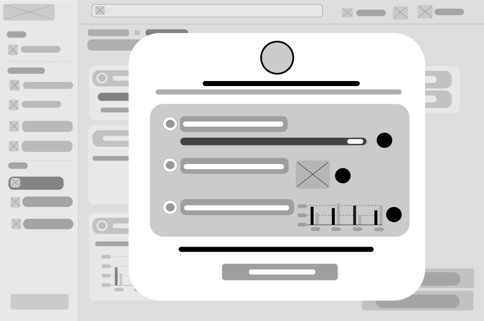

- **Settings and Help:** Esta vista técnica expone los parámetros operativos y de soporte del productor a través de un contenedor modal organizado en pestañas contextuales (*Tabs*), permitiendo la actualización de datos agronómicos del predio (nombre de la parcela, tipo de cultivo y área declarada), la gestión de información de contacto (teléfono y credenciales de acceso) y el acceso a manuales interactivos de usuario con línea directa de asistencia técnica; asimismo, el módulo integra la funcionalidad de **Offline Mode**, respaldada por la historia técnica TS-05, la cual permite al agricultor alternar conscientemente hacia un modo de trabajo en almacenamiento local para registrar labores e insumos en sectores profundos de la chacra donde la señal celular desaparece por completo, garantizando que los datos queden retenidos en la memoria del navegador y se sincronicen de manera diferida y automática una vez recuperada la cobertura de red.
  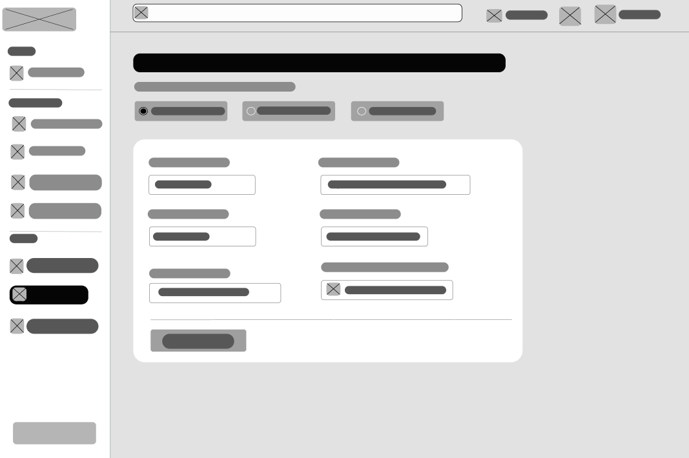
  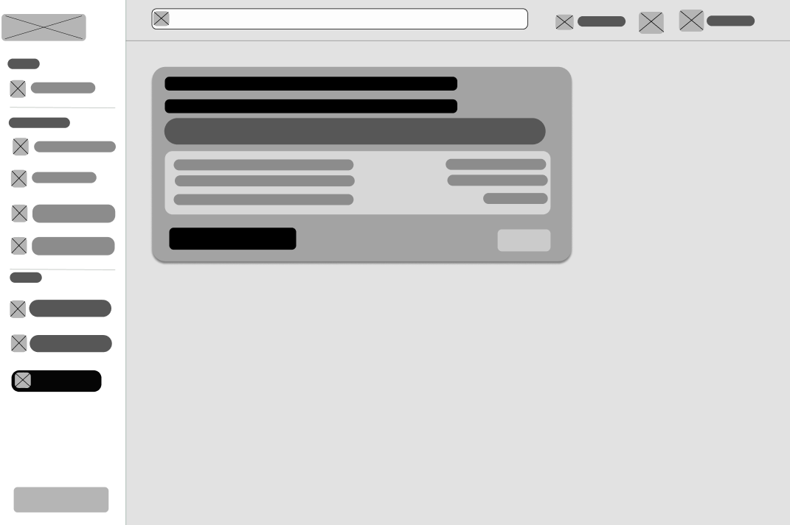

#### Mobile Web Browser

**Aplicación de Principios de Diseño y Arquitectura de Información:** Los wireframes móviles adaptan los módulos de la aplicación de escritorio a una sola columna de 360 × 800 px, pensada para el uso con una mano en campo. El menú lateral se reemplaza por una barra de navegación inferior de cinco destinos, las tablas se convierten en listas y tarjetas, y los indicadores más importantes se ubican en el primer tercio de la pantalla. Los wireframes W-01 a W-07 cubren los flujos del productor.

##### W-01: Dashboard Principal ("Mi Parcela")
Vista central de mando con lectura rápida de los indicadores operativos de la campaña en curso (vigor vegetal, inversión acumulada y punto de equilibrio comercial).

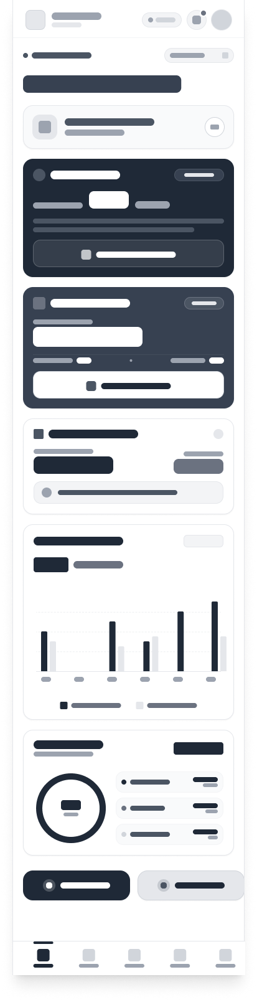

##### W-02: Monitoreo Satelital y Visor Multiespectral
Visualizador georreferenciado que exhibe la reflectancia del predio mediante los índices multiespectrales NDVI y NDWI, permitiendo evaluar anomalías de vegetación y emitir solicitudes de asistencia fitosanitaria.

##### W-03: Resumen Financiero y Punto de Equilibrio de Campaña
Consolidado contable que clasifica los egresos en insumos, mano de obra y transporte, deduciendo el costo unitario de producción para respaldar negociaciones comerciales justas.

##### W-04: Centro de Alertas Agroclimáticas y Sanitarias
Bandeja cronológica y categorizada que despacha advertencias tempranas ante caídas súbitas en el verdor foliar, estrés por sequía o pronósticos meteorológicos adversos (heladas).

##### W-05: Bitácora de Registro Operativo en Campo
Formulario optimizado para el asiento ágil de jornales, compra de fertilizantes o fletes rurales sin requerir conexión continua a internet, almacenando la información localmente.

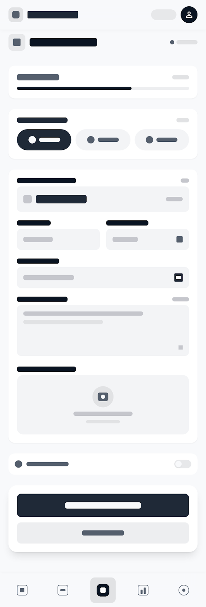

##### W-06: Acreditación de Calidad y Código QR de Trazabilidad
Ficha técnica del lote cosechado que centraliza las evaluaciones de calidad física/sensorial y genera un código QR criptográfico para validación inmediata por parte de compradores y acopiadores.

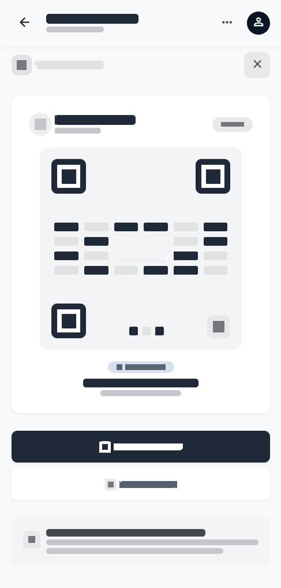

##### W-07: Autenticación, Registro y Onboarding de Usuario
Flujo de acceso e identificación institucional que permite a agricultores y asesores ingresar mediante credenciales seguras, seleccionando su rol y cooperativa de adscripción.

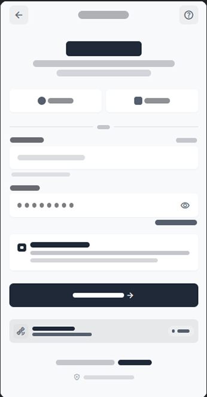

#### Sustento de Principios y Elementos de Diseño

* **Jerarquía Visual y Patrón de Escaneo Vertical:** Dado el factor de forma compacto de las pantallas móviles, se organizó la información bajo un patrón de lectura vertical estricto. Los indicadores de mayor impacto para la toma de decisiones inmediatas (estado NDVI, costos acumulados y nivel de alerta) ocupan tarjetas prominentes en el tercio superior de la pantalla, relegando las series temporales y desgloses detallados hacia la zona de desplazamiento (*scroll*).
* **Leyes de Proximidad y Región Común (Gestalt):** La interfaz utiliza contenedores modulares (*cards*) con bordes y espaciados homogéneos para vincular datos dependientes entre sí (por ejemplo, en el módulo financiero se asocia en una misma tarjeta el costo total invertido junto a los porcentajes de insumos y mano de obra).
* **Convenciones Móviles y Zona Ergonómica del Pulgar (*Thumb Zone*):** Se sustituyó el menú lateral de escritorio (*sidebar*) por una barra de navegación inferior (*Bottom Navigation Bar*) permanente de 5 accesos directos principales. Asimismo, en la vista contable se adoptó un botón flotante de acción destacada (*Floating Action Button - FAB*) situado en la esquina inferior derecha para agilizar el registro recurrente de gastos.
* **Contraste Tipográfico y Claridad Estructural:** A pesar de mantenerse en una escala de grises estricta para baja fidelidad, se establecieron diferencias marcadas de peso tipográfico (*Bold* para métricas cuantitativas e importes en soles, y *Regular* para etiquetas y leyendas descriptivas), garantizando un escaneo ágil bajo luz solar.

#### Aplicación de Principios de Diseño Inclusivo y Accesibilidad

* **Dimensionamiento de Áreas Táctiles (*Touch Targets*):** Conforme a las recomendaciones internacionales de accesibilidad móvil (WCAG / a11y), los botones de confirmación, campos de formulario y controles de navegación cuentan con dimensiones mínimas de 48 × 48 dp/px, evitando pulsaciones accidentales por parte de agricultores que operan el dispositivo con guantes o dedos fatigados por faenas de campo.
* **Reducción de la Sobrecarga Cognitiva:** Se eliminaron las tablas extensas de escritorio, reemplazándolas por listas condensadas y estados cualitativos claros ("Óptimo", "Bajo Control", "Alerta") que acompañan a las cifras científicas (como el valor numérico de NDVI), facilitando la interpretación técnica a productores de baja escolaridad.
* **Soporte de Arquitectura *Offline-First*:** Las pantallas de cabecera incorporan un indicador persistente de conectividad (*Connected / Offline Mode*). Esto brinda retroalimentación clara de que las anotaciones de jornales e insumos en la chacra se almacenan de forma local en la memoria del dispositivo y se transmitirán sin pérdida al recobrar cobertura celular.
* **Simplificación en la Entrada de Datos:** Los formularios de campo priorizan campos numéricos automáticos, menús desplegables preestablecidos y captura fotográfica de recibos, disminuyendo al mínimo la necesidad de redactar textos extensos sobre el teclado virtual.

#### Alineación con la Arquitectura de Información

* **Sistemas de Organización (*Organization Systems*):** La aplicación implementa una estructura organizativa jerárquica y funcional orientada a tareas de campo. La pantalla raíz expone el balance general de la campaña agrícola, desde la cual se puede profundizar hacia subniveles analíticos (visor espectral, historial de transacciones o catálogo de alertas).
* **Sistemas de Navegación (*Navigation Systems*):** Se articula una navegación global fija soportada en la *Bottom Navigation Bar* para conmutar entre los módulos principales (Inicio, Monitoreo, Finanzas, Alertas, Perfil), complementada con navegación jerárquica (flechas de retroceso en la barra superior *AppBar*) para regresar de formularios o vistas de detalle sin perder el estado previo.
* **Sistemas de Rotulado (*Labeling Systems*):** Las etiquetas adoptadas derivan del Glosario de Lenguaje Ubicuo formalizado para el proyecto ("Mi Parcela", "Salud Foliar", "Insumos", "Jornales", "Punto de Equilibrio", "Certificado QR"), empleando terminología precisa y familiar para la comunidad agrícola.
* **Sistemas de Búsqueda y Filtrado (*Searching Systems*):** Se integraron barras de búsqueda con autocompletado y selectores rápidos horizontales (*chips*) que permiten segmentar notificaciones y lotes históricos por fecha, nivel de riesgo o campaña fenológica activa.

### 4.4.2. Web Applications Wireflow Diagrams

Un **wireflow** o flujo de pantallas es una representación visual que conecta distintos wireframes para mostrar el recorrido que sigue el usuario dentro de una aplicación hasta alcanzar un objetivo específico. Su propósito es explicar cómo se relacionan las diferentes pantallas y qué acciones debe realizar el usuario durante el proceso.

Para construir un wireflow, primero se identifica el objetivo que el usuario desea lograr. Después, se establece la secuencia de tareas necesarias para completar dicho objetivo dentro de la aplicación. Finalmente, estas tareas se representan mediante las pantallas correspondientes y se conectan a través de las acciones disponibles en botones, enlaces u otros elementos interactivos del wireframe.

**Wireflow 1: Georreferenciación y delimitación cartográfica de parcela**
* User Persona: Guillermo Cortés (Segmento 1: Pequeño agricultor independiente)
* User Goal 1: Registrar y delimitar los vértices geográficos de un nuevo predio agrícola mediante coordenadas GPS/mapa interactivo para habilitar el cálculo de superficie y la sincronización de analítica satelital.

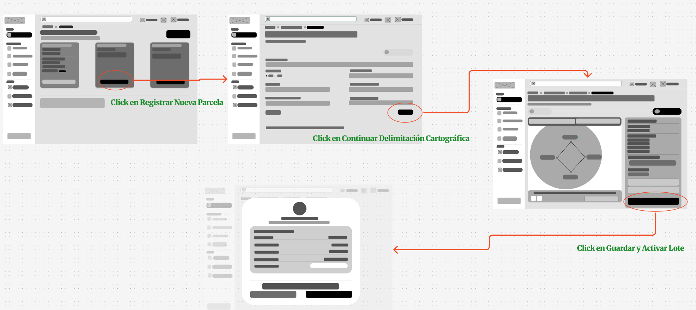

El flujo comienza en el módulo Registro de Parcelas, donde el agricultor presiona el botón «Registrar Parcela» para acceder al formulario de datos agronómicos e ingresar el nombre, cultivo y fecha de siembra. A continuación, el usuario pasa a la etapa de delimitación y traza los vértices del predio sobre un mapa cartográfico interactivo, permitiendo validar la geometría y calcular la superficie del terreno. Finalmente, tras confirmar la operación, el sistema guarda la información, despliega una notificación de éxito y redirige al listado general de parcelas actualizado.

**Wireflow 2: Registro de egresos operacionales y cálculo de punto de equilibrio**
* User Persona: Guillermo Cortés (Segmento 1: Pequeño agricultor independiente)
* User Goal 2: Anotar los desembolsos de la campaña (compra de fertilizantes/insumos, pago de peones/jornales o flete) para actualizar automáticamente el costo total acumulado y consultar el precio de venta mínimo sugerido por saco/kilo para negociar en el mercado.

El flujo inicia en el panel financiero, donde el agricultor revisa su resumen de gastos y presiona la opción para registrar un nuevo egreso. A continuación, completa un formulario con la categoría, parcela, concepto y monto correspondiente; en caso de no contar con internet en el campo, la información se guarda localmente para sincronizarse después, y si olvida ingresar datos obligatorios, el sistema le solicitará corregirlos. Finalmente, al guardar la información, el gasto se añade al historial y los indicadores clave del panel principal se actualizan de forma automática, permitiendo al usuario visualizar el impacto inmediato en sus finanzas.

**Wireflow 3: Recepción e inspección de alertas agrícolas (Clima y Riesgo Sanitario)**
* User Persona: Guillermo Cortés (Segmento 1: Pequeño agricultor independiente)
* User Goal 3: Consultar la seccion avisos climáticos (heladas/sequías) para tomar medidas preventivas antes de sufrir pérdidas en la cosecha.

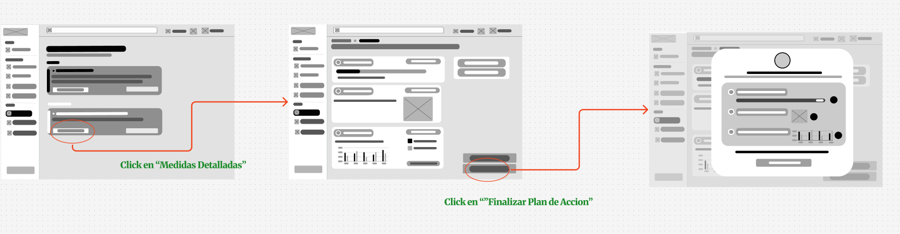

El flujo inicia en el módulo Alertas Agrícolas, donde el usuario revisa los avisos emitidos y accede a la sección de Medidas Detalladas. En este apartado, encuentra toda la información técnica necesaria para tomar acciones inmediatas ante la problemática detectada. Una vez completadas las recomendaciones, el usuario presiona el botón «Finalizar Plan de Acción», lo que despliega una ventana modal con el resumen general de las actividades realizadas y la opción para retornar a la bandeja principal de alertas.

**Wireflow 1: Consulta y auditoría del padrón consolidado de socios**
* User Persona: Cristian Santana (Segmento 2: Gerente de Operaciones de Cooperativa Agraria).
* User Goal 1: Explorar, filtrar y auditar la lista general de productores afiliados y sus predios registrados para supervisar el alcance territorial de la organización y planificar las metas de acopio de la campaña.

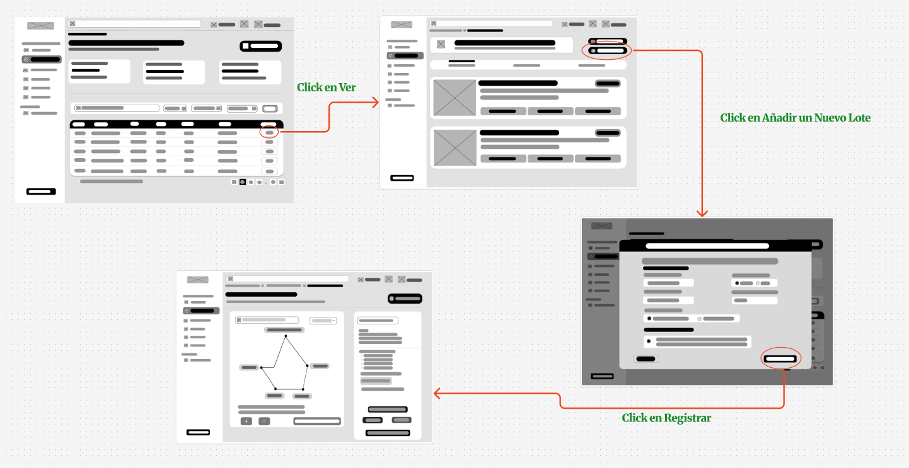

El flujo inicia en la sección Padrón de Socios, donde se muestra una tabla con los socios registrados. Al presionar el botón “Ver” de un socio, se accede a su expediente, donde se pueden visualizar las parcelas que tiene asignadas actualmente. Posteriormente, al seleccionar el botón “Añadir lote del socio”, se despliega un formulario para ingresar los datos del nuevo lote. Una vez completada la información, al presionar “Registrar”, el usuario avanza a la siguiente etapa, donde podrá delimitar gráficamente el lote mediante la creación de polígonos sobre la parcela.

**Wireflow 2: Registro e incorporación de un nuevo socio al padrón digital**
* User Persona: Cristian Santana (Segmento 2: Gerente de Operaciones de Cooperativa Agraria).
* User Goal 2: Registrar los datos personales y de contacto de un nuevo productor para otorgarle alta oficial en el padrón de la cooperativa y habilitar la posterior vinculación de sus terrenos.

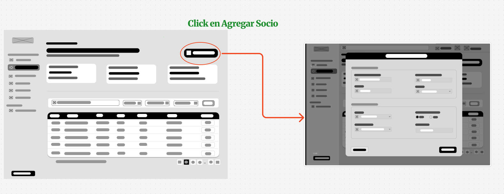

El flujo inicia en la sección Padrón de Socios, donde se muestra una tabla con todos los socios registrados. Al seleccionar el botón “Asignar o agregar socio”, se despliega un formulario que permite ingresar y completar los datos correspondientes al nuevo socio para su posterior registro en el sistema.

**Wireflow 3: Auditoría de la matriz consolidada de costos por hectárea y balance de campaña**
* User Persona: Cristian Santana (Segmento 2: Gerente de Operaciones de Cooperativa Agraria).
* User Goal 3: Analizar la matriz comparativa de egresos operacionales de todos los socios afiliados para identificar desviaciones financieras en insumos/jornales y exportar el balance contable consolidado para la asamblea general.

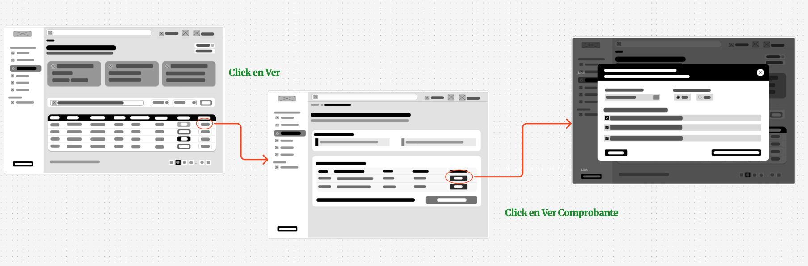

El flujo inicia en la sección Costos, donde se muestra una tabla con los datos registrados. Al seleccionar la opción “Auditar usuario”, se accede a una vista que presenta el listado completo de los últimos asientos contables reportados. Posteriormente, al presionar el botón “Ver” en la columna “Comprobante” del registro correspondiente, se despliega una ventana modal que permite revisar y configurar la información necesaria para gestionar correctamente el balance financiero.

**Wireflow 4: Monitoreo de salud foliar y despacho de alerta agroclimática en SMS**
* User Persona: Cristian Santana (Segmento 2: Gerente de Operaciones de Cooperativa Agraria).
* User Goal 4: Supervisar la salud vegetativa de los predios afiliados mediante mapas satelitales y despachar avisos preventivos por SMS a los socios para mitigar pérdidas por sequías o plagas.

El flujo inicia en la sección Salud de Parcelas, donde se muestra un mapa con las parcelas y sus respectivos estados. Al seleccionar una parcela marcada en rojo, se despliega su información, incluyendo los datos del socio y el estado actual de su terreno. Posteriormente, al presionar el botón “Despachar Alerta SMS a Socio”, se abre una ventana donde se muestra el mensaje que será enviado al socio. Finalmente, al seleccionar “Enviar Alerta SMS Ahora”, se envía la notificación y se muestra un mensaje de confirmación, indicando que la alerta fue enviada correctamente.

**Wireflow 1: Emisión y transmisión de boletín fitosanitario regional**
* User Persona: Juan Antonio Morales (Segmento 3: Asesor Agrónomo y Técnico de Campo).
* User Goal 1: Redactar y despachar masivamente un boletín fitosanitario de alerta regional a todos los productores de un valle o cuenca para prevenir la propagación de plagas epidémicas.

El flujo inicia en el panel principal del tercer segmento, donde el usuario selecciona la opción “Nuevo Boletín Informativo”. Al ingresar, se despliega una ventana con un formulario en el que deberá completar la información solicitada. Finalmente, una vez ingresados todos los datos, el usuario presiona el botón “Registrar” para guardar la información.

**Wireflow 2: Agendamiento y confirmación de visitas de inspección en campo**
* User Persona: Juan Antonio Morales (Segmento 3: Asesor Agrónomo y Técnico de Campo).
* User Goal 2: Programar salidas de inspección técnica presencial en un calendario interactivo para estructurar las rutas de viaje entre fundos rurales y notificar automáticamente al agricultor la fecha y hora de la visita.

El flujo inicia en la sección **Agendamiento de Visitas de Campo**, donde el asesor puede visualizar sus visitas programadas y seleccionar la opción para agregar una nueva. Al hacerlo, se abre un formulario donde deberá completar los datos del productor, la parcela, el motivo de la visita, la fecha, el horario y la ubicación. Finalmente, al confirmar el registro, se envía una notificación por SMS al agricultor y la nueva visita aparece en la lista de visitas programadas.

### 4.4.3. Web Applications Mock-ups

En esta sección se presentan los mockups de la aplicación web de **SumaqAgro**, los cuales representan de manera visual y detallada las principales funcionalidades de la solución. Estos diseños fueron elaborados tomando como base los wireframes desarrollados previamente, permitiendo definir con mayor precisión la estructura, distribución de elementos, estilos visuales y flujo de interacción de la interfaz antes de su implementación final.

**Aplicación del Design System, principios de diseño e inclusión:** Los mock-ups aplican el Design System de la sección 4.1 (paleta teal/verde/neutros, tipografía Poppins e Inter, espaciado base 8 px y componentes de Vue). Se aplica jerarquía visual con tarjetas de indicadores (*KPI Cards*) y el principio de proximidad y región común de la Gestalt para agrupar datos relacionados. Los estados se comunican con color, ícono y texto, y se mantienen contrastes AA y áreas táctiles de al menos 48 px. La navegación lateral (*sidebar*) y las etiquetas siguen la arquitectura de información de la sección 4.2.

#### Desktop Web Browser

##### LOGIN / REGISTER

##### SEGMENTO 1

###### PLOTS

###### CROP HEALTH

###### EARNING

###### CONSULT

###### CERTIFICATE

###### AGRICULTURAL ALERTS

###### SETTINGS

###### OFFLINE MODE

##### Semento 2

###### LOGIN / REGISTER

###### Dashboard

###### member directory

###### Plots Health

###### Costs

###### certificates

###### Alerts

###### Settings

##### SEGMENTO 3

###### DASHBOARD

###### PLOTS

###### REPORT

###### VISITOR

###### AGRONOMIC

###### REGIONAL

#### Mobile Web Browser

Los mock-ups de la aplicación móvil se elaboraron en Figma (página *Mobile*) sobre un frame Android de 360 × 800 px, a partir de los wireframes móviles y aplicando las Mobile Style Guidelines de la sección 4.1.3. A continuación se presentan las pantallas principales del productor.

[Ver página Mobile en Figma](https://www.figma.com/design/ISAgMtqNOAucizqd3eXYzR/UI-DESIGN?node-id=898-10332)

**Aplicación del Design System, principios de diseño e inclusión:** Se usa la misma paleta teal/verde, las tipografías Poppins e Inter y el espaciado base 8 px de la web. La jerarquía visual destaca la tarjeta de *Salud Foliar* en teal oscuro, seguida de *Gasto Total* y *Precio para no perder*. Las tarjetas agrupan los datos relacionados (proximidad y región común), la navegación inferior de cinco destinos queda en la zona del pulgar y las acciones principales usan botones de ancho completo. Para la inclusión se emplean áreas táctiles de 48 px, contraste AA, estados cualitativos junto a las cifras (por ejemplo "Optimal"), formularios con chips y foto de recibo en lugar de texto largo, y un indicador de conexión visible para el modo sin conexión. Las etiquetas respetan la arquitectura de información de la sección 4.2.

##### LOGIN, REGISTER AND HOME

##### MY PLOTS, REGISTER A PLOT AND MONITORING

##### FINANCES

##### AGRICULTURAL ALERTS

##### ADVISOR AND HARVEST CERTIFICATES

##### SETTINGS AND OFFLINE MODE

### 4.4.4. Web Applications User Flow Diagrams

En esta sección se presentan los diagramas de flujo de usuario (*User Flows*) de la aplicación web de la plataforma **SumaqAgro**. De acuerdo con las directrices metodológicas del proyecto, los User Flows derivan de los Wireflows preliminares y formalizan la experiencia de interacción integrando tanto los Mock-ups de alta fidelidad con sus elementos interactivos como los diagramas lógicos resumidos de navegación.

Para cada User Goal se modela la ruta de éxito principal (*happy path*) junto con las rutas alternas o de contingencia (*unhappy paths*), vinculándolas a los User Persona oficiales del sistema (Guillermo Cortés como productor independiente y Cristian Santana como gestor cooperativo).

#### User Flow 01 (UG-01): Registro y Creación de Nueva Cuenta de Usuario

* **User Goal:** Registrar una nueva cuenta de usuario en la plataforma seleccionando el rol correspondiente (productor independiente, directivo de cooperativa o asesor técnico) para acceder a los servicios de gestión agronómica.
* **User Persona:** Guillermo Cortés (Pequeño y Mediano Agricultor Independiente) / Cristian Santana (Directivo de Cooperativa).
* **Herramienta utilizada:** Figma / FigJam.

##### Mock-up Flow Diagram (Alta Fidelidad)

##### Resumed Flow Diagram (Flujo Lógico Resumido)

##### Explicación de flujos y condiciones
* **Happy Path (Ruta de éxito esperada):**
  1. El visitante accede a la pantalla de bienvenida (*Welcome back!*) y, al carecer de credenciales, pulsa el enlace interactivo *"Sign up here"* ubicado en el pie del formulario.
  2. La interfaz transiciona a la pantalla *Create your free account*, donde el usuario selecciona su rol funcional (`Farmer`), ingresa su nombre completo, correo electrónico, nombre de su predio o fundo y establece una contraseña segura de acceso.
  3. Marca la casilla de aceptación de los Términos de Servicio y Políticas de Privacidad y pulsa el botón principal de confirmación.
  4. El backend corrobora que los campos son válidos y que el correo no existe en el sistema, completando el registro y habilitando el ingreso a la aplicación web.
* **Unhappy Paths (Rutas alternativas y de excepción):**
  * *Validación sintáctica fallida:* Si el usuario omite campos requeridos, introduce un correo con formato no estándar o una contraseña menor a 8 caracteres, los campos se marcan en rojo con mensajes descriptivos impidiendo el avance del registro.
  * *Correo electrónico preexistente:* Si la dirección ingresada ya figura en el sistema, la interfaz muestra una alerta informando que el correo ya está en uso y sugiere iniciar sesión o restablecer la contraseña.
  * *Términos legales sin aceptar:* Si la casilla de términos y privacidad no es marcada, el botón de envío permanece inactivo o emite un aviso de obligatoriedad legal.

#### User Flow 02 (UG-02): Inicio de Sesión y Autenticación de Usuario

* **User Goal:** Iniciar sesión en la plataforma web mediante credenciales de acceso registradas para ingresar al panel de control agronómico y financiero.
* **User Persona:** Guillermo Cortés (Pequeño y Mediano Agricultor Independiente).
* **Herramienta utilizada:** Figma / FigJam.

##### Mock-up Flow Diagram (Alta Fidelidad)

##### Resumed Flow Diagram (Flujo Lógico Resumido)

##### Explicación de flujos y condiciones
* **Happy Path (Ruta de éxito esperada):**
  1. El agricultor se sitúa en la vista de acceso (*Welcome back!*), digita su correo electrónico institucional/personal y su contraseña registrada.
  2. De forma opcional, marca la opción *"Remember my session for 30 days"* para mantener activa su sesión y presiona el botón interactivo verde **"Login"**.
  3. El servicio de autenticación valida las credenciales contra la base de datos y genera el token Bearer JWT de autorización.
  4. El sistema redirige automáticamente al usuario a su panel de control personalizado (*Good morning, Guillermo!*), desplegando las métricas en tiempo real de Salud Foliar (NDVI 0.74), Gasto Total Invertido (S/ 14,850.00) y el Precio de equilibrio para no perder (S/ 46.40).
* **Unhappy Paths (Rutas alternativas y de excepción):**
  * *Credenciales no válidas:* Si el correo o la contraseña no coinciden con los registros del sistema, se despliega una notificación de error en color rojo (*"Usuario o contraseña incorrectos"*), manteniendo el correo ingresado pero vaciando el campo de clave para reintentar.
  * *Exceso de reintentos fallidos:* Si se ingresan contraseñas incorrectas de manera reiterada, la plataforma bloquea temporalmente el formulario por seguridad y recomienda utilizar el flujo de recuperación de clave.

#### User Flow 03 (UG-03): Recuperación y Restablecimiento de Contraseña

* **User Goal:** Recuperar el acceso a la cuenta del sistema mediante la solicitud y confirmación de un código numérico temporal enviado al correo electrónico registrado.
* **User Persona:** Guillermo Cortés (Pequeño y Mediano Agricultor Independiente).
* **Herramienta utilizada:** Figma / FigJam.

##### Mock-up Flow Diagram (Alta Fidelidad)

##### Resumed Flow Diagram (Flujo Lógico Resumido)

##### Explicación de flujos y condiciones
* **Happy Path (Ruta de éxito esperada):**
  1. Desde la pantalla de Login (*¡Bienvenido de nuevo!*), el usuario que ha olvidado sus credenciales presiona el enlace interactivo **"¿Olvidaste tu clave?"**.
  2. El sistema lo conduce al formulario *Recuperar Contraseña*, donde ingresa su dirección de correo electrónico registrada y presiona el botón **"Enviar"**.
  3. El sistema comprueba que el usuario existe, despacha un token OTP temporal de 6 dígitos al buzón y navega a la pantalla *Mensaje de Confirmación*.
  4. El agricultor revisa su bandeja de correo, digita los 6 dígitos en las casillas correspondientes y presiona confirmar; al ser validado con éxito, la plataforma le permite ingresar su nueva clave de acceso y reanudar sesión.
* **Unhappy Paths (Rutas alternativas y de excepción):**
  * *Correo electrónico no registrado:* Si el usuario introduce una dirección que no figura en la base de datos, el formulario permanece en la pantalla actual y despliega un mensaje de error indicando que no se encontró ninguna cuenta asociada.
  * *Código de verificación incorrecto o expirado:* Si el código ingresado no coincide con el token despachado o si supera el tiempo límite de vigencia (10 minutos), las casillas se resaltan con borde rojo y se habilita un enlace para solicitar un reenvío del código OTP.

#### User Flow 04 (UG-04): Consulta y Administración del Inventario de Parcelas Registradas

* **User Goal:** Consultar desde el Dashboard operativo la totalidad de parcelas agrícolas dadas de alta en el sistema para monitorear su estado y verificar los cupos disponibles de nuevos lotes.
* **User Persona:** Guillermo Cortés (Pequeño y Mediano Agricultor Independiente).
* **Herramienta utilizada:** Figma / FigJam.

##### Mock-up Flow Diagram (Alta Fidelidad)

##### Resumed Flow Diagram (Flujo Lógico Resumido)

##### Explicación de flujos y condiciones
* **Happy Path (Ruta de éxito esperada):**
  1. En el Dashboard principal (*¡Buen día, Guillermo!*), el productor examina los indicadores de su predio activo y pulsa el botón **"Ver Todos Mis Lotes"** en la cabecera superior.
  2. La aplicación abre la vista de administración *Mis Parcelas Registradas*, cargando el inventario de lotes bajo monitoreo satelital.
  3. El usuario observa la tarjeta de la *PARCELA #1* (Fundo Los Pinos, cultivo Papa Canchan, área de 3.5 ha y estado NDVI 0.74 Óptimo) con acceso a su visor satelital.
  4. Asimismo, el sistema muestra las tarjetas de la *PARCELA #2* y *PARCELA #3* identificadas como *Cupo Disponible*, acompañadas del botón interactivo **"Registrar Nueva Parcela"** dentro de los márgenes del plan gratuito activo.
* **Unhappy Paths (Rutas alternativas y de excepción):**
  * *Límite de cupos de parcelas alcanzado:* Si el usuario cuenta con los 3 lotes registrados y pulsa sobre agregar uno nuevo, el sistema no abre el catastro GPS; en su lugar, despliega un cuadro modal informando que ha copado el límite de su plan gratuito y ofrece un botón de actualización hacia el plan comercial.
  * *Ausencia total de registros (Empty State):* Si el agricultor aún no hubiera configurado su primer lote o hubiera borrado sus datos, la pantalla reemplaza las tarjetas activas por una guía informativa orientada al trazado inicial del polígono georreferenciado.

#### User Flow 05 (UG-05): Gestión y Ejecución de Medidas por Alerta Climática Crítica

* **User Goal:** Revisar una notificación de emergencia agroclimática (ej. Helada Severa), evaluar las medidas técnicas de contingencia requeridas y confirmar la culminación del plan de acción en campo.
* **User Persona:** Guillermo Cortés (Pequeño y Mediano Agricultor Independiente).
* **Herramienta utilizada:** Figma / FigJam.

##### Mock-up Flow Diagram (Alta Fidelidad)

##### Resumed Flow Diagram (Flujo Lógico Resumido)

##### Explicación de flujos y condiciones
* **Happy Path (Ruta de éxito esperada):**
  1. El productor ingresa al módulo de alertas desde el menú lateral (*Avisos y Riesgos Notificados*) y visualiza el banner crítico en rojo correspondiente a la **"Alerta de Helada Severa [Clima]"**.
  2. Hace clic sobre el botón **"Medidas Detalladas"**, navegando a la pantalla técnica *Medidas Detalladas: Helada Severa (Clima)*.
  3. En esta vista, el usuario examina las tres fases estructuradas: (1) Riego de Emergencia, (2) Cobertura de Cultivo y (3) Monitoreo de Microclima.
  4. Una vez implementadas las recomendaciones en su predio, pulsa el botón **"Finalizar Plan de Acción"** ubicado al final de la cronología.
  5. La interfaz superpone el modal *Plan de Acción Finalizado - Informe de Ejecución*, exhibiendo la barra de progreso al 100% y los tres checks de cumplimiento completados en verde.
  6. El agricultor presiona **"Volver a Alertas Agrícolas"**, regresando al panel donde el aviso pasa a estado de evento mitigado.
* **Unhappy Paths (Rutas alternativas y de excepción):**
  * *Intento de finalización prematura:* Si el agricultor pulsa "Finalizar Plan de Acción" sin haber marcado o registrado el cumplimiento de las labores de campo (como el riego de emergencia o la colocación de coberturas), el sistema despliega un mensaje modal de confirmación advirtiendo que aún existen labores críticas sin verificar antes de archivar la alerta.
  * *Pérdida de enlace al sincronizar:* Si el cierre de la alerta se efectúa en condiciones de baja señal móvil, la acción se registra en la memoria local (*IndexedDB*) y se programa para su envío diferido cuando el dispositivo restablezca la conectividad.

#### User Flow 06 (UG-06): Registro Contable de Costos Operativos de Campo

* **User Goal:** Registrar un desembolso económico en campo (compra de insumos/abonos, pago de jornales o transporte/flete) para mantener actualizado el historial de costos y recalcular el precio mínimo de venta de equilibrio.
* **User Persona:** Guillermo Cortés (Pequeño y Mediano Agricultor Independiente).
* **Herramienta utilizada:** Figma / FigJam.

##### Mock-up Flow Diagram (Alta Fidelidad)

##### Resumed Flow Diagram (Flujo Lógico Resumido)

##### Explicación de flujos y condiciones
* **Happy Path (Ruta de éxito esperada):**
  1. El agricultor navega a la sección *Finanzas de la Campaña* y presiona el botón interactivo **"+ Anotar Nuevo Gasto"** ubicado en la cabecera superior.
  2. La plataforma lo dirige al formulario estructurado *Registrar Gasto de Campo*:
  * **Paso 1:** Selecciona el tipo de costo operativo mediante chips de selección rápida (`Insumos y Abono`, `Mano de Obra / Jornal` o `Flete`).
  * **Paso 2:** Selecciona la parcela asignada (`Fundo Los Pinos`), digita el nombre del insumo o labor, especifica la cantidad, introduce el monto total pagado en soles (`S/ 1,240.00`), la fecha de desembolso y, de forma opcional, adjunta el número de comprobante o recibo y notas adicionales de campo.
  3. El usuario pulsa el botón **"Guardar Gasto"**. El sistema valida la integridad de los datos monetarios y registra el asiento en el backend transaccional.
  4. La aplicación superpone la ventana modal de confirmación *Registro Gasto de Campo Exitoso* con check circular verde, resumiendo el desglose: concepto guardado, fecha y monto final (`S/ 1,240.00`).
  5. Al hacer clic en **"Regresar a registrar gastos"** o volver al panel principal, el nuevo registro se incorpora a la tabla del *Historial de desembolsos registrados*, actualizando automáticamente el Total Gastado y recalculando el **Precio Mínimo de Venta** por saco para no incurrir en pérdidas comerciales.
* **Unhappy Paths (Rutas alternativas y de excepción):**
  * *Datos contables incompletos o no válidos:* Si el usuario omite seleccionar el tipo de costo, deja el monto vacío o ingresa una cifra numérica menor o igual a cero (`S/ 0.00`), la interfaz muestra alertas visuales de validación en rojo debajo de los campos afectados y deshabilita el envío hasta subsanar la entrada.
  * *Pérdida de conectividad en parcela (Offline-First):* Si el desembolso se anota directamente en campo sin cobertura 4G/WiFi, el *Service Worker* captura la transacción y persiste el registro en *IndexedDB*. La aplicación muestra un banner informativo indicando que el gasto se guardó en el dispositivo y se sincronizará con la base de datos central al detectar conexión, visualizándose temporalmente en el historial con un icono ámbar de sincronización pendiente.

#### User Flow 07 (UG-07): Envío de Reporte de Plaga al Asesor

* **User Goal:** Reportar una incidencia fitosanitaria con evidencia fotográfica para que el asesor técnico asignado emita un diagnóstico.
* **User Persona:** Guillermo Cortés (Pequeño y Mediano Agricultor Independiente).
* **Herramienta utilizada:** Figma / FigJam.

##### Mock-up Flow Diagram (Alta Fidelidad)

##### Resumed Flow Diagram (Flujo Lógico Resumido)

##### Explicación de flujos y condiciones
* **Happy Path (Ruta de éxito esperada):**
  1. En la sección *Consulta al Asesor* (*Asistencia Fitosanitaria y Recetas*), el productor presiona **"Enviar Foto de Plaga"**.
  2. Se despliega el formulario *Enviar Reporte de Plaga*, donde selecciona la parcela, adjunta la fotografía de la evidencia y agrega observaciones opcionales.
  3. Presiona **"Enviar Reporte"**; el sistema registra la consulta y muestra una confirmación de que el reporte fue enviado al ingeniero asignado.
* **Unhappy Paths (Rutas alternativas y de excepción):**
  * *Sin foto adjunta:* el formulario resalta el campo de evidencia y no permite el envío hasta adjuntar una imagen.
  * *Sin señal:* el reporte se guarda en el dispositivo, se muestra el estado "Reporte en cola" y se envía automáticamente al recuperar la conexión.

#### User Flow 08 (UG-08): Cambio de Parcela en el Visor Satelital Multiespectral

* **User Goal:** Alternar entre las parcelas registradas dentro del visor satelital para revisar los índices NDVI y NDWI de cada una.
* **User Persona:** Guillermo Cortés (Pequeño y Mediano Agricultor Independiente).
* **Herramienta utilizada:** Figma / FigJam.

##### Mock-up Flow Diagram (Alta Fidelidad)

##### Resumed Flow Diagram (Flujo Lógico Resumido)

##### Explicación de flujos y condiciones
* **Happy Path (Ruta de éxito esperada):**
  1. En el módulo *Salud del Cultivo* (visor satelital), el productor presiona **"Cambiar Parcela"**.
  2. El sistema muestra la lista de parcelas disponibles y el usuario selecciona la deseada.
  3. Se solicita una confirmación y, al pulsar **"Confirmar"**, el visor actualiza el polígono y los índices multiespectrales del nuevo predio.
* **Unhappy Paths (Rutas alternativas y de excepción):**
  * *Parcela sin imagen reciente (nubosidad):* el visor muestra un aviso indicando que no hay una imagen satelital utilizable para esa parcela.

## 4.5. Web Applications Prototyping

En esta sección se presentan y sustentan los prototipos interactivos de alta fidelidad (*high-fidelity*) desarrollados para la plataforma **SumaqAgro**, abarcando las experiencias de usuario para **Desktop Web Browser** y **Mobile Web Browser**. La interactividad simula las rutas principales (*happy paths*) y rutas alternativas formalizadas en los diagramas de flujos de usuario (*User Flow Diagrams*).

#### 1. Criterios para las Decisiones de Interacción

Las decisiones de interacción se fundamentan en los diferentes entornos de uso y perfiles operacionales de los tres segmentos de usuario de la plataforma:

* **Contexto de Uso Diferenciado:** La versión Desktop se diseñó para la gestión administrativa, auditoría y análisis en oficina (empleada por directivos de cooperativas y agrónomos frente a monitores estándar), mientras que la versión Mobile Web se optimizó para la operación táctil en campo bajo condiciones de alta luminosidad y conectividad intermitente (productores agrícolas y técnicos en terreno).
* **Tipos de Interacciones Seleccionadas:**
  * *En Desktop:* Se implementaron interacciones basadas en cursor (*hover states*, menús desplegables contextuales, tablas dinámicas y clics directos sobre gráficos multiespectrales), agilizando el acceso a herramientas de supervisión masiva.
  * *En Mobile:* Se restringieron los eventos a pulsaciones simples (*on tap*), evitando gestos complejos propensos a error en campo. Se incorporaron microinteracciones con retroalimentación visual inmediata (transiciones *Instant* y *Dissolve* de 200 ms) en selectores de lote, botones de acción flotante (FAB) y filtros rápidos (*chips*).
* **Simulación de Comportamiento Desconectado (*Offline-First*):** En la experiencia móvil, las interacciones en formularios de bitácora y egresos simulan la persistencia local inmediata mediante avisos de confirmación en pantalla, actualizando la cabecera con el estado de cola de sincronización diferida hasta simular la reconexión a la red.

#### 2. Relación con la Arquitectura de Información

La navegación interactiva traduce de manera directa las decisiones de Arquitectura de Información establecidas en el proyecto:

* **Sistema de Navegación (*Navigation System*):**
  * *Desktop:* Mantiene un menú lateral fijo (*sidebar*) con navegación jerárquica permanente, permitiendo alternar entre el catálogo de parcelas, módulo contable y reportes consolidados sin perder contexto de trabajo.
  * *Mobile:* La navegación global se traslada íntegramente a una barra inferior (*Bottom Navigation Bar*) con 5 destinos clave (Inicio, Monitoreo, Finanzas, Alertas y Perfil) dentro de la zona ergonómica del pulgar (*thumb zone*), combinada con navegación jerárquica mediante botones de retroceso en el *AppBar*.
* **Sistema de Organización (*Organization System*):** Ambas interfaces aplican una organización jerárquica orientada a tareas. El punto de entrada es un panel de control consolidado (*Dashboard* con indicadores de salud vegetal NDVI y costos), desde el cual las tarjetas (*cards*) funcionan como disparadores interactivos para profundizar en vistas de detalle analítico o formularios transaccionales.
* **Sistema de Rotulado (*Labeling System*):** La rotulación interactiva mantiene una correspondencia biunívoca con el Lenguaje Ubicuo del dominio ("Mi Parcela", "Salud Foliar", "Insumos", "Jornales", "Punto de Equilibrio", "Certificado QR"), garantizando que cada botón o enlace anticipe con exactitud el resultado de la acción.
* **Sistema de Búsqueda y Filtrado (*Searching System*):** Las vistas de alertas y bitácoras contables integran selectores horizontales (*chips*) e interacciones de filtrado instantáneo por severidad, fecha o campaña fenológica, reduciendo la fricción en la localización de anomalías agronómicas.

#### 3. Prototipo y Demostración en Video: Desktop Web Browser

* **Enlace al Prototipo Interactivo en Figma (Desktop):**  
  [Visualizar Prototipo Desktop SumaqAgro en Figma](https://www.figma.com/design/ISAgMtqNOAucizqd3eXYzR/UI-DESIGN?node-id=7-55&t=zJ6zOatR2rSsKo7x-1)

##### Demostración Audiovisual en Microsoft Stream (Desktop)

* **Plataforma de Alojamiento:** Microsoft Stream
* **Nombre del Video (Nomenclatura Oficial):** `upc-pre-202620-1asi0729-7742-dymbia-prototype-desktop-sprint-1.mp4`
* **Duración:** 04:15 minutos
* **Enlace de Reproducción:** [Reproducir Demostración Desktop en Microsoft Stream](https://goo.su/MEGQ9O9)

*Figura 4.5.1: Cuadro representativo de la sesión en video demostrando la navegación del prototipo Desktop en Microsoft Stream.*

#### 4. Prototipo y Demostración en Video: Mobile Web Browser

* **Enlace al Prototipo Interactivo en Figma (Mobile):**  
  [Visualizar Prototipo Mobile SumaqAgro en Figma](https://www.figma.com/design/ISAgMtqNOAucizqd3eXYzR/UI-DESIGN?node-id=7-56&t=zJ6zOatR2rSsKo7x-1)

* **Enlace al Prototipo Mobile (Android 360 × 800):**  
  [Visualizar Prototipo Mobile en Figma](https://www.figma.com/design/ISAgMtqNOAucizqd3eXYzR/UI-DESIGN?node-id=898-10332). Cada flujo de usuario (UG-01 a UG-08) se abre desde su punto de inicio (botón de reproducir) en el panel *Prototype*.

##### Demostración Audiovisual en Microsoft Stream (Mobile)

* **Plataforma de Alojamiento:** Microsoft Stream
* **Nombre del Video (Nomenclatura Oficial):** `upc-pre-202620-1asi0729-7742-dymbia-prototype-mobile-sprint-1.mp4`
* **Duración:** 04:30 minutos
* **Enlace de Reproducción:** [Reproducir Demostración Mobile en Microsoft Stream](https://goo.su/XRcWU)

## 4.6. Domain-Driven Software Architecture

En esta sección se traslada la comprensión del negocio obtenida en el Big Picture Event Storming hacia el diseño de arquitectura de software guiado por el dominio (Domain-Driven Design - DDD) y el modelo de abstracción y comunicación visual C4 Model en sus niveles de Contexto, Contenedores y Componentes. A través de esta aproximación arquitectónica, se divide el espacio del problema en Bounded Contexts independientes y de bajo acoplamiento, estableciendo sus agregados transaccionales (Aggregates), comandos, eventos de dominio, modelos de consulta (Read Models) y políticas de automatización reactivas. Asimismo, se formaliza la topología técnica y modular de la solución distribuida, articulando la aplicación web de cara al usuario, el servicio de backend RESTful en Spring Boot, la base de datos relacional y las interfaces de integración con servicios externos.

### 4.6.1. Design-Level Event Storming
El equipo llevó a cabo una sesión sincrónica de trabajo colaborativo en Miro siguiendo las pautas metodológicas de la guía Design-Level EventStorming (<https://bit.ly/dles-guide>). La dinámica se enfocó en profundizar y refinar el modelo general del dominio de las cadenas de café de especialidad y papa andina, definiendo las reglas de invariante transaccional y la mecánica de ejecución del sistema.

#### Proceso y Actividades Realizadas en el Taller

Durante la dinámica colaborativa, el equipo ejecutó las siguientes actividades de modelado:

* **Presentación y encuadre del dominio objetivo:** Revisión de las fronteras preliminares identificadas en la fase Big Picture para acotar los flujos de alta criticidad del negocio y delimitar el Core Domain de la plataforma SaaS.
* **Refinamiento de eventos de dominio (Domain Events - Naranja):** Formalización de los hechos inmutables de negocio ocurridos en cada fase operativa, expresados estrictamente en tiempo pasado participio.
* **Incorporación de desencadenantes (Commands - Azul y Policies - Morado):** Asociación de las intenciones operativas formuladas en imperativo con sus respectivos ejecutores (actores o eventos previos). Se establecieron políticas reactivas bajo la convención *Whenever [Domain Event] Then [Command]* para orquestar la consistencia eventual entre distintos contextos.
* **Integración de proyecciones y actores (Read Models - Verde):** Identificación de las vistas de datos, reportes y tableros que los usuarios requieren para tomar decisiones antes de ejecutar un comando.
* **Mapeo de sistemas externos (External Systems - Rosa):** Identificación de pasarelas y servicios satelitales o gubernamentales ajenos a la solución que interactúan como emisores o receptores de datos.
* **Definición de reglas de negocio e invariantes (Aggregates - Amarillo):** Agrupación de datos y comportamientos transaccionales atómicos bajo raíces de agregación (Aggregate Roots) para garantizar la consistencia del estado del sistema en todo momento.

#### Evidencia del Modelado en Miro
A continuación se presenta la vista general del tablero desarrollado en Miro, evidenciando los 10 pasos de la técnica Design-Level Event Storming y la organización de los elementos de modelado por colores y categorías.

#### Step 1: Unstructured Exploration

* En este paso se colocan los eventos de dominio del negocio sin un orden definido, escritos en inglés y en tiempo pasado. Son 67 eventos que van desde el registro del usuario hasta la certificación de la cosecha, por ejemplo *User Signed Up*, *Field Plot Registered*, *Frost Risk Detected* y *Quality Certificate Issued*. También aparecen algunos eventos de venta del lote, que quedan fuera del alcance del MVP.

#### Step 2: Timelines

* Los eventos se ordenan de izquierda a derecha según cómo ocurren en una campaña: registro del usuario, registro de la parcela, inicio de la campaña, monitoreo satelital, registro de gastos y certificación de la cosecha. En la fila principal está el camino feliz y debajo los escenarios alternativos, como *Subscription Cancelled*, *Cloudy Imagery Discarded* o *Frost Risk Detected*.

#### Step 3: Pain Points

* Los rombos morados marcan los puntos de dolor sobre la línea de tiempo. Son nueve preguntas que salieron de las entrevistas, por ejemplo cómo superar la resistencia de los adultos mayores al celular, cómo mapear parcelas sin un catastro formal, qué pasa si la parcela mide menos de 1 hectárea, cómo medir con nubosidad extrema, cómo emitir alertas de helada sin señal móvil y cómo controlar los costos si se pierden los registros en papel.

#### Step 4: Pivotal Points

* Las barras verticales marcan los eventos que cambian la etapa del negocio y dividen la línea de tiempo en seis secciones: registro, organizaciones y suscripciones; configuración de la parcela y la campaña; monitoreo del cultivo y alertas; asesoría agronómica; contabilidad de costos de campo; y calidad y certificación de la cosecha. Por ejemplo, *Subscription Activated* cierra el registro y *Crop Campaign Started* inicia el seguimiento del cultivo. La última sección, comercialización del lote, queda fuera del alcance del MVP.

#### Step 5: Commands

* Las notas azules son los comandos, escritos en imperativo, y cada uno está junto al evento que provoca y al actor que lo ejecuta. Por ejemplo, el agricultor ejecuta *Register Field Plot* y se produce *Field Plot Registered*, y el agrónomo ejecuta *Issue Technical Prescription* y se produce *Technical Prescription Issued*. Los actores son el visitante, el usuario registrado, el agricultor, el gerente de la cooperativa, el agrónomo, el calificador de calidad, el catador de café y el programador del sistema, que ejecuta tareas automáticas como *Fetch Satellite Imagery*.

#### Step 6: Policies

* Las notas moradas son las políticas: comandos que el sistema ejecuta solo cuando ocurre un evento, con la forma *Whenever [evento] Then [comando]*. Son once, por ejemplo: cuando un usuario se registra se le asigna el Plan Semilla, cuando se registra la fecha de siembra se programa el monitoreo satelital, cuando se detecta una anomalía de vegetación, estrés hídrico o riesgo de helada se emite una alerta agroclimática, y cuando se inicia una campaña se abre su libro de costos.

#### Step 7: Read Models

* Las notas verdes son los modelos de lectura, es decir, la información que el actor revisa antes de ejecutar un comando. Por ejemplo, el agricultor revisa *My Plots and Plan Quota* antes de registrar una parcela, el agrónomo revisa *Phytosanitary Diagnosis Inbox* antes de emitir una receta y el productor consulta el *Breakeven Report* para conocer su precio mínimo de venta. Estos modelos corresponden a las pantallas de la aplicación web.

#### Step 8: External Systems

* Las notas rosadas son los sistemas externos con los que se comunica la plataforma. Son tres: la API de AgroMonitoring, que entrega las imágenes satelitales de Sentinel-2 y Landsat-8, los índices NDVI y NDWI y el pronóstico del clima; la pasarela de pagos Niubiz, que confirma el pago de las suscripciones; y Twilio, que envía las alertas por SMS y WhatsApp.

#### Step 9: Aggregates

* Los rectángulos amarillos son los agregados, que agrupan los comandos y eventos que comparten las mismas reglas de negocio. Son 17, entre ellos *FieldPlot*, *CropCampaign*, *CampaignLedger*, *SatelliteObservation*, *PestReport* y *HarvestBatch*. Por ejemplo, *CropCampaign* no permite abrir una segunda campaña en la misma parcela mientras la anterior siga activa, y *CampaignLedger* no permite registrar gastos en una campaña cerrada.

#### Step 10: Bounded Contexts

* Los agregados que trabajan con la misma información y el mismo lenguaje se agrupan en seis bounded contexts: *Identity and Access Management*, *Profiles*, *Subscriptions and Payments*, *Field Management*, *Crop Health* y *Harvest Certification*. A estos se suma el contexto *Shared*, que no tiene eventos propios y reúne las clases base que usan todos los demás. Las flechas que cruzan de un contexto a otro son las políticas que los conectan; por ejemplo, cuando se registra la fecha de siembra en *Field Management*, *Crop Health* programa el monitoreo satelital de esa parcela.

* **Enlace interactivo al espacio de trabajo:** [Tablero de Event Storming en Miro](https://miro.com/welcomeonboard/WG5aQ1R0dmR5b0xQWTI5TEZvaXplRmpPTUxmT2pmR1NNVXBVakcxRFI5Yk16dVY3TXpRc0RwbHVKNWFndGJvZDZkZXJrbkN4VFZQdzhHTjV6MWdBNUJtQnhYMVFmcjNLbkxyOWQwZlVuWHVPRUdrWUJzeGVtb1g5cE9UeGFKdjJBd044SHFHaVlWYWk0d3NxeHNmeG9BPT0hdjE=?share_link_id=126689221129)

#### Alineación con Subdominios SaaS y Bounded Contexts

Considerando la estructura de subdominios recomendada para plataformas SaaS de servicios (gestión de identidades, suscripciones, recursos, ejecución de servicios y analítica) y adaptándola al *Ubiquitous Language* de la cadena de valor agroalimentaria, el dominio se estructuró en 6 Bounded Contexts y un contexto compartido (*Shared Kernel*):

**1. Identity and Access Management (IAM) Context (Generic Subdomain)**

* **Responsabilidad:** Registrar a los usuarios, autenticarlos mediante tokens JWT y controlar el acceso a la plataforma.
* **Agregado `User`:**
  * *Commands:* `SignUp`, `SignIn`.
  * *Events:* `UserSignedUp`, `UserSignedIn`.
  * *Read Models:* `PlansCatalog`.
  * *External System:* Brevo Email Service (correo de recuperación de contraseña).

**2. Profiles Context (Supporting Subdomain)**

* **Responsabilidad:** Gestionar los datos de contacto de cada usuario, el registro de las cooperativas con su padrón de socios y la asignación de agrónomos a las parcelas.
* **Agregado `Profile`:**
  * *Commands:* `UpdateProfile`.
  * *Events:* `ProfileUpdated`.
  * *Read Models:* `ProfileAndPreferences`.
* **Agregado `Cooperative`:**
  * *Commands:* `RegisterCooperative`, `AddCooperativeMember`, `InviteAgronomist`.
  * *Events:* `CooperativeRegistered`, `CooperativeMemberAdded`, `AgronomistInvited`.
  * *Read Models:* `MemberDirectory`.
  * *External System:* Brevo Email Service (correo de invitación al agrónomo).
* **Agregado `AgronomistAssignment`:**
  * *Commands:* `AssignAgronomistToPlot`.
  * *Events:* `AgronomistAssignedToPlot`.
  * *Read Models:* `MembersPlotsList`.

**3. Subscriptions and Payments Context (Generic Subdomain)**

* **Responsabilidad:** Controlar los planes de suscripción (Semilla, Cooperativa Pro y Asesor Técnico), el cobro mediante la pasarela de pagos y la cuota de parcelas que permite cada plan.
* **Agregado `Subscription`:**
  * *Commands:* `AssignSeedPlan`, `SelectSubscriptionPlan`, `SubmitPayment`, `ActivateSubscription`, `CancelSubscription`.
  * *Events:* `SeedPlanAssigned`, `SubscriptionPlanSelected`, `PaymentConfirmed`, `SubscriptionActivated`, `SubscriptionCancelled`.
  * *Read Models:* `PlansCatalog`, `BillingSummary`.
  * *External System:* Niubiz Payment Gateway.

**4. Field Management Context (Core Subdomain)**

* **Responsabilidad:** Registrar las parcelas con su polígono GPS, gestionar las campañas agrícolas y llevar el libro de costos de cada campaña (insumos, jornales y fletes) para calcular el punto de equilibrio. Los gastos también se pueden registrar sin conexión y se sincronizan después.
* **Agregado `FieldPlot`:**
  * *Commands:* `RegisterFieldPlot`, `DelineatePlotBoundary`, `LinkPlotPolygon`, `RecordSoilBaseline`.
  * *Events:* `FieldPlotRegistered`, `PlotBoundaryDelineated`, `PlotAreaCalculated`, `PlotPolygonLinked`, `SoilBaselineRecorded`.
  * *Read Models:* `MyPlotsAndPlanQuota`, `SatelliteMapAndCadastreViewer`.
  * *External System:* AgroMonitoring API (registro del polígono).
* **Agregado `CropCampaign`:**
  * *Commands:* `StartCropCampaign`, `SelectCropType`, `SpecifySeedVariety`, `RecordSowingDate`, `CloseCropCampaign`.
  * *Events:* `CropCampaignStarted`, `CropTypeSelected`, `SeedVarietySpecified`, `SowingDateRecorded`, `CropCampaignClosed`.
  * *Read Models:* `SeedVarietyCatalog`, `CampaignSummary`.
* **Agregado `CampaignLedger`:**
  * *Commands:* `OpenCampaignLedger`, `RecordInputExpense`, `RecordDailyLaborExpense`, `RecordFieldFreightExpense`, `SetExpectedYield`, `RecalculateBreakevenPrice`, `RecordActualYield`, `ExportCampaignCostReport`.
  * *Events:* `CampaignLedgerOpened`, `InputExpenseRecorded`, `DailyLaborExpenseRecorded`, `FieldFreightExpenseRecorded`, `ExpectedYieldSet`, `TotalInvestmentCalculated`, `BreakevenPriceCalculated`, `ActualYieldRecorded`, `CampaignCostReportExported`.
  * *Read Models:* `ExpenseHistory`, `BreakevenReport`, `CostPerHectareReport`.

**5. Crop Health Context (Core Subdomain)**

* **Responsabilidad:** Monitorear la salud del cultivo con imágenes satelitales (NDVI y NDWI) y el pronóstico del clima, emitir alertas ante anomalías, estrés hídrico o heladas, y gestionar la asesoría del agrónomo: reportes de plagas, visitas de campo y recetas técnicas.
* **Agregado `SatelliteObservation`:**
  * *Commands:* `ScheduleSatelliteMonitoring`, `FetchSatelliteImagery`, `RecordVegetationIndexes`.
  * *Events:* `SatelliteMonitoringScheduled`, `SatelliteImageryIngested`, `CloudyImageryDiscarded`, `NDVIIndexComputed`, `NDWIIndexComputed`, `VegetationAnomalyDetected`, `WaterStressDetected`.
  * *Read Models:* `LeafHealthDashboard`.
* **Agregado `ClimateForecast`:**
  * *Commands:* `FetchClimateForecast`.
  * *Events:* `ClimateForecastUpdated`, `FrostRiskDetected`.
* **Agregado `AgroclimaticAlert`:**
  * *Commands:* `RaiseAgroclimaticAlert`, `NotifyFarmerAndAgronomist`, `CompleteActionStep`, `CloseAlert`.
  * *Events:* `AgroclimaticAlertRaised`, `AlertNotificationSent`, `ActionStepCompleted`, `AlertMitigated`.
  * *Read Models:* `AlertDetailAndActionPlan`.
* **Agregado `RegionalBulletin`:**
  * *Commands:* `IssueRegionalBulletin`.
  * *Events:* `RegionalBulletinIssued`.
  * *Read Models:* `MultiPlotDashboardByUrgency`.
* **Agregado `PestReport`:**
  * *Commands:* `UploadPestEvidencePhoto`, `NotifyAssignedAgronomist`, `RecordDamageAssessment`.
  * *Events:* `PestEvidencePhotoUploaded`, `AgronomistNotified`, `DamageAssessmentRecorded`.
  * *Read Models:* `AdvisorConsultation`, `PhytosanitaryDiagnosisInbox`.
* **Agregado `FieldInspection`:**
  * *Commands:* `ScheduleFieldInspection`, `CompleteFieldInspection`.
  * *Events:* `FieldInspectionScheduled`, `FieldInspectionCompleted`.
  * *Read Models:* `VisitSchedule`.
* **Agregado `TechnicalPrescription`:**
  * *Commands:* `IssueTechnicalPrescription`, `ConfirmTreatmentApplication`, `ReportFoliageRecovery`, `EvaluateTreatmentEffectiveness`.
  * *Events:* `TechnicalPrescriptionIssued`, `TreatmentApplicationConfirmed`, `FoliageRecoveryReported`, `TreatmentEffectivenessEvaluated`.
  * *Read Models:* `MultispectralIndexDashboard`, `ActivePrescriptions`.
* *External Systems:* AgroMonitoring API (imágenes, índices y clima), Twilio SMS / WhatsApp Gateway.

**6. Harvest Certification Context (Core Subdomain)**

* **Responsabilidad:** Registrar los lotes de cosecha que llegan al acopio, calificar su calidad (calibres de papa según MIDAGRI y catación de café según SCA) y emitir certificados digitales con código QR que cualquier persona puede verificar.
* **Agregado `HarvestBatch`:**
  * *Commands:* `RegisterHarvestBatch`, `WeighDeliveredBatch`, `ExtractRepresentativeSample`, `GradePotatoCalibers`, `PerformCoffeeCupping`, `AssignQualityScore`.
  * *Events:* `HarvestBatchRegistered`, `DeliveredBatchWeighed`, `RepresentativeSampleExtracted`, `PotatoCalibersGraded`, `CoffeeCuppingCompleted`, `QualityScoreAssigned`.
  * *Read Models:* `MemberDirectory`, `HarvestGradingSheet`.
* **Agregado `QualityCertificate`:**
  * *Commands:* `IssueQualityCertificate`, `VerifyCertificate`.
  * *Events:* `QualityCertificateIssued`, `TraceabilityQRCodeCreated`, `CertificateVerified`.
  * *Read Models:* `CertificateAndQRCodePreview`, `PublicTraceabilityView`.

**7. Shared Context (Shared Kernel)**

* **Responsabilidad:** Reunir los elementos comunes que reutilizan todos los bounded contexts. No tiene comandos ni eventos de dominio propios.
* **Contenido:** clases base `AuditableAbstractAggregateRoot` y `AuditableModel`, los value objects `EmailAddress` y `Money`, la estrategia de nombres *snake_case* para la base de datos, el manejo global de excepciones, la configuración de OpenAPI, los mensajes i18n y el adaptador común de notificaciones.

#### Políticas de Automatización Reactivas (Policies)

La orquestación entre los contextos delimitados se rige por políticas eventuales bajo el estándar *Whenever [Domain Event] Then [Command]*:

* **P1:** `Whenever UserSignedUp Then AssignSeedPlan` (IAM → Subscriptions and Payments)
* **P2:** `Whenever PaymentConfirmed Then ActivateSubscription` (Subscriptions and Payments)
* **P3:** `Whenever PlotBoundaryDelineated Then LinkPlotPolygon` (Field Management)
* **P4:** `Whenever SowingDateRecorded Then ScheduleSatelliteMonitoring` (Field Management → Crop Health)
* **P5:** `Whenever VegetationAnomalyDetected, WaterStressDetected or FrostRiskDetected Then RaiseAgroclimaticAlert` (Crop Health)
* **P6:** `Whenever AgroclimaticAlertRaised Then NotifyFarmerAndAgronomist` (Crop Health)
* **P7:** `Whenever PestEvidencePhotoUploaded Then NotifyAssignedAgronomist` (Crop Health)
* **P8:** `Whenever CropCampaignStarted Then OpenCampaignLedger` (Field Management)
* **P9:** `Whenever InputExpenseRecorded, DailyLaborExpenseRecorded, FieldFreightExpenseRecorded or ExpectedYieldSet Then RecalculateBreakevenPrice` (Field Management)
* **P10:** `Whenever DeliveredBatchWeighed Then RecordActualYield` (Harvest Certification → Field Management)
* **P11:** `Whenever PotatoCalibersGraded or CoffeeCuppingCompleted Then AssignQualityScore` (Harvest Certification)

### 4.6.2. Software Architecture Context Diagram

En esta sección se presenta el Diagrama de Contexto del Sistema (Nivel 1 del modelo C4), el cual delimita las fronteras operativas y de software de la plataforma **SumaqAgro**, ubicándola como la solución central del ecosistema. A través de esta vista de alto nivel, se establecen los canales de comunicación y flujos de información que mantiene el sistema tanto con los distintos perfiles de usuario identificados en la investigación como con los servicios externos de terceros necesarios para la operación agrícola. Siguiendo los lineamientos de arquitectura y el enfoque *Diagram-as-Code* exigido para el proyecto, el modelado se desarrolló mediante la herramienta **Structurizr** a través de su especificación formal en Structurizr DSL.

**Herramienta utilizada:** Structurizr (*Diagrams as Code*, mediante Structurizr DSL).

#### Explicación del Diagrama de Contexto

El diagrama sitúa en el centro a **SumaqAgro Platform**, plataforma web distribuida orientada a la agricultura de precisión, el cálculo de costos operativos de campo y la certificación de calidad para las cadenas de café de especialidad y papa andina. A su alrededor se articulan las siguientes interacciones:

##### 1. Actores y Usuarios del Dominio
* **Agricultural Producer (Productor Agrícola):** Agricultor que accede mediante navegadores web o dispositivos móviles para registrar la delimitación geográfica de sus parcelas, monitorear el vigor foliar satelital (NDVI/NDWI) y registrar sus compras de insumos, jornales y fletes en la bitácora de costos.
* **Cooperative Manager (Directivo de Cooperativa):** Usuario administrativo que utiliza la plataforma desde terminales de escritorio para auditar el volumen de acopio de los socios, monitorear los balances financieros por hectárea y aprobar formalmente la emisión de los certificados de calidad de cosecha.
* **Technical Field Advisor (Asesor Técnico de Campo):** Ingeniero agrónomo que hace seguimiento a las alertas satelitales tempranas de estrés hídrico o plagas para priorizar sus visitas presenciales en parcelas críticas, emitiendo recetas agronómicas y dosis correctivas desde la aplicación.
* **Visitor (Visitante):** Persona que no necesita una cuenta. Consulta la landing page para conocer la propuesta de valor y los planes, o escanea el código QR de un saco o lote para verificar en línea su procedencia, su variedad y su puntaje de calidad certificado.

##### 2. Sistemas Externos e Integraciones
* **AgroMonitoring API:** Servicio de OpenWeather que recibe el polígono de cada parcela y entrega, mediante HTTPS/JSON, las imágenes satelitales de Sentinel-2 y Landsat-8, los índices NDVI y NDWI y el pronóstico del clima. Con esta información el sistema calcula el vigor foliar, detecta estrés hídrico y anticipa heladas sin depender de sensores instalados en campo.
* **Twilio SMS / WhatsApp Gateway:** Pasarela de mensajería externa utilizada por SumaqAgro para remitir notificaciones prioritarias y alertas agroclimáticas urgentes a productores ubicados en zonas rurales con baja cobertura móvil de datos.
* **Niubiz Payment Gateway:** Pasarela de procesamiento de pagos electrónicos integrada mediante API REST (HTTPS/JSON) para la gestión y cobro transaccional de los planes de suscripción de cooperativas agrarias y asesores técnicos.
* **Brevo Email Service:** Servicio de correo transaccional que SumaqAgro usa, mediante SMTP o HTTPS, para enviar el enlace de recuperación de contraseña y la invitación que recibe un agrónomo cuando una cooperativa lo agrega a su equipo.

### 4.6.3. Software Architecture Container Diagrams

En esta sección se presenta y describe el Diagrama de Contenedores (Nivel 2 del modelo C4) de la plataforma **SumaqAgro**, el cual profundiza en la frontera del sistema para exponer su arquitectura técnica distribuida. Este diagrama muestra las unidades de despliegue y ejecución independientes que componen la solución, la distribución de responsabilidades entre ellas, las principales decisiones de tecnología adoptadas y los protocolos de red empleados para la comunicación interna y con sistemas externos. El modelado fue estructurado y generado formalmente mediante la especificación DSL de la herramienta **Structurizr**.

**Herramienta utilizada:** Structurizr (*Diagrams as Code*, mediante Structurizr DSL).

#### Asignación de Responsabilidades y Decisiones Tecnológicas

La topología de ejecución del sistema está conformada por cinco contenedores:

* **Static Content Container:**
  Carpeta con los archivos compilados de la Web Application (HTML, CSS, JavaScript e imágenes), publicada en Cloudflare Pages. Desde aquí el navegador del productor, del directivo y del agrónomo descarga la aplicación Vue. El visitante también la usa para abrir la vista pública del certificado al escanear un código QR.

* **Landing Page Container:**
  Sitio web público estático desarrollado con HTML5, CSS3 y JavaScript vanilla, alojado en un servicio cloud de distribución estática. Diseñado con una carga ligera para garantizar un rendimiento óptimo en terminales móviles bajo redes rurales 3G/4G. Su propósito es exponer la propuesta de valor del producto, presentar los planes de suscripción comercial (Semilla, Cooperativa Pro y Asesor Técnico) y llevar al visitante al registro de la Web Application. No se comunica con el backend: es un sitio estático.

* **Web Application Container (Single Page Application - SPA):**
  Aplicación web cliente desarrollada sobre el framework Vue 3, utilizando TypeScript y la biblioteca Vue Material. Provee una interfaz reactiva y accesible tanto para productores de campo como para administradores de cooperativas e ingenieros agrónomos. Integra capacidades de almacenamiento local mediante *Service Workers* e *IndexedDB*, lo que permite soportar operaciones en modo desconectado (*offline-first*) para el registro de gastos de campo y de reportes de plagas en predios rurales sin cobertura de datos móvil, sincronizando la información automáticamente contra la API REST al recuperar la conexión a internet. Asimismo, aloja el visor público interactivo que permite auditar las credenciales y trazabilidad de los lotes cuando un visitante escanea el código QR impreso.

* **RESTful API Backend Container:**
  Servidor de aplicaciones distribuido implementado en Java 21 utilizando el framework Spring Boot 3.x (Spring MVC, Spring Security y Spring Data JPA). Representa el núcleo transaccional del sistema y aloja la lógica de negocio basada en DDD para los 6 Bounded Contexts identificados y el Shared Kernel que todos reutilizan. Sus responsabilidades abarcan la emisión y validación de tokens criptográficos JWT para el control de accesos, el cómputo de las matrices financieras de costo unitario y punto de equilibrio rural, el procesamiento de las imágenes e índices satelitales y la exposición de endpoints documentados formalmente bajo OpenAPI 3.0 (Swagger UI).

* **Database Container:**
  Base de datos relacional MySQL 8.0 (`sumaqagro_db`). Guarda en una sola base las tablas de los 6 bounded contexts, con transacciones ACID y claves primarias y foráneas que mantienen la integridad referencial. Los vértices del polígono de cada parcela se guardan como pares de latitud y longitud.

#### Protocolos de Interoperabilidad y Comunicación

* **Acceso de Usuarios:** Los usuarios entran por HTTPS. El visitante navega la *Landing Page*, y desde ella pasa al registro de la *Web Application*. Los usuarios registrados cargan la *Web Application* desde el *Static Content*.
* **Cliente Web a Backend:** La Web Application llama a los endpoints REST del backend con JSON sobre HTTPS, enviando el token Bearer JWT en cada petición. Por este mismo canal sincroniza los datos guardados sin conexión.
* **Backend a Base de Datos:** El backend lee y escribe los agregados mediante el controlador JDBC de MySQL, sobre el puerto 3306.
* **Backend a Servicios Externos:** El backend se comunica con AgroMonitoring API, Twilio y Niubiz con JSON sobre HTTPS. Niubiz, además, confirma cada pago llamando a un webhook del backend. Los correos de recuperación de contraseña e invitación de agrónomos se envían a Brevo mediante SMTP.

### 4.6.4. Software Architecture Components Diagrams

En esta sección se presentan y explican los Diagramas de Componentes (Nivel 3 del modelo C4) correspondientes a cada uno de los contenedores de software ejecutables que integran la plataforma **SumaqAgro**: la **Landing Page**, la **Web Application (Single Page Application en Vue 3)** y el **RESTful API Backend (Spring Boot 3.x)**. A través de estos diagramas se detalla la descomposición estructural interna de cada unidad de despliegue, identificando la naturaleza de sus componentes, sus responsabilidades de negocio asignadas, los detalles de implementación tecnológica y sus flujos de interacción internos y externos. El modelado fue desarrollado en **Structurizr** siguiendo la especificación formal de Structurizr DSL.

**Herramienta utilizada:** Structurizr (*Diagrams as Code*, mediante Structurizr DSL).

#### 4.6.4.1. Landing Page Container Components Diagram

El contenedor de la Landing Page descompone la estructura del sitio web estático público, diseñado con una arquitectura liviana orientada a maximizar la velocidad de carga y la tasa de conversión en dispositivos móviles bajo redes rurales 3G/4G.

##### Desglose de Componentes de la Landing Page:
* **`Navigation & Hero Component`:** Bloque estructural desarrollado con HTML5 semántico y maquetado responsivo mediante CSS3 Flexbox. Administra la barra de navegación superior, la identidad visual corporativa de SumaqAgro, la propuesta de valor agroclimática orientada a café de especialidad y papa andina, y el llamado a la acción (CTA) que lleva al visitante al registro de la Web Application.
* **`Pricing & Plans Catalog Component`:** Componente visual maquetado mediante CSS3 Grid. Presenta la matriz comparativa de los planes de suscripción comercial SaaS: el plan *Semilla* (gratuito para pequeños productores familiares), el plan *Cooperativa Pro* (para gremios con monitoreo consolidado de socios) y el plan *Asesor Técnico* (para agrónomos independientes con carteras de clientes).

#### 4.6.4.2. Web Application Container Components Diagram (Vue 3 **SPA**)

La Web Application, construida con **Vue 3**, se organiza por bounded context siguiendo DDD. Cada componente del diagrama es una carpeta de Vue dentro de `src/app` y todas tienen las mismas capas: `domain/model` (entidades), `application` (store con el estado), `infrastructure` (llamadas a la API) y `presentation` (vistas). Además existe una carpeta `shared` con lo que usan todos los contextos.

##### Desglose de Componentes de la Web Application:
* **`IAM Component`:** Formularios de registro, inicio de sesión y recuperación de contraseña. Contiene el *guard* que protege las rutas privadas según la sesión y el rol, y el *interceptor* que agrega el token JWT a cada petición.
* **`Profiles Component`:** Configuración del perfil, registro de la cooperativa, padrón de socios y asignación de agrónomos a las parcelas.
* **`Subscriptions and Payments Component`:** Catálogo de planes, pago (*checkout*) e historial de cobros.
* **`Field Management Component`:** Registro de parcelas con el mapa para marcar el polígono GPS (Leaflet.js), campañas agrícolas y bitácora de costos, donde los gastos se pueden registrar sin conexión.
* **`Crop Health Component`:** Mapa con los índices NDVI y NDWI (Leaflet.js), alertas agroclimáticas, reportes de plagas, inspecciones y recetas técnicas.
* **`Harvest Certification Component`:** Lotes de acopio, fichas de catación SCA para café y de calibres MIDAGRI para papa, certificados de calidad y la vista pública que se abre al escanear el código QR.
* **`Shared Component`:** Lo que usan todos los contextos: el *layout* con el menú, el selector de idioma, las clases base para llamar a la API, la sincronización sin conexión con IndexedDB (Dexie.js) y la caché del Service Worker.

##### Relaciones entre Componentes:
* **Usuarios:** el productor usa Field Management, Crop Health y Subscriptions and Payments; el directivo usa Profiles y Harvest Certification; el agrónomo usa Crop Health; y el visitante se registra en IAM o verifica un certificado en Harvest Certification. La Landing Page envía al visitante al registro en IAM.
* **IAM:** los otros cinco componentes revisan la sesión y el rol del usuario con el *guard* de IAM antes de abrir sus rutas. Shared también lee el rol desde IAM para mostrar el menú que le corresponde a cada usuario.
* **Shared:** todos los componentes usan su *layout* y sus clases base de API. Field Management y Crop Health, además, usan su sincronización sin conexión.
* **RESTful API:** cada componente llama solo al componente de su mismo bounded context en el backend, con JSON sobre HTTPS.

#### 4.6.4.3. RESTful API Backend Container Components Diagram (Spring Boot)

El backend, desarrollado en **Java 21 con Spring Boot 3.x**, también se organiza por bounded context. Cada componente del diagrama es un bounded context y contiene sus propios controllers REST, servicios de Spring y repositorios de Spring Data JPA. El Shared Kernel agrupa lo que todos comparten.

##### Desglose de Componentes del Backend:
* **`IAM Component`:** Registro, inicio de sesión, emisión del token JWT, roles y recuperación de contraseña.
* **`Profiles Component`:** Perfiles de usuario, cooperativas, padrón de socios e invitación y asignación de agrónomos a las parcelas.
* **`Subscriptions and Payments Component`:** Planes (Semilla, Cooperativa Pro y Asesor Técnico), cobros y cupo de parcelas de cada plan.
* **`Field Management Component`:** Parcelas con su polígono GPS, campañas agrícolas, bitácora de costos y precio de equilibrio. También recibe los gastos registrados sin conexión.
* **`Crop Health Component`:** Índices NDVI y NDWI, pronóstico del clima, alertas agroclimáticas, reportes de plagas, inspecciones y recetas técnicas.
* **`Harvest Certification Component`:** Lotes de acopio, calificación de calibres de papa y catación de café, y emisión de certificados de calidad con código QR.
* **`Shared Kernel Component`:** Clases base, value objects compartidos, manejo de excepciones, configuración de OpenAPI y el envío de notificaciones que usan los demás contextos.

##### Relaciones entre Componentes:
* **Domain events (políticas):**
  * IAM publica `UserSignedUp` y Subscriptions and Payments asigna el plan Semilla (P1).
  * Field Management publica `SowingDateRecorded` y Crop Health programa el monitoreo satelital (P4).
  * Harvest Certification publica `DeliveredBatchWeighed` y Field Management registra el rendimiento real (P10).
* **Consultas mediante ACL (facades):**
  * Profiles asigna roles mediante IAM y valida las parcelas en Field Management.
  * Field Management revisa el cupo de parcelas del plan en Subscriptions and Payments.
  * Crop Health lee los polígonos de las parcelas en Field Management y busca el agrónomo asignado en Profiles.
  * Harvest Certification valida los socios de la cooperativa en Profiles y lee el origen de la parcela en Field Management.
* **Sistemas externos:**
  * Subscriptions and Payments cobra con Niubiz, y Niubiz confirma cada pago llamando a un webhook.
  * Field Management registra los polígonos de las parcelas en AgroMonitoring.
  * Crop Health obtiene de AgroMonitoring las imágenes, los índices y el clima, y envía las alertas por SMS o WhatsApp con Twilio.
  * IAM envía el correo de recuperación de contraseña y Profiles el de invitación al agrónomo, ambos con Brevo mediante SMTP.
* **Shared Kernel y base de datos:** todos los componentes usan las clases base y los value objects del Shared Kernel, y leen y escriben en la base de datos MySQL mediante JDBC.

## 4.7. Software Object-Oriented Design

En esta sección se presenta el diseño orientado a objetos de SumaqAgro a nivel de clases. Los diagramas toman como base los 6 bounded contexts y el Shared Kernel definidos en el Design-Level EventStorming, y los llevan al código de los dos productos de software que los implementan: la **Web Application** en Vue 3 y la **RESTful API** en Spring Boot.

Estos diagramas corresponden al nivel de código (nivel 4) del modelo C4. Cada uno amplía un componente del diagrama de componentes de la sección 4.6.4: hay un diagrama por bounded context, más el de Shared, para cada contenedor.

Las principales características que se consideran en los diagramas son:

* **Organización por bounded context:** cada contexto tiene su propio diagrama y sus clases se agrupan en paquetes que siguen la estructura de carpetas del proyecto. El componente aparece dentro de un marco con su paquete (por ejemplo, `com.sumaqagro.platform.fieldmanagement` en la API y `src/app/field-management` en la Web Application). Las clases que vienen de otro componente, como Shared o IAM, se dibujan fuera de ese marco.
* **Capas de DDD:** en la RESTful API se separan las capas `domain` (agregados, entidades, value objects, commands y events), `application` (servicios de commands y queries, event handlers y servicios de ACL), `infrastructure` (repositorios JPA y assemblers hacia sistemas externos) e `interfaces` (controllers REST, assemblers de recursos y facades de ACL). En la Web Application se separan `domain/model`, `application` (store), `infrastructure` (API, endpoints, assemblers, requests y responses) y `presentation` (vistas y componentes).
* **Principios SOLID:** cada servicio se define como interfaz y se implementa en una clase aparte, los controllers dependen de interfaces y no de implementaciones, y cada clase tiene una sola responsabilidad (por ejemplo, un assembler solo transforma datos).
* **Comunicación entre contextos:** los contextos no se llaman directamente. Lo hacen mediante domain events, que activan las políticas P1 a P11 del EventStorming, o mediante facades de ACL.
* **Notación:** los miembros indican su alcance (`-` privado, `+` público y `#` protegido), su tipo de dato y el tipo de retorno de los métodos. Las asociaciones entre clases del dominio muestran su nombre, su dirección y su multiplicidad. Las dependencias (`..>`), herencias e implementaciones muestran su dirección.

**Herramienta utilizada:** PlantUML (*Diagrams as Code*).

### 4.7.1. Class Diagrams

A continuación se presentan los diagramas de clases de cada bounded context, primero para la Web Application y luego para la RESTful API. En la Web Application los nombres de archivo siguen la convención *kebab-case* de Vue 3 (por ejemplo, `field-plot.entity.ts` o `field-management.store.ts`), y se muestran junto a cada clase. Cada contexto de la Web Application, salvo IAM, tiene su archivo de rutas (`*.routes.ts`), que usa `IamGuard` para revisar la sesión y el rol antes de abrir sus vistas.

#### 4.7.1.1. Shared Kernel

El Shared Kernel reúne las clases comunes que reutilizan todos los bounded contexts. No tiene commands ni events propios.

##### Web Application (Vue 3)

- **`src/shared/domain/model`:**
  - `BaseEntity`: clase base de las entidades del frontend; conserva su identificador y permite consultarlo o actualizarlo.
  - `Money`: objeto de valor que representa un monto y una moneda. Permite sumar, multiplicar y mostrar importes con formato.

- **`src/shared/infrastructure`:**
  - `BaseApiEndpoint`: reúne las operaciones HTTP comunes (`getAll`, `getById`, `create`, `update` y `delete`). Sus métodos devuelven `Promise`.
  - `BaseAssembler`: transforma las respuestas JSON del API en entidades del frontend y viceversa. `BaseResource` y `BaseResponse` representan contratos de datos JavaScript.
  - `OfflineSyncService`: componente previsto para guardar operaciones pendientes en IndexedDB y sincronizarlas cuando regrese la conexión.
  - `AppUpdateService`: componente previsto para comprobar actualizaciones mediante el Service Worker del navegador.

- **`src/shared/presentation`:**
  - `TheAppLayout.vue`: estructura general y menú de navegación.
  - `LanguageSwitcher.vue`: permite cambiar el idioma.
  - `OfflineStatusBanner.vue`: muestra el estado de conexión cuando se habilite la sincronización sin conexión.
  - `PageNotFound.vue`: muestra la página para rutas inexistentes.

**Relaciones principales:**

- `BaseApiEndpoint` delega la transformación de datos en `BaseAssembler`.
- `OfflineSyncService` administra una colección de `PendingOperation`.
- `TheAppLayout.vue` contiene `LanguageSwitcher.vue` y, si se habilita la función sin conexión, `OfflineStatusBanner.vue`.
- `TheAppLayout.vue` consulta el store de autenticación de Pinia para mostrar las opciones correspondientes al usuario.

##### RESTful API (ASP.NET Core)

- **Dominio compartido:**
  - `AuditableAggregateRoot` y `AuditableEntity`: clases base para entidades que requieren identificador y fechas de creación y actualización.
  - `EmailAddress`: objeto de valor que representa y valida una dirección de correo.
  - `Money`: objeto de valor que representa un importe y su moneda; realiza cálculos con `decimal`.

- **Infraestructura compartida:**
  - La configuración de Entity Framework Core establece el mapeo entre entidades y tablas de la base de datos.
  - `INotificationSender` define el contrato para enviar notificaciones. Sus implementaciones pueden conectar proveedores de correo, SMS o WhatsApp.
  - `NotificationRequest` y `NotificationResult` representan la solicitud y el resultado de un envío.

- **API y configuración:**
  - Un manejador global de excepciones convierte los errores de la aplicación en respuestas HTTP coherentes.
  - La configuración de OpenAPI documenta los endpoints del API.
  - La configuración de localización permite gestionar mensajes en los idiomas admitidos.

**Relaciones principales:**

- Los agregados y entidades de los distintos contextos reutilizan las clases base auditables.
- Las implementaciones de notificaciones cumplen el contrato `INotificationSender`.
- El manejador global de excepciones genera la respuesta de error que recibe la aplicación web.

#### 4.7.1.2. Identity and Access Management (IAM) Context

Este contexto registra a los usuarios, los autentica con JWT, maneja sus roles y la recuperación de contraseña.

#####  Web Application (Vue 3)

- **Dominio:** `User` y `AuthenticatedUser` representan al usuario y su sesión. `AuthenticatedUser` contiene el token y permite comprobar roles mediante `hasRole(role)`. `UserRole` define `FARMER`, `COOPERATIVE_MANAGER` y `AGRONOMIST`. Los datos de registro, inicio de sesión y recuperación de contraseña se representan como objetos JavaScript.
- **Aplicación:** `AuthStore`, creado con Pinia, mantiene el usuario actual, el token y el estado de autenticación mediante `ref` y `computed`. Ofrece acciones para registrarse, iniciar sesión, cerrar sesión y recuperar la contraseña.
- **Infraestructura:** `AuthService` realiza las solicitudes HTTP al API de ASP.NET Core y `AuthMapper` transforma las respuestas JSON en objetos del dominio. El cliente HTTP adjunta el token JWT a las solicitudes que lo requieren.
- **Navegación:** Vue Router protege las rutas privadas mediante `beforeEach`, consultando el estado de `AuthStore`.
- **Presentación:** `SignUpForm.vue`, `SignInForm.vue`, `ForgotPasswordForm.vue`, `ResetPasswordForm.vue` y `LogoutMenuItem.vue` permiten realizar las acciones de IAM desde la interfaz.

**Relaciones principales:**

- `AuthStore` mantiene como máximo un `AuthenticatedUser` activo.
- `AuthStore` utiliza `AuthService` para comunicarse con el API.
- `AuthService` utiliza `AuthMapper` para transformar las respuestas.
- Los formularios `.vue` envían los datos ingresados a las acciones de `AuthStore`.
- Vue Router consulta `AuthStore` antes de permitir el acceso a rutas privadas.

##### RESTful API (ASP.NET Core)

- **Dominio:** `User` es el agregado principal y contiene un `EmailAddress`, la contraseña protegida mediante hash y sus roles. `Role` representa los valores `ROLE_FARMER`, `ROLE_COOPERATIVE_MANAGER` y `ROLE_AGRONOMIST`. `PasswordResetToken` almacena un código temporal, su vencimiento y si ya fue utilizado. El contexto contempla los eventos `UserSignedUpEvent` y `UserSignedInEvent`.
- **Aplicación:** `UserCommandService`, `UserQueryService` y `RoleCommandService` definen las operaciones de escritura, consulta y gestión de roles. Sus implementaciones coordinan los repositorios, la generación de tokens y el envío de notificaciones.
- **Seguridad:** un servicio de hashing protege y verifica las contraseñas. Un servicio de tokens genera los JWT. La autenticación JWT de ASP.NET Core valida los tokens recibidos y las políticas de autorización controlan el acceso según el rol.
- **Infraestructura:** los repositorios de usuarios, roles y tokens de recuperación utilizan Entity Framework Core para acceder a la base de datos. El correo de recuperación se envía mediante el contrato `INotificationSender` del Shared Kernel.
- **Interfaces:** `AuthenticationController` expone el registro, el inicio de sesión y la recuperación de contraseña; `UsersController` expone las consultas de usuarios. `IamContextFacade` ofrece a otros contextos operaciones controladas para consultar usuarios y asignar roles.

**Relaciones principales:**

- Un `User` tiene uno o más `Role`.
- Un `User` puede tener varios `PasswordResetToken` a lo largo del tiempo.
- `UserCommandService` utiliza `INotificationSender` para enviar el correo de recuperación.
- Al registrar un usuario, IAM publica `UserSignedUpEvent` para que el contexto de suscripciones pueda asignarle el plan Semilla, según la política P1. que Subscriptions and Payments escucha para asignarle el plan Semilla (política P1).

#### 4.7.1.3. Profiles Context

Este contexto guarda los datos de contacto de cada usuario, registra las cooperativas con su padrón de socios y controla qué agrónomo atiende cada parcela.

##### Web Application (Vue 3)

- **Dominio:** `Profile`, `Cooperative`, `CooperativeMember`, `AgronomistInvitation` y `AgronomistAssignment` representan las entidades del contexto. `PreferredLanguage` indica el idioma elegido por el usuario e `InvitationStatus` describe el estado de una invitación. Los datos de actualización, registro, invitación y asignación se envían como objetos JavaScript.
- **Aplicación:** `ProfilesStore`, creado con Pinia, mantiene el perfil, la cooperativa, sus socios y las asignaciones mediante `ref` y `computed`. Sus acciones permiten actualizar el perfil, registrar una cooperativa, agregar socios, invitar agrónomos y asignarlos a parcelas.
- **Infraestructura:** `ProfilesApi` realiza solicitudes HTTP al API de ASP.NET Core y devuelve `Promise`. Los mappers transforman las respuestas JSON en objetos del dominio.
- **Presentación:** `ProfileSettingsView.vue`, `CooperativeRegistrationForm.vue`, `MemberDirectoryView.vue` y `AgronomistAssignmentView.vue` muestran los datos y ejecutan las acciones del store.

**Relaciones principales:**

- Una `Cooperative` agrupa a sus `CooperativeMember` y `AgronomistInvitation`.
- Una `Cooperative` gestiona las `AgronomistAssignment` de sus parcelas.
- Las vistas `.vue` utilizan `ProfilesStore`, que se comunica con `ProfilesApi`.
##### RESTful API (ASP.NET Core)

- **Dominio:** `Profile`, `Cooperative` y `AgronomistAssignment` son los agregados principales. `CooperativeMember` y `AgronomistInvitation` pertenecen a `Cooperative`. Los objetos de valor `PersonName`, `PhoneNumber`, `Ruc` y `Dni` validan los datos de personas y cooperativas. El contexto contempla los eventos `ProfileUpdatedEvent`, `CooperativeRegisteredEvent`, `CooperativeMemberAddedEvent`, `AgronomistInvitedEvent` y `AgronomistAssignedToPlotEvent`.
- **Aplicación:** `ProfileCommandService`, `CooperativeCommandService`, `AgronomistAssignmentCommandService` y `ProfilesQueryService` coordinan las operaciones del contexto. La invitación a un agrónomo utiliza `INotificationSender` del Shared Kernel.
- **Infraestructura:** los repositorios de perfiles, cooperativas y asignaciones utilizan Entity Framework Core para acceder a la base de datos.
- **Interfaces:** `ProfilesController`, `CooperativesController` y `AgronomistAssignmentsController` exponen las operaciones HTTP. `ProfilesContextFacade` permite que Crop Health consulte al agrónomo asignado a una parcela y que Harvest Certification compruebe la pertenencia de un socio a una cooperativa.
- **Comunicación con otros contextos:** `ExternalIamService` solicita la asignación del rol de agrónomo en IAM. `ExternalFieldManagementService` comprueba la existencia de la parcela en Field Management.

**Relaciones principales:**

- Una `Cooperative` contiene varios `CooperativeMember` y puede registrar varias `AgronomistInvitation`.
- `PersonName` y `PhoneNumber` forman parte de los datos de `Profile`.
- Una `Cooperative` puede gestionar varias `AgronomistAssignment`.
- `CooperativeCommandService` utiliza `INotificationSender` para enviar las invitaciones sin depender directamente de un proveedor de correo.
#### 4.7.1.4. Subscriptions and Payments Context

Este contexto maneja los planes (Semilla, Cooperativa Pro y Asesor Técnico), los pagos con Niubiz y la cuota de parcelas que permite cada plan.

##### Web Application (Vue 3)

- **Dominio:** `Plan`, `Subscription` y `Payment` representan las entidades del contexto. `PlanCode`, `SubscriptionStatus`, `BillingCycle` y `PaymentStatus` describen sus tipos y estados. La selección de un plan, el envío de un pago y la cancelación de una suscripción se representan mediante objetos JavaScript.
- **Aplicación:** `SubscriptionsStore`, creado con Pinia, mantiene el catálogo de planes, la suscripción actual y el historial de pagos. Sus acciones cargan los datos, seleccionan un plan, envían un pago y cancelan la suscripción.
- **Infraestructura:** `SubscriptionsApi` realiza las solicitudes HTTP al API de ASP.NET Core y devuelve `Promise`. Los mappers convierten las respuestas JSON en objetos del dominio.
- **Presentación:** `PlansCatalogView.vue` muestra los planes; `CheckoutView.vue` permite realizar el pago; y `BillingHistoryView.vue` muestra los pagos y la suscripción.

**Relaciones principales:**

- Una `Subscription` se basa en un `Plan` y puede tener varios `Payment`.
- Cada `Plan` contiene un precio mensual y uno anual, representados mediante `Money`.
- Las vistas `.vue` utilizan `SubscriptionsStore`, que se comunica con `SubscriptionsApi`.

##### RESTful API (ASP.NET Core)

- **Dominio:** `Subscription` es el agregado principal; `Plan` y `Payment` son entidades del contexto. `SubscriptionPeriod` representa las fechas de vigencia. La operación `canRegisterPlot()` comprueba si el usuario todavía dispone de cupo para registrar parcelas. El contexto contempla los eventos `SeedPlanAssignedEvent`, `SubscriptionPlanSelectedEvent`, `PaymentConfirmedEvent`, `SubscriptionActivatedEvent` y `SubscriptionCancelledEvent`.
- **Aplicación:** `SubscriptionCommandService` y `SubscriptionQueryService` coordinan las operaciones. `UserSignedUpEventHandler` aplica la política P1 y asigna el plan Semilla cuando se registra un usuario. `PaymentConfirmedEventHandler` aplica la política P2 y activa la suscripción cuando se confirma el pago.
- **Infraestructura:** `SubscriptionRepository` y `PlanRepository` utilizan Entity Framework Core. Un cliente de Niubiz gestiona la comunicación con la pasarela de pagos y valida la autenticidad de las confirmaciones recibidas.
- **Interfaces:** `PlansController` y `SubscriptionsController` exponen las operaciones de planes y suscripciones. `PaymentsWebhookController` recibe las confirmaciones de Niubiz. `SubscriptionsContextFacade` permite que Field Management consulte el cupo de parcelas del plan.

**Relaciones principales:**

- Cada `Subscription` se basa en un `Plan`.
- Una `Subscription` contiene su `SubscriptionPeriod` y puede registrar varios `Payment`.
- Cada `Plan` tiene un precio mensual y uno anual, representados con `Money`.
- Field Management consulta `SubscriptionsContextFacade` antes de permitir el registro de una nueva parcela.

#### 4.7.1.5. Field Management Context

Este contexto registra las parcelas con su polígono GPS, gestiona las campañas agrícolas y lleva el libro de costos de cada campaña para calcular el precio de equilibrio.

##### Web Application (Vue 3)

- **Dominio:** `FieldPlot`, `CropCampaign`, `CampaignLedger` y `ExpenseEntry` representan las entidades principales. `GeoCoordinate` describe los vértices de la parcela y `SoilBaseline` conserva los datos del análisis de suelo. Las operaciones permiten registrar y delimitar parcelas, iniciar campañas, elegir cultivo y variedad, registrar la siembra y los gastos, fijar el rendimiento esperado y exportar el reporte de costos.
- **Aplicación:** `FieldManagementStore`, creado con Pinia, mantiene las parcelas, las campañas y el libro de costos mediante `ref` y `computed`. La sincronización de gastos sin conexión se contempla mediante `OfflineSyncService`.
- **Infraestructura:** `FieldManagementApi` realiza solicitudes HTTP al API de ASP.NET Core y devuelve `Promise`. Los mappers convierten las respuestas JSON en entidades del frontend.
- **Presentación:** `MyPlotDashboardView.vue`, `RegisteredPlotsView.vue`, `PlotRegistrationForm.vue`, `PlotBoundaryMapView.vue`, `CampaignFinancesView.vue` y `FieldExpenseForm.vue`. `PlotBoundaryMapView.vue` utiliza Leaflet para marcar los vértices de la parcela.

**Relaciones principales:**

- Una `FieldPlot` contiene al menos tres `GeoCoordinate` para delimitar su polígono.
- Una `FieldPlot` puede tener varias `CropCampaign` a lo largo del tiempo.
- Cada `CropCampaign` tiene un `CampaignLedger`, que agrupa sus `ExpenseEntry`.
- Las vistas `.vue` utilizan `FieldManagementStore`, que se comunica con `FieldManagementApi`.
##### RESTful API (ASP.NET Core)

- **Dominio:** `FieldPlot`, `CropCampaign` y `CampaignLedger` son los agregados principales. `ExpenseEntry` pertenece al libro de costos. Los objetos de valor `PlotBoundary` y `GeoCoordinate` validan la geometría de la parcela y permiten calcular su área en hectáreas. `CampaignLedger` calcula la inversión total, el precio de equilibrio y el precio sugerido.
- **Aplicación:** `FieldPlotCommandService`, `CropCampaignCommandService`, `CampaignLedgerCommandService` y `FieldManagementQueryService` coordinan las operaciones. Los manejadores de eventos aplican las políticas P3, P8, P9 y P10:
  - **P3:** al delimitar la parcela, registra el polígono en AgroMonitoring.
  - **P8:** al iniciar una campaña, abre su libro de costos.
  - **P9:** al registrar un gasto, recalcula el precio de equilibrio.
  - **P10:** cuando Harvest Certification informa el peso de un lote entregado, registra el rendimiento real.
- **Infraestructura:** los repositorios de parcelas, campañas y libros de costos utilizan Entity Framework Core. Un cliente de AgroMonitoring registra los polígonos y `CampaignCostReportGenerator` genera el reporte de costos en PDF.
- **Interfaces:** `FieldPlotsController`, `CropCampaignsController` y `FinancesController` exponen las operaciones HTTP. `FieldManagementContextFacade` proporciona a otros contextos los datos de la parcela y la campaña. `ExternalSubscriptionService` consulta el cupo del plan antes de registrar una parcela.

**Relaciones principales:**

- `PlotBoundary` contiene al menos tres `GeoCoordinate` distintos que definen el polígono.
- `CampaignLedger` contiene los `ExpenseEntry` de la campaña.
- Al registrar la fecha de siembra, el servicio de campañas publica `SowingDateRecordedEvent`. Crop Health utiliza ese evento para programar el monitoreo satelital, según la política P4.

#### 4.7.1.6. Crop Health Context

Este contexto monitorea la salud del cultivo con imágenes satelitales y el clima, emite alertas y gestiona la asesoría del agrónomo: reportes de plagas, inspecciones y recetas técnicas.

##### Web Application (Vue 3)

- **Dominio:** `SatelliteObservation`, `ClimateForecast`, `AgroclimaticAlert`, `ActionStep`, `RegionalBulletin`, `PestReport`, `FieldInspection` y `TechnicalPrescription` representan las entidades del contexto. Las operaciones del usuario incluyen reportar una plaga con fotografía, evaluar el daño, programar y completar inspecciones, emitir recetas técnicas, registrar la aplicación del tratamiento, evaluar su efectividad, completar pasos de un plan de acción, cerrar alertas y publicar boletines regionales.
- **Aplicación:** `CropHealthStore`, creado con Pinia, mantiene las observaciones, los pronósticos, las alertas, los reportes de plagas y las recetas mediante `ref` y `computed`. La sincronización de reportes sin conexión se contempla mediante `OfflineSyncService` y un `clientSyncId` para evitar duplicados.
- **Infraestructura:** `CropHealthApi` realiza solicitudes HTTP y devuelve `Promise`. `CropHealthMapper` transforma las respuestas JSON del API en entidades del frontend. El envío de fotografías utiliza `FormData`.
- **Presentación:** `CropHealthView.vue` muestra el mapa y las capas NDVI/NDWI; `AgriculturalAlertsView.vue` y `AlertDetailView.vue` presentan las alertas y sus planes de acción; `AdvisorConsultationView.vue`, `PestReportForm.vue`, `DiagnosisInboxView.vue` y `PrescriptionForm.vue` apoyan el seguimiento de plagas; `RegionalBulletinForm.vue` permite emitir boletines. El mapa utiliza Leaflet.

**Relaciones principales:**

- Una `AgroclimaticAlert` contiene uno o más `ActionStep`.
- Un `PestReport` puede tener varias `FieldInspection` y, según este diseño, como máximo una `TechnicalPrescription`.
- Las vistas `.vue` utilizan `CropHealthStore`, que se comunica con `CropHealthApi`.

##### RESTful API (ASP.NET Core)

- **Dominio:** `SatelliteObservation`, `ClimateForecast`, `AgroclimaticAlert`, `RegionalBulletin`, `PestReport`, `FieldInspection` y `TechnicalPrescription` son los agregados del contexto. `SatelliteObservation` identifica imágenes con exceso de nubosidad y analiza anomalías o estrés hídrico; `ClimateForecast` permite detectar riesgo de helada. Los objetos de valor son `VegetationIndexes` (NDVI y NDWI), `TemperatureRange`, `PhotoEvidence` y `Dosage`. `PestReport` conserva un `clientSyncId` para evitar duplicados cuando se sincronizan reportes creados sin conexión.
- **Aplicación:** `SatelliteMonitoringCommandService`, `AgroclimaticAlertCommandService`, `AgronomicAdvisoryCommandService` y `CropHealthQueryService` coordinan las operaciones. Los manejadores de eventos aplican estas políticas:
  - **P4:** `SowingDateRecordedEventHandler` programa el monitoreo después de registrar la siembra.
  - **P5:** `CropRiskDetectedEventHandler` genera una alerta ante anomalías de vegetación, estrés hídrico o riesgo de helada.
  - **P6:** `AgroclimaticAlertRaisedEventHandler` notifica al productor y al agrónomo.
  - **P7:** `PestEvidencePhotoUploadedEventHandler` avisa al agrónomo asignado cuando se registra evidencia de una plaga.
- **Procesamiento programado:** `SatelliteMonitoringScheduler` contempla la consulta de imágenes cada cinco días y del pronóstico climático diariamente.
- **Infraestructura:** los repositorios utilizan Entity Framework Core. `AgroMonitoringClient` obtiene imágenes, índices de vegetación y datos climáticos; `PhotoStorageService` almacena las fotografías de plagas.
- **Interfaces:** `MonitoringController`, `AlertsController` y `AdvisoryController` exponen las operaciones HTTP. Las notificaciones utilizan el contrato `INotificationSender` del Shared Kernel.
- **Comunicación con otros contextos:** `ExternalFieldManagementService` obtiene el polígono de la parcela y `ExternalProfilesService` consulta el agrónomo asignado y sus datos de contacto.

**Relaciones principales:**

- Una `AgroclimaticAlert` contiene uno o más `ActionStep`.
- Cada `FieldInspection` y `TechnicalPrescription` se vincula con un `PestReport`; un reporte puede tener varias inspecciones y, según este diseño, como máximo una receta.
- Cada `SatelliteObservation` contiene sus `VegetationIndexes`.

#### 4.7.1.7. Harvest Certification Context

Este contexto registra los lotes que llegan al acopio, califica su calidad (calibres de papa según MIDAGRI y catación de café según SCA) y emite certificados con código QR que cualquier persona puede verificar.

##### Web Application (Vue 3)

- **Dominio:** `HarvestBatch`, `RepresentativeSample`, `PotatoCaliberGrading`, `CoffeeCuppingResult`, `QualityCertificate` y `PublicTraceabilityRecord` representan los datos del contexto. Las operaciones permiten registrar y pesar un lote, extraer una muestra, calificar papa o café, emitir el certificado y consultar su trazabilidad mediante el QR.
- **Aplicación:** `HarvestCertificationStore`, creado con Pinia, mantiene los lotes de la cooperativa, los certificados del socio y el resultado de la verificación pública.
- **Infraestructura:** `HarvestCertificationApi` realiza solicitudes HTTP y devuelve `Promise`. Los mappers transforman las respuestas JSON del API en objetos del frontend.
- **Presentación:** `HarvestBatchRegistrationView.vue`, `HarvestGradingSheetView.vue`, `HarvestCertificatesView.vue` y `PublicTraceabilityView.vue`. La ruta de trazabilidad pública puede abrirse al escanear el QR sin iniciar sesión.

**Relaciones principales:**

- Un `HarvestBatch` puede tener una `RepresentativeSample` y una calificación de papa o de café, según el cultivo.
- Un `HarvestBatch` puede tener como máximo un `QualityCertificate`.
- Las vistas `.vue` utilizan `HarvestCertificationStore`, que se comunica con `HarvestCertificationApi`.

##### RESTful API (ASP.NET Core)

- **Dominio:** `HarvestBatch` y `QualityCertificate` son los agregados principales; `RepresentativeSample` pertenece al lote. Los objetos de valor `BatchCode`, `BatchWeight`, `PotatoCaliberGrading`, `CoffeeCuppingResult` y `CertificateHash` representan el código, el peso, las calificaciones y la huella digital del certificado. `QualityCategory` define los resultados `PREMIUM_GOLD`, `STANDARD`, `B_GRADE_REQUIRES_SORTING`, `SPECIALTY_COFFEE` y `COMMERCIAL_COFFEE`.
- **Aplicación:** `HarvestBatchCommandService`, `QualityCertificateCommandService` y `HarvestCertificationQueryService` coordinan las operaciones. `BatchGradedEventHandler` aplica la política P11 al determinar la categoría de calidad después de calificar la papa o catar el café.
- **Infraestructura:** `HarvestBatchRepository` y `QualityCertificateRepository` utilizan Entity Framework Core. `PdfQrGenerator` genera el PDF del certificado, el código QR y el hash utilizado para comprobar su integridad.
- **Interfaces:** `HarvestBatchesController` y `QualityCertificatesController` exponen las operaciones de registro y certificación. `PublicTraceabilityController` permite consultar y verificar públicamente un certificado mediante su número y hash.
- **Comunicación con otros contextos:** `ExternalProfilesService` valida que el socio pertenezca a la cooperativa. `ExternalFieldManagementService` obtiene el origen de la parcela y la variedad sembrada para la información de trazabilidad.

**Relaciones principales:**

- Cada `QualityCertificate` corresponde a un `HarvestBatch` y contiene un `CertificateHash`.
- Al registrar el peso de un lote, el servicio de lotes publica `DeliveredBatchWeighedEvent`. Field Management utiliza ese evento para registrar el rendimiento real, según la política P10.
- La vista pública consulta `PublicTraceabilityController` sin requerir autenticación.

## 4.8. Database Design

En esta sección se presenta el diseño de la base de datos relacional de SumaqAgro. Los diagramas toman como base los agregados, entidades y value objects de los diagramas de clases de la RESTful API (sección 4.7) y los llevan a tablas de MySQL.

Las principales características que se consideran en los diagramas son:

* **Motor:** MySQL 8.0 con InnoDB y juego de caracteres `utf8mb4`. Todas las tablas viven en una sola base de datos, `sumaqagro_db`.
* **Organización por bounded context:** las tablas se agrupan según los 6 bounded contexts: IAM, Profiles, Subscriptions and Payments, Field Management, Crop Health y Harvest Certification. El Shared Kernel no tiene tablas propias.
* **Agregados y entidades:** cada agregado y cada entidad interna tiene su propia tabla. Los value objects se guardan como columnas de la tabla de su agregado (por ejemplo, el análisis de suelo en `field_plots` o la catación de café en `harvest_batches`).
* **Nombres:** tablas y columnas en inglés, en minúsculas, en plural y en `snake_case`. Las restricciones llevan prefijo: `pk_` (primary key), `fk_` (foreign key) y `uk_` (unique).
* **Claves:** todas las tablas usan `id BIGINT AUTO_INCREMENT` como primary key. Las foreign keys se nombran `<entidad>_id`.
* **Relaciones entre contextos:** las relaciones dentro de un contexto se declaran junto con su tabla. Las relaciones hacia otro contexto (por ejemplo, `field_plots.owner_user_id` hacia `users`) se declaran al final del script; en el código estas consultas pasan por los facades de ACL.
* **Tipos de datos:** `DECIMAL(10,2)` para montos y cantidades, `DECIMAL(10,8)` y `DECIMAL(11,8)` para latitud y longitud, `DECIMAL(5,4)` para los índices NDVI y NDWI, y `VARCHAR` para los estados, con los mismos valores de los enums del backend.
* **Auditoría:** las tablas principales tienen `created_at` y `updated_at`, que MySQL llena de forma automática.
* **Tablas por contexto:** para cada tabla se indica qué guarda cada columna y su tipo de dato. Las claves se marcan al inicio de la descripción: **PK** (primary key), **FK** (foreign key, con la tabla a la que apunta) y **UNIQUE** (valor que no se repite).

### 4.8.1. Database Diagrams

El modelo se elaboró en **Hackolade Studio** a partir del script `SumaqAgro_db.sql`, y las pruebas de creación de tablas se hicieron en **DataGrip** conectado a MySQL 8.0. Primero se muestra el diagrama completo de la base de datos y luego el detalle de cada bounded context.

**Herramientas utilizadas:** Hackolade Studio y DataGrip.

#### 4.8.1.1. Identity and Access Management (IAM) Context

Este contexto guarda las cuentas de usuario, sus roles y los códigos para recuperar la contraseña.

###### Tabla `users`

Cuentas de usuario de la plataforma. La contraseña se guarda cifrada con BCrypt.

| Columna | Tipo | Descripción |
|---|---|---|
| `id` | `BIGINT` | **(PK)** Identificador único del registro, generado automáticamente. |
| `email` | `VARCHAR(150)` | **(UNIQUE)** Correo con el que el usuario inicia sesión. No se repite. |
| `password` | `VARCHAR(255)` | Contraseña cifrada con BCrypt; nunca se guarda en texto plano. |
| `created_at` | `TIMESTAMP` | Fecha y hora en que se creó el registro. |
| `updated_at` | `TIMESTAMP` | Fecha y hora de la última modificación del registro. |

###### Tabla `roles`

Catálogo de roles: `ROLE_FARMER`, `ROLE_COOPERATIVE_MANAGER` y `ROLE_AGRONOMIST`.

| Columna | Tipo | Descripción |
|---|---|---|
| `id` | `BIGINT` | **(PK)** Identificador único del registro, generado automáticamente. |
| `name` | `VARCHAR(30)` | **(UNIQUE)** Nombre del rol: `ROLE_FARMER`, `ROLE_COOPERATIVE_MANAGER` o `ROLE_AGRONOMIST`. |

###### Tabla `user_roles`

Tabla intermedia que asigna uno o varios roles a cada usuario.

| Columna | Tipo | Descripción |
|---|---|---|
| `user_id` | `BIGINT` | **(PK; FK → `users`)** Usuario al que se le asigna el rol. |
| `role_id` | `BIGINT` | **(PK; FK → `roles`)** Rol asignado al usuario. |

Clave primaria compuesta: `(user_id, role_id)`.

###### Tabla `password_reset_tokens`

Códigos temporales que se envían por correo (Brevo) para cambiar la contraseña.

| Columna | Tipo | Descripción |
|---|---|---|
| `id` | `BIGINT` | **(PK)** Identificador único del registro, generado automáticamente. |
| `user_id` | `BIGINT` | **(FK → `users`)** Usuario que pidió recuperar su contraseña. |
| `token` | `VARCHAR(255)` | **(UNIQUE)** Código que se envía por correo (Brevo) para cambiar la contraseña. |
| `expires_at` | `TIMESTAMP` | Fecha y hora en que el código deja de ser válido. |
| `used` | `BOOLEAN` | Indica si el código ya se usó, para que no sirva dos veces. |
| `created_at` | `TIMESTAMP` | Fecha y hora en que se creó el registro. |
| `updated_at` | `TIMESTAMP` | Fecha y hora de la última modificación del registro. |

**Relaciones principales:**
* `users` 1 — N `user_roles` N — 1 `roles`: un usuario tiene uno o varios roles.
* `users` 1 — N `password_reset_tokens`: un usuario puede pedir varios códigos de recuperación.

#### 4.8.1.2. Profiles Context

Este contexto guarda el perfil de cada usuario, las cooperativas con su padrón de socios y la asignación de agrónomos a las parcelas.

###### Tabla `profiles`

Datos de contacto de cada usuario. Hay un solo perfil por usuario.

| Columna | Tipo | Descripción |
|---|---|---|
| `id` | `BIGINT` | **(PK)** Identificador único del registro, generado automáticamente. |
| `user_id` | `BIGINT` | **(FK → `users`, otro contexto; UNIQUE)** Cuenta de usuario a la que pertenece el perfil. |
| `first_name` | `VARCHAR(100)` | Nombres del usuario. |
| `last_name` | `VARCHAR(100)` | Apellidos del usuario. |
| `phone_number` | `VARCHAR(20)` | Celular donde recibe las alertas por SMS o WhatsApp. |
| `photo_url` | `VARCHAR(255)` | Dirección de la foto de perfil. |
| `preferred_language` | `VARCHAR(2)` | Idioma de la interfaz: `ES` (español) o `EN` (inglés). |
| `created_at` | `TIMESTAMP` | Fecha y hora en que se creó el registro. |
| `updated_at` | `TIMESTAMP` | Fecha y hora de la última modificación del registro. |

###### Tabla `cooperatives`

Cooperativas registradas, identificadas por su RUC.

| Columna | Tipo | Descripción |
|---|---|---|
| `id` | `BIGINT` | **(PK)** Identificador único del registro, generado automáticamente. |
| `ruc` | `CHAR(11)` | **(UNIQUE)** RUC de la cooperativa (11 dígitos). |
| `business_name` | `VARCHAR(150)` | Razón social de la cooperativa. |
| `region` | `VARCHAR(100)` | Región donde trabaja la cooperativa. |
| `manager_user_id` | `BIGINT` | **(FK → `users`, otro contexto)** Directivo que administra la cooperativa en la plataforma. |
| `created_at` | `TIMESTAMP` | Fecha y hora en que se creó el registro. |
| `updated_at` | `TIMESTAMP` | Fecha y hora de la última modificación del registro. |

###### Tabla `cooperative_members`

Padrón de socios de cada cooperativa. Un mismo DNI no se repite dentro de una cooperativa.

| Columna | Tipo | Descripción |
|---|---|---|
| `id` | `BIGINT` | **(PK)** Identificador único del registro, generado automáticamente. |
| `cooperative_id` | `BIGINT` | **(FK → `cooperatives`)** Cooperativa a la que pertenece el socio. |
| `dni` | `CHAR(8)` | DNI del socio (8 dígitos). |
| `first_name` | `VARCHAR(100)` | Nombres del socio. |
| `last_name` | `VARCHAR(100)` | Apellidos del socio. |
| `community` | `VARCHAR(100)` | Comunidad o caserío donde vive el socio. |
| `joined_at` | `DATE` | Fecha en que el socio entró a la cooperativa. |
| `created_at` | `TIMESTAMP` | Fecha y hora en que se creó el registro. |
| `updated_at` | `TIMESTAMP` | Fecha y hora de la última modificación del registro. |

Restricción única compuesta: `(cooperative_id, dni)`.

###### Tabla `agronomist_invitations`

Invitaciones que la cooperativa envía por correo a los agrónomos.

| Columna | Tipo | Descripción |
|---|---|---|
| `id` | `BIGINT` | **(PK)** Identificador único del registro, generado automáticamente. |
| `cooperative_id` | `BIGINT` | **(FK → `cooperatives`)** Cooperativa que envía la invitación. |
| `email` | `VARCHAR(150)` | Correo del agrónomo invitado. |
| `invitation_token` | `VARCHAR(255)` | **(UNIQUE)** Código del enlace de invitación que se envía por correo (Brevo). |
| `status` | `VARCHAR(20)` | Estado de la invitación: `PENDING`, `ACCEPTED` o `EXPIRED`. |
| `sent_at` | `TIMESTAMP` | Fecha y hora en que se envió la invitación. |
| `created_at` | `TIMESTAMP` | Fecha y hora en que se creó el registro. |
| `updated_at` | `TIMESTAMP` | Fecha y hora de la última modificación del registro. |

###### Tabla `agronomist_assignments`

Indica qué agrónomo atiende cada parcela de la cooperativa.

| Columna | Tipo | Descripción |
|---|---|---|
| `id` | `BIGINT` | **(PK)** Identificador único del registro, generado automáticamente. |
| `cooperative_id` | `BIGINT` | **(FK → `cooperatives`)** Cooperativa que hace la asignación. |
| `agronomist_user_id` | `BIGINT` | **(FK → `users`, otro contexto)** Agrónomo que atenderá la parcela. |
| `plot_id` | `BIGINT` | **(FK → `field_plots`, otro contexto)** Parcela que se le asigna al agrónomo. |
| `assigned_at` | `TIMESTAMP` | Fecha y hora de la asignación. |
| `active` | `BOOLEAN` | Indica si la asignación sigue vigente. |
| `created_at` | `TIMESTAMP` | Fecha y hora en que se creó el registro. |
| `updated_at` | `TIMESTAMP` | Fecha y hora de la última modificación del registro. |

**Relaciones principales:**
* `cooperatives` 1 — N `cooperative_members`, `agronomist_invitations` y `agronomist_assignments`.
* `profiles.user_id`, `cooperatives.manager_user_id` y `agronomist_assignments.agronomist_user_id` → `users` (IAM).
* `agronomist_assignments.plot_id` → `field_plots` (Field Management).

#### 4.8.1.3. Subscriptions and Payments Context

Este contexto guarda los planes, la suscripción de cada usuario y los pagos hechos con Niubiz.

###### Tabla `plans`

Catálogo de planes (Semilla, Cooperativa Pro y Asesor Técnico) con su precio y su cupo de parcelas.

| Columna | Tipo | Descripción |
|---|---|---|
| `id` | `BIGINT` | **(PK)** Identificador único del registro, generado automáticamente. |
| `code` | `VARCHAR(30)` | **(UNIQUE)** Código del plan: `SEED`, `COOPERATIVE_PRO` o `TECHNICAL_ADVISOR`. |
| `name` | `VARCHAR(100)` | Nombre comercial del plan (Semilla, Cooperativa Pro o Asesor Técnico). |
| `monthly_price_amount` | `DECIMAL(10,2)` | Precio del plan con pago mensual. |
| `annual_price_amount` | `DECIMAL(10,2)` | Precio del plan con pago anual. |
| `currency` | `CHAR(3)` | Moneda de los precios (por defecto `PEN`). |
| `plot_quota` | `INT` | Cantidad máxima de parcelas que permite el plan. |
| `created_at` | `TIMESTAMP` | Fecha y hora en que se creó el registro. |
| `updated_at` | `TIMESTAMP` | Fecha y hora de la última modificación del registro. |

###### Tabla `subscriptions`

Suscripción vigente de cada usuario. Hay una sola suscripción por usuario.

| Columna | Tipo | Descripción |
|---|---|---|
| `id` | `BIGINT` | **(PK)** Identificador único del registro, generado automáticamente. |
| `user_id` | `BIGINT` | **(FK → `users`, otro contexto; UNIQUE)** Usuario dueño de la suscripción. Cada usuario tiene una sola. |
| `plan_id` | `BIGINT` | **(FK → `plans`)** Plan contratado. |
| `status` | `VARCHAR(20)` | Estado de la suscripción: `ACTIVE` o `CANCELLED`. |
| `billing_cycle` | `VARCHAR(10)` | Frecuencia de cobro: `MONTHLY` o `ANNUAL`. |
| `start_date` | `DATE` | Fecha de inicio del periodo vigente. |
| `end_date` | `DATE` | Fecha de fin del periodo vigente. Está vacía en el plan gratuito. |
| `auto_renew` | `BOOLEAN` | Indica si la suscripción se renueva sola al terminar el periodo. |
| `created_at` | `TIMESTAMP` | Fecha y hora en que se creó el registro. |
| `updated_at` | `TIMESTAMP` | Fecha y hora de la última modificación del registro. |

###### Tabla `payments`

Pagos de cada suscripción con el token de transacción que devuelve Niubiz.

| Columna | Tipo | Descripción |
|---|---|---|
| `id` | `BIGINT` | **(PK)** Identificador único del registro, generado automáticamente. |
| `subscription_id` | `BIGINT` | **(FK → `subscriptions`)** Suscripción a la que corresponde el pago. |
| `amount` | `DECIMAL(10,2)` | Monto cobrado. |
| `currency` | `CHAR(3)` | Moneda del cobro (por defecto `PEN`). |
| `transaction_token` | `VARCHAR(255)` | **(UNIQUE)** Token de la transacción que devuelve Niubiz. No se repite, así el webhook no registra dos veces el mismo pago. |
| `status` | `VARCHAR(20)` | Estado del pago: `PENDING`, `COMPLETED` o `REJECTED`. |
| `paid_at` | `TIMESTAMP` | Fecha y hora en que Niubiz confirmó el pago. |
| `created_at` | `TIMESTAMP` | Fecha y hora en que se creó el registro. |
| `updated_at` | `TIMESTAMP` | Fecha y hora de la última modificación del registro. |

**Relaciones principales:**
* `plans` 1 — N `subscriptions`: varios usuarios pueden tener el mismo plan.
* `subscriptions` 1 — N `payments`: una suscripción acumula sus pagos.
* `subscriptions.user_id` → `users` (IAM).

#### 4.8.1.4. Field Management Context

Este contexto guarda las parcelas con su polígono GPS, las campañas agrícolas y el libro de costos de cada campaña.

###### Tabla `field_plots`

Parcelas registradas. El análisis de suelo (value object `SoilBaseline`) se guarda en las columnas `soil_*`.

| Columna | Tipo | Descripción |
|---|---|---|
| `id` | `BIGINT` | **(PK)** Identificador único del registro, generado automáticamente. |
| `owner_user_id` | `BIGINT` | **(FK → `users`, otro contexto)** Productor dueño de la parcela. |
| `name` | `VARCHAR(100)` | Nombre que el productor le da a la parcela. |
| `region` | `VARCHAR(100)` | Región donde está la parcela. |
| `area_hectares` | `DECIMAL(10,4)` | Área calculada a partir del polígono, en hectáreas. |
| `status` | `VARCHAR(20)` | Estado de la parcela: `WITHOUT_POLYGON` (sin polígono) o `ACTIVE_MONITORING` (con monitoreo satelital). |
| `agromonitoring_polygon_id` | `VARCHAR(50)` | Identificador del polígono registrado en AgroMonitoring. |
| `soil_ph` | `DECIMAL(4,2)` | pH del suelo según el análisis inicial. |
| `soil_texture` | `VARCHAR(50)` | Textura del suelo (por ejemplo, franco o arcilloso). |
| `soil_organic_matter_percentage` | `DECIMAL(5,2)` | Porcentaje de materia orgánica del suelo. |
| `soil_recorded_at` | `DATE` | Fecha del análisis de suelo. |
| `created_at` | `TIMESTAMP` | Fecha y hora en que se creó el registro. |
| `updated_at` | `TIMESTAMP` | Fecha y hora de la última modificación del registro. |

###### Tabla `plot_coordinates`

Vértices del polígono GPS de cada parcela, en orden.

| Columna | Tipo | Descripción |
|---|---|---|
| `id` | `BIGINT` | **(PK)** Identificador único del registro, generado automáticamente. |
| `field_plot_id` | `BIGINT` | **(FK → `field_plots`)** Parcela a la que pertenece el vértice. |
| `vertex_order` | `INT` | Posición del vértice dentro del polígono. |
| `latitude` | `DECIMAL(10,8)` | Latitud GPS del vértice. |
| `longitude` | `DECIMAL(11,8)` | Longitud GPS del vértice. |

Restricción única compuesta: `(field_plot_id, vertex_order)`.

###### Tabla `crop_campaigns`

Campañas agrícolas de cada parcela, con el cultivo, la variedad y la fecha de siembra.

| Columna | Tipo | Descripción |
|---|---|---|
| `id` | `BIGINT` | **(PK)** Identificador único del registro, generado automáticamente. |
| `field_plot_id` | `BIGINT` | **(FK → `field_plots`)** Parcela donde se hace la campaña. |
| `season` | `VARCHAR(20)` | Temporada agrícola (por ejemplo, 2026-A). |
| `crop_type` | `VARCHAR(20)` | Cultivo: `ANDEAN_POTATO` (papa andina) o `SPECIALTY_COFFEE` (café de especialidad). |
| `seed_variety_name` | `VARCHAR(100)` | Variedad sembrada. |
| `seed_variety_custom` | `BOOLEAN` | Indica si la variedad la escribió el productor porque no estaba en la lista. |
| `sowing_date` | `DATE` | Fecha de siembra. Al registrarla se programa el monitoreo satelital. |
| `status` | `VARCHAR(20)` | Estado de la campaña: `IN_PROGRESS` o `FINISHED`. |
| `created_at` | `TIMESTAMP` | Fecha y hora en que se creó el registro. |
| `updated_at` | `TIMESTAMP` | Fecha y hora de la última modificación del registro. |

###### Tabla `campaign_ledgers`

Libro de costos de cada campaña, con el rendimiento esperado y el real.

| Columna | Tipo | Descripción |
|---|---|---|
| `id` | `BIGINT` | **(PK)** Identificador único del registro, generado automáticamente. |
| `crop_campaign_id` | `BIGINT` | **(FK → `crop_campaigns`; UNIQUE)** Campaña a la que pertenece el libro de costos. Cada campaña tiene uno solo. |
| `expected_yield_quantity` | `DECIMAL(10,2)` | Rendimiento que el productor espera cosechar. |
| `expected_yield_unit` | `VARCHAR(10)` | Unidad del rendimiento esperado: `SACK` (saco) o `QUINTAL`. |
| `actual_yield_quantity` | `DECIMAL(10,2)` | Rendimiento real, que se registra cuando se pesa el lote en el acopio. |
| `actual_yield_unit` | `VARCHAR(10)` | Unidad del rendimiento real: `SACK` o `QUINTAL`. |
| `frozen` | `BOOLEAN` | Indica si el libro está cerrado y ya no acepta gastos. |
| `created_at` | `TIMESTAMP` | Fecha y hora en que se creó el registro. |
| `updated_at` | `TIMESTAMP` | Fecha y hora de la última modificación del registro. |

###### Tabla `expense_entries`

Gastos del libro de costos: insumos, jornales y flete. `client_sync_id` evita duplicar los gastos registrados sin conexión.

| Columna | Tipo | Descripción |
|---|---|---|
| `id` | `BIGINT` | **(PK)** Identificador único del registro, generado automáticamente. |
| `campaign_ledger_id` | `BIGINT` | **(FK → `campaign_ledgers`)** Libro de costos al que pertenece el gasto. |
| `category` | `VARCHAR(10)` | Tipo de gasto: `INPUTS` (insumos), `LABOR` (jornales) o `FREIGHT` (flete). |
| `description` | `VARCHAR(255)` | Detalle del gasto (por ejemplo, el nombre del insumo). |
| `quantity` | `DECIMAL(10,2)` | Cantidad comprada o número de jornales. |
| `unit_price_amount` | `DECIMAL(10,2)` | Precio por unidad. |
| `currency` | `CHAR(3)` | Moneda del gasto (por defecto `PEN`). |
| `expense_date` | `DATE` | Fecha en que se hizo el gasto. |
| `notes` | `VARCHAR(255)` | Notas adicionales del productor. |
| `client_sync_id` | `CHAR(36)` | **(UNIQUE)** Código generado en el celular cuando el gasto se registra sin conexión. No se repite, así el gasto no se duplica al sincronizar. |
| `created_at` | `TIMESTAMP` | Fecha y hora en que se creó el registro. |
| `updated_at` | `TIMESTAMP` | Fecha y hora de la última modificación del registro. |

**Relaciones principales:**
* `field_plots` 1 — N `plot_coordinates` y `crop_campaigns`.
* `crop_campaigns` 1 — 1 `campaign_ledgers` 1 — N `expense_entries`.
* `field_plots.owner_user_id` → `users` (IAM).

#### 4.8.1.5. Crop Health Context

Este contexto guarda las observaciones satelitales, el pronóstico del clima, las alertas y la asesoría del agrónomo.

###### Tabla `satellite_observations`

Imágenes de AgroMonitoring con sus índices NDVI y NDWI. Las imágenes con mucha nubosidad se marcan como descartadas.

| Columna | Tipo | Descripción |
|---|---|---|
| `id` | `BIGINT` | **(PK)** Identificador único del registro, generado automáticamente. |
| `plot_id` | `BIGINT` | **(FK → `field_plots`, otro contexto)** Parcela observada. |
| `polygon_id` | `VARCHAR(50)` | Identificador del polígono en AgroMonitoring. |
| `captured_at` | `TIMESTAMP` | Fecha y hora en que el satélite tomó la imagen. |
| `source` | `VARCHAR(15)` | Satélite de origen: `SENTINEL_2` o `LANDSAT_8`. |
| `cloud_coverage` | `DECIMAL(5,2)` | Porcentaje de nubes en la imagen. |
| `ndvi` | `DECIMAL(5,4)` | Índice de vigor de la vegetación (NDVI). |
| `ndwi` | `DECIMAL(5,4)` | Índice de agua en la vegetación (NDWI). |
| `discarded` | `BOOLEAN` | Indica si la imagen se descartó por tener demasiadas nubes. |
| `created_at` | `TIMESTAMP` | Fecha y hora en que se creó el registro. |
| `updated_at` | `TIMESTAMP` | Fecha y hora de la última modificación del registro. |

###### Tabla `climate_forecasts`

Pronóstico diario de cada parcela. Solo hay un pronóstico por parcela y fecha.

| Columna | Tipo | Descripción |
|---|---|---|
| `id` | `BIGINT` | **(PK)** Identificador único del registro, generado automáticamente. |
| `plot_id` | `BIGINT` | **(FK → `field_plots`, otro contexto)** Parcela a la que corresponde el pronóstico. |
| `forecast_date` | `DATE` | Día pronosticado. |
| `min_celsius` | `DECIMAL(5,2)` | Temperatura mínima esperada, en °C. Sirve para detectar riesgo de helada. |
| `max_celsius` | `DECIMAL(5,2)` | Temperatura máxima esperada, en °C. |
| `precipitation_mm` | `DECIMAL(6,2)` | Lluvia esperada, en milímetros. |
| `created_at` | `TIMESTAMP` | Fecha y hora en que se creó el registro. |
| `updated_at` | `TIMESTAMP` | Fecha y hora de la última modificación del registro. |

Restricción única compuesta: `(plot_id, forecast_date)`.

###### Tabla `agroclimatic_alerts`

Alertas por anomalía de vegetación, estrés hídrico o riesgo de helada.

| Columna | Tipo | Descripción |
|---|---|---|
| `id` | `BIGINT` | **(PK)** Identificador único del registro, generado automáticamente. |
| `plot_id` | `BIGINT` | **(FK → `field_plots`, otro contexto)** Parcela afectada. |
| `type` | `VARCHAR(20)` | Tipo de alerta: `VEGETATION_ANOMALY`, `WATER_STRESS` o `FROST_RISK`. |
| `severity` | `VARCHAR(10)` | Gravedad: `LOW`, `MEDIUM` o `CRITICAL`. |
| `status` | `VARCHAR(10)` | Estado: `ACTIVE` o `MITIGATED`. |
| `raised_at` | `TIMESTAMP` | Fecha y hora en que se generó la alerta. |
| `created_at` | `TIMESTAMP` | Fecha y hora en que se creó el registro. |
| `updated_at` | `TIMESTAMP` | Fecha y hora de la última modificación del registro. |

###### Tabla `action_steps`

Pasos del plan de acción de cada alerta.

| Columna | Tipo | Descripción |
|---|---|---|
| `id` | `BIGINT` | **(PK)** Identificador único del registro, generado automáticamente. |
| `agroclimatic_alert_id` | `BIGINT` | **(FK → `agroclimatic_alerts`)** Alerta a la que pertenece el paso. |
| `description` | `VARCHAR(255)` | Acción que debe hacer el productor (por ejemplo, regar o cubrir el cultivo). |
| `scheduled_at` | `TIMESTAMP` | Fecha y hora en que se debe hacer la acción. |
| `completed` | `BOOLEAN` | Indica si el productor ya hizo la acción. |
| `created_at` | `TIMESTAMP` | Fecha y hora en que se creó el registro. |
| `updated_at` | `TIMESTAMP` | Fecha y hora de la última modificación del registro. |

###### Tabla `regional_bulletins`

Boletines preventivos que el agrónomo emite para una región.

| Columna | Tipo | Descripción |
|---|---|---|
| `id` | `BIGINT` | **(PK)** Identificador único del registro, generado automáticamente. |
| `agronomist_user_id` | `BIGINT` | **(FK → `users`, otro contexto)** Agrónomo que emite el boletín. |
| `region` | `VARCHAR(100)` | Región a la que va dirigido el boletín. |
| `title` | `VARCHAR(150)` | Título del boletín. |
| `preventive_measures` | `TEXT` | Medidas preventivas que recomienda el agrónomo. |
| `issued_at` | `TIMESTAMP` | Fecha y hora de publicación. |
| `created_at` | `TIMESTAMP` | Fecha y hora en que se creó el registro. |
| `updated_at` | `TIMESTAMP` | Fecha y hora de la última modificación del registro. |

###### Tabla `pest_reports`

Reportes de plaga con foto. `farmer_user_id` es quien reporta y `assigned_agronomist_user_id` es el agrónomo que lo revisa; las dos columnas apuntan a `users`. `client_sync_id` evita duplicar los reportes hechos sin conexión.

| Columna | Tipo | Descripción |
|---|---|---|
| `id` | `BIGINT` | **(PK)** Identificador único del registro, generado automáticamente. |
| `plot_id` | `BIGINT` | **(FK → `field_plots`, otro contexto)** Parcela donde se encontró la plaga. |
| `farmer_user_id` | `BIGINT` | **(FK → `users`, otro contexto)** Productor que hace el reporte. |
| `assigned_agronomist_user_id` | `BIGINT` | **(FK → `users`, otro contexto)** Agrónomo que revisa el reporte. Puede estar vacío hasta que se asigne. |
| `photo_url` | `VARCHAR(255)` | Dirección de la foto de la plaga. |
| `photo_uploaded_at` | `TIMESTAMP` | Fecha y hora en que se subió la foto. |
| `comments` | `VARCHAR(500)` | Comentarios del productor sobre lo que observó. |
| `damage_assessment` | `VARCHAR(500)` | Evaluación del daño hecha por el agrónomo. |
| `status` | `VARCHAR(15)` | Estado del reporte: `SUBMITTED`, `UNDER_REVIEW`, `PRESCRIBED`, `IN_FOLLOW_UP`, `RESOLVED` o `REOPENED`. |
| `client_sync_id` | `CHAR(36)` | **(UNIQUE)** Código generado en el celular cuando el reporte se hace sin conexión. No se repite, así el reporte no se duplica al sincronizar. |
| `created_at` | `TIMESTAMP` | Fecha y hora en que se creó el registro. |
| `updated_at` | `TIMESTAMP` | Fecha y hora de la última modificación del registro. |

###### Tabla `field_inspections`

Visitas de campo programadas a partir de un reporte de plaga.

| Columna | Tipo | Descripción |
|---|---|---|
| `id` | `BIGINT` | **(PK)** Identificador único del registro, generado automáticamente. |
| `pest_report_id` | `BIGINT` | **(FK → `pest_reports`)** Reporte de plaga que origina la visita. |
| `agronomist_user_id` | `BIGINT` | **(FK → `users`, otro contexto)** Agrónomo que hace la visita. |
| `scheduled_at` | `TIMESTAMP` | Fecha y hora programada de la visita. |
| `completed_at` | `TIMESTAMP` | Fecha y hora en que se terminó la visita. |
| `findings` | `VARCHAR(500)` | Lo que encontró el agrónomo en la parcela. |
| `status` | `VARCHAR(10)` | Estado: `SCHEDULED` o `COMPLETED`. |
| `created_at` | `TIMESTAMP` | Fecha y hora en que se creó el registro. |
| `updated_at` | `TIMESTAMP` | Fecha y hora de la última modificación del registro. |

###### Tabla `technical_prescriptions`

Receta técnica emitida para un reporte de plaga. Hay como máximo una por reporte.

| Columna | Tipo | Descripción |
|---|---|---|
| `id` | `BIGINT` | **(PK)** Identificador único del registro, generado automáticamente. |
| `pest_report_id` | `BIGINT` | **(FK → `pest_reports`; UNIQUE)** Reporte de plaga que se trata. Cada reporte tiene como máximo una receta. |
| `agronomist_user_id` | `BIGINT` | **(FK → `users`, otro contexto)** Agrónomo que emite la receta. |
| `product` | `VARCHAR(150)` | Producto recomendado. |
| `dosage_quantity` | `DECIMAL(10,2)` | Cantidad del producto por aplicación. |
| `dosage_unit` | `VARCHAR(20)` | Unidad de la dosis (por ejemplo, ml o g). |
| `dosage_per` | `VARCHAR(20)` | Base de la dosis (por ejemplo, por litro o por mochila). |
| `frequency` | `VARCHAR(100)` | Cada cuánto se aplica el producto. |
| `waiting_period_days` | `INT` | Días que se deben esperar antes de cosechar. |
| `status` | `VARCHAR(20)` | Estado: `PENDING_APPLICATION`, `APPLIED` o `EVALUATED`. |
| `created_at` | `TIMESTAMP` | Fecha y hora en que se creó el registro. |
| `updated_at` | `TIMESTAMP` | Fecha y hora de la última modificación del registro. |

**Relaciones principales:**
* `agroclimatic_alerts` 1 — N `action_steps`.
* `pest_reports` 1 — N `field_inspections` y 1 — 0..1 `technical_prescriptions`.
* `plot_id` → `field_plots` (Field Management) y las columnas `*_user_id` → `users` (IAM).

#### 4.8.1.6. Harvest Certification Context

Este contexto guarda los lotes que llegan al acopio, su calificación de calidad y los certificados con código QR.

###### Tabla `harvest_batches`

Lotes de cosecha. El peso, los calibres de papa y la catación de café (value objects) se guardan en sus columnas; solo se llenan las que corresponden al cultivo.

| Columna | Tipo | Descripción |
|---|---|---|
| `id` | `BIGINT` | **(PK)** Identificador único del registro, generado automáticamente. |
| `code` | `VARCHAR(20)` | **(UNIQUE)** Código del lote. No se repite. |
| `cooperative_id` | `BIGINT` | **(FK → `cooperatives`, otro contexto)** Cooperativa que recibe el lote. |
| `member_id` | `BIGINT` | **(FK → `cooperative_members`, otro contexto)** Socio que entrega el lote. |
| `plot_id` | `BIGINT` | **(FK → `field_plots`, otro contexto)** Parcela de donde viene la cosecha. |
| `campaign_id` | `BIGINT` | **(FK → `crop_campaigns`, otro contexto)** Campaña en la que se cosechó. |
| `crop_type` | `VARCHAR(20)` | Cultivo: `ANDEAN_POTATO` o `SPECIALTY_COFFEE`. |
| `collected_at` | `DATE` | Fecha en que el lote llegó al acopio. |
| `gross_kg` | `DECIMAL(10,2)` | Peso bruto del lote, en kg. |
| `tare_kg` | `DECIMAL(10,2)` | Peso de los envases (tara), en kg. El peso neto es bruto menos tara. |
| `potato_first_percentage` | `DECIMAL(5,2)` | Papa: porcentaje de primera calidad según el calibre (MIDAGRI). |
| `potato_second_percentage` | `DECIMAL(5,2)` | Papa: porcentaje de segunda calidad. |
| `potato_third_percentage` | `DECIMAL(5,2)` | Papa: porcentaje de tercera calidad. |
| `potato_weevil_damage_pct` | `DECIMAL(5,2)` | Papa: porcentaje de tubérculos dañados por gorgojo. |
| `coffee_aroma` | `DECIMAL(4,2)` | Café: puntaje de aroma en la catación (SCA). |
| `coffee_flavor` | `DECIMAL(4,2)` | Café: puntaje de sabor. |
| `coffee_acidity` | `DECIMAL(4,2)` | Café: puntaje de acidez. |
| `coffee_body` | `DECIMAL(4,2)` | Café: puntaje de cuerpo. |
| `quality_category` | `VARCHAR(30)` | Resultado de la calificación: `PREMIUM_GOLD`, `STANDARD`, `B_GRADE_REQUIRES_SORTING`, `SPECIALTY_COFFEE` o `COMMERCIAL_COFFEE`. |
| `status` | `VARCHAR(20)` | Estado del lote: `PENDING_GRADING`, `GRADED` o `CERTIFIED`. |
| `created_at` | `TIMESTAMP` | Fecha y hora en que se creó el registro. |
| `updated_at` | `TIMESTAMP` | Fecha y hora de la última modificación del registro. |

###### Tabla `representative_samples`

Muestra extraída de cada lote para calificarlo.

| Columna | Tipo | Descripción |
|---|---|---|
| `id` | `BIGINT` | **(PK)** Identificador único del registro, generado automáticamente. |
| `harvest_batch_id` | `BIGINT` | **(FK → `harvest_batches`; UNIQUE)** Lote del que se extrajo la muestra. Cada lote tiene una sola. |
| `weight_kg` | `DECIMAL(8,2)` | Peso de la muestra, en kg. |
| `extracted_at` | `TIMESTAMP` | Fecha y hora en que se tomó la muestra. |
| `created_at` | `TIMESTAMP` | Fecha y hora en que se creó el registro. |
| `updated_at` | `TIMESTAMP` | Fecha y hora de la última modificación del registro. |

###### Tabla `quality_certificates`

Certificados de calidad. `sha256_hash` sella el contenido y permite verificarlo al escanear el QR.

| Columna | Tipo | Descripción |
|---|---|---|
| `id` | `BIGINT` | **(PK)** Identificador único del registro, generado automáticamente. |
| `harvest_batch_id` | `BIGINT` | **(FK → `harvest_batches`; UNIQUE)** Lote certificado. Cada lote tiene como máximo un certificado. |
| `certificate_number` | `VARCHAR(30)` | **(UNIQUE)** Número del certificado. No se repite. |
| `sha256_hash` | `CHAR(64)` | Huella SHA-256 del contenido del certificado; permite comprobar que no fue alterado. |
| `qr_code_url` | `VARCHAR(255)` | Enlace que abre el código QR hacia la vista pública del certificado. |
| `issued_by_user_id` | `BIGINT` | **(FK → `users`, otro contexto)** Directivo que emitió el certificado. |
| `issued_at` | `TIMESTAMP` | Fecha y hora de emisión. |
| `status` | `VARCHAR(10)` | Estado: `ACTIVE` o `REVOKED`. |
| `revoked_reason` | `VARCHAR(255)` | Motivo de la anulación, si el certificado fue revocado. |
| `created_at` | `TIMESTAMP` | Fecha y hora en que se creó el registro. |
| `updated_at` | `TIMESTAMP` | Fecha y hora de la última modificación del registro. |

**Relaciones principales:**
* `harvest_batches` 1 — 0..1 `representative_samples` y 1 — 0..1 `quality_certificates`.
* `cooperative_id` → `cooperatives`, `member_id` → `cooperative_members` (Profiles), `plot_id` → `field_plots` y `campaign_id` → `crop_campaigns` (Field Management).
* `quality_certificates.issued_by_user_id` → `users` (IAM).

